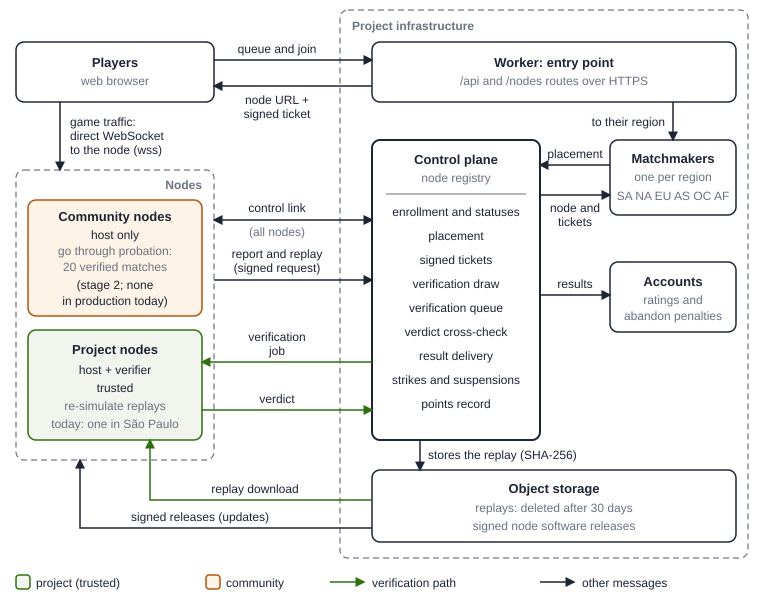
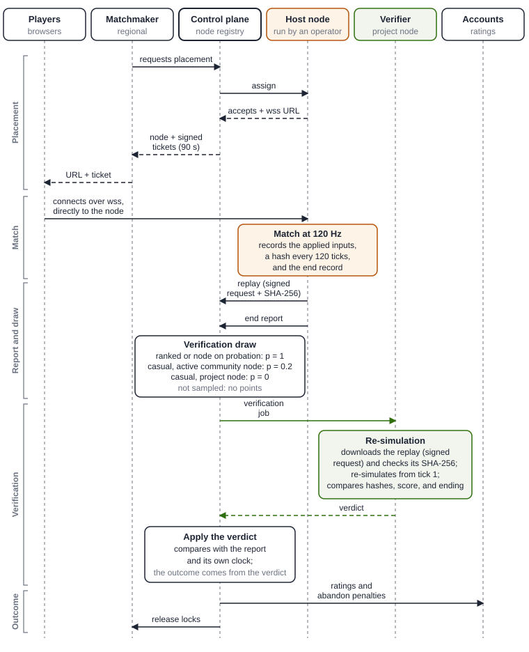
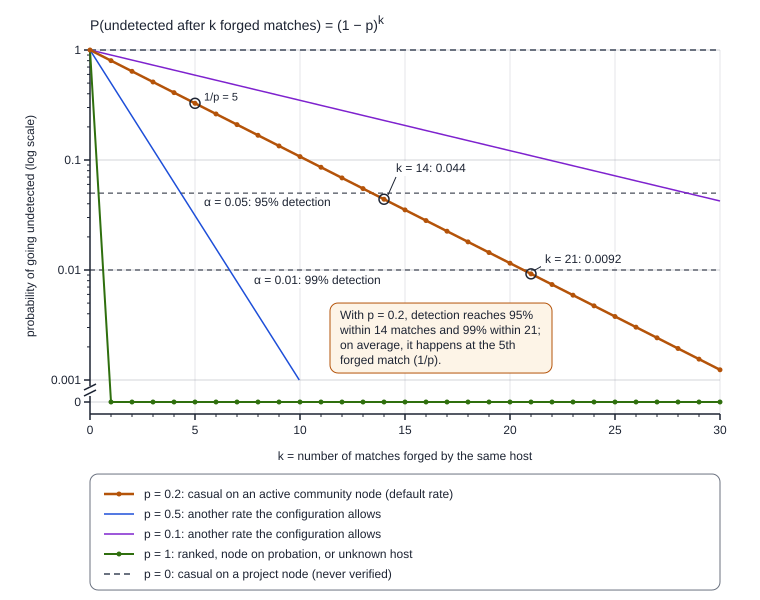
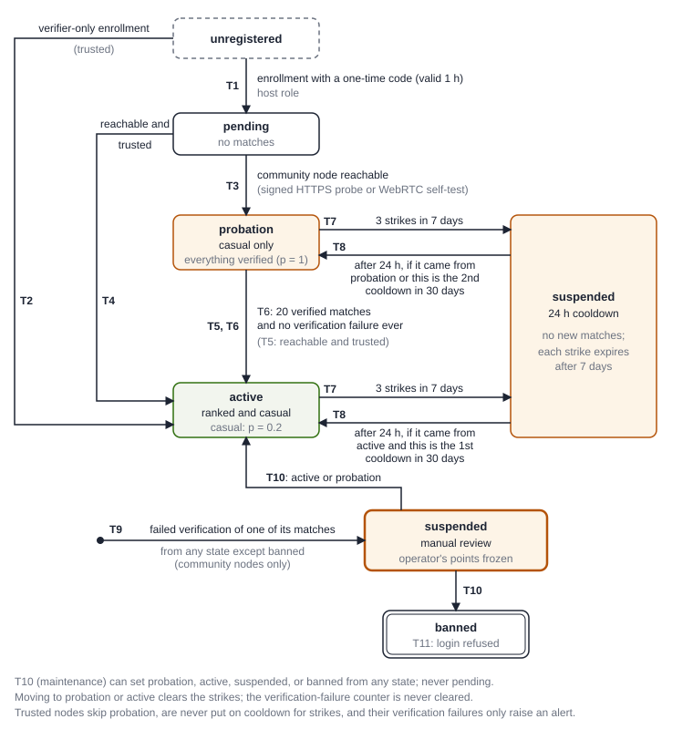

# Turbogol: A Community Network of Verifiable Match Servers

**Technical foundations, architecture and mathematical model of community nodes and verifiers**

Version 1.0 · October 2026 · Turbogol Project (open source, AGPL)

## Abstract

Turbogol is an open-source car-soccer game that runs in the browser. This paper describes a network of match servers run by third parties (“nodes”) and the mechanism that lets the project accept their results because each one is checked independently: a node only *reports* a result; a project verifier *decides* whether it counts, by re-simulating the entire match.

The technical foundation is a deterministic simulation: a single WebAssembly binary of the physics engine, run at a fixed 120 Hz, with controls quantized to 6 bytes per car, and with bots and rules that never consult the clock or unseeded sources of randomness. A match is therefore fully described by its configuration, the sequence of controls applied to the human seats, the explicit leaves, and an end record. The node records this information in a compact binary replay (the TGR1 format), which includes a 32-bit FNV-1a hash of the physical state for every second of play, and uploads it with a request signed with Ed25519; the project's central service (the control plane) commits to the replay's SHA-256 before it decides at random whether to verify the match. Re-simulating a three-minute match takes about one second of CPU time in production.

We formalize the per-tick transition; the proof required for each way a match can end; verification sampling (probability 1 for ranked matches and for nodes on probation; 0.2 for casual matches on active community nodes); the probability that $k$ forgeries all go undetected, $(1-p)^k$, with an expected $1/p = 5$ forged matches until the first detection; the reputation state machine (access to ranked matches requires 20 verified matches without a single failure; 3 strikes in 7 days trigger a 24 h cooldown); the eligibility predicate and the rule that picks a node at random from the lowest load band; the link-liveness thresholds (15, 30, and 60 s); and a formula, unbiased under sampling, for the server points that recognize verified hosting. Points are not money: they cannot be bought, sold, or transferred, and they only unlock cosmetic items.

We are explicit about the limitations. Verification proves consistency, not the authenticity of the inputs: it shows that the result is the deterministic consequence of the recorded inputs, not that those inputs are the ones the players sent. Today there is a single verifier, and the empirical evidence of determinism across machines is limited. As of this version, the system is in its first deployment stage (stage 1): a single project node, in São Paulo, has hosted and verified real matches since 21 October 2026, and no one receives points yet.

## 1. Introduction and motivation

### 1.1 Background

Turbogol is a multiplayer car-soccer game for the browser, released as open source under the AGPL. It offers matches from 1v1 to 3v3 (the replay format supports up to 8 seats), bots that fill out the teams, and two kinds of match: casual matches and ranked matches; only ranked matches change the players' ratings. Before nodes were introduced, every match with an authoritative server ran on the game's own infrastructure: each regional matchmaker creates a match object (a *Durable Object* on the edge computing platform the project uses), with at most 20 active match objects per matchmaker. By default, casual matches with two or more people are played browser-to-browser.

### 1.2 The trust problem

Opening the network to community servers brings coverage where the project has no machines, lower latency, and a concrete way for people to take part. But in a game with an authoritative server, *the server decides*: whoever controls it could invent a goal, cut short a losing match, falsely charge a player with abandoning the match, or claim minutes that were never played. The usual answers (closed server lists, client-side anti-cheat, and manual audits) do not scale to our goal: anyone should be able to lend a machine, and its results should be checked as rigorously as those of the game's own servers.

### 1.3 The core idea

The solution rests on a property of the engine: the simulation is deterministic. Given the same binary, the same initial state, and the same inputs, two machines compute the same states, tick by tick. The result of a match is therefore a function of a small amount of data (the configuration and the controls applied to the human seats), and anyone who holds that data can recompute it. The result does not depend on the server's word; the server only has to deliver the evidence. A project verifier re-simulates the match, and only then does the result count. A central project service, the *control plane*, registers the nodes, assigns them matches, randomly selects the matches to verify, and applies the verdicts. Recomputing three minutes of a 3v3 with bots takes about one second of CPU time in production, roughly 1/180 of the time it takes to play them.

### 1.4 Contributions

This paper:

- describes the complete architecture of the network;
- formalizes the simulation as a per-tick transition function;
- defines the verification algorithm and the control plane's timing checks;
- derives the detection probability under sampling, the expected number of forgeries until a forger is caught, the probability of passing probation while forging, and the cost of verification;
- models reputation as a state machine;
- formalizes eligibility, node selection, and the regional factor;
- proves that the points formula is not biased by sampling; and
- collects the measurements and a roadmap that separates what works from what is planned.

### 1.5 Current status and conventions

Since 21 October 2026, every eligible match, from any player, has been offered to a node. There is **a single node** in production, run by the project in São Paulo (South America region), with both the host and verifier roles, a declared capacity of 15 concurrent matches, and node software version 0.3.0. Today only trusted (project) operator accounts can create enrollment codes, so all the machinery designed for untrusted nodes (probation, sampling with $p = 0.2$, freezing of points, points weighted by $1/p$) is implemented and covered by automated tests but **is not exercised in production**. For the same reason, **no one receives server points yet**.

Throughout the text we use five status labels: *in production* (deployed and in real use), *implemented* (on the main branch and tested, but with no real effect in production), *in progress* (implemented on a branch not yet merged), *planned* (decided, not implemented), and *idea* (no design yet). Numerical values correspond to node version 0.3.0, released from commit `ab8d97d` on the main branch.

### 1.6 Organization

Sections 2 and 3 present the design principles and the technical foundation; Sections 4 and 5, the architecture and the life cycle of a match; Sections 6–9, the verification, reputation, scheduling, and link-liveness models; Section 10, server points; Sections 11–13, security, privacy, and measurements; and Section 14, the roadmap. Section 15 concludes. The appendices collect the constants, the notation, a glossary, references to the source code, and external references.

## 2. Design principles

**P1. Nodes host; the project decides.** A community machine never writes a result. It hosts the match, records the replay, and reports. Ratings, abandon penalties, and the minutes that count toward points are derived from the verdict of a verifier that re-simulated the match, never from the node's word.

**P2. Determinism is the foundation.** The entire design depends on the same binary, given the same inputs, producing the same states on any machine. That is why there is a single physics binary for browsers, servers, and nodes; why the identity of a “simulation” is the triple formed by the binary's SHA-256, the game protocol version, and the node software version; and why a node and a verifier work together only if that triple matches exactly.

**P3. Commit before drawing.** The evidence of a match is fixed (uploaded, hashed with SHA-256, and stored) before the control plane decides, using a secure random source, whether that match will be verified. The node cannot know in advance which matches will be audited, nor can it modify the evidence afterward.

**P4. Randomness wherever an operator could gain an advantage.** The hosting node, the verifier, the kickoff seed, the match identifier, and whether the match is verified are all decided at random by the control plane. No operator can choose or engineer the node on which a particular match will land (the random node choice uses the environment's standard random number generator, while draws that affect verification use the secure random source; see Section 8.3).

**P5. Key separation and least privilege.** There are three independent Ed25519 keys: the control key (signs match tickets), the release key (signs the node software), and one key per node (identifies the machine). A node can check tickets but cannot issue them, and whoever compromises the control plane cannot distribute code to the nodes.

**P6. Outbound connections only.** The node opens a single control link to the project and exposes no administration ports; apart from a static text page, it serves only players' game connections and the reachability endpoint that the project probes. This follows the same pattern as continuous-integration runners and the volunteer clients of distributed chess-analysis services.

**P7. Fail safe.** The configuration switches that enable nodes default to off on any error: a missing or misspelled value counts as “off”. If no node is available, the matchmaker uses its own servers, as before. An infrastructure failure never penalizes players.

**P8. One outage, one strike.** Penalties on nodes measure reliability, not bad luck: outages are deduplicated, strikes expire, and a single outage never excludes anyone permanently.

**P9. Recognize verified service.** Server points are counted in player-minutes that were served and confirmed by re-simulation. Points are not money: they cannot be bought, sold, or transferred, and they only unlock cosmetic items.

**P10. Be honest about limitations.** Every mechanism rests on assumptions. We make them explicit and separate what works today from what is planned.

## 3. Technical foundation: the deterministic simulation

### 3.1 The physics engine and the single binary

Physics is provided by an open-source C++ library built on Bullet, compiled with Emscripten into a single WebAssembly module of 593 938 bytes (flags `-O3`, `-flto`, `-msimd128`, and `-fno-strict-aliasing`; SIMD is limited to the fixed-width instruction set, not the Relaxed SIMD extension, whose results can vary across platforms). **The same binary** runs in the browser, in the project's *Workers* (the server-side functions the project runs on the edge computing platform), and on the nodes, and only one TypeScript bridge module accesses its memory.

Each match and each verification gets its own instance, with its own memory and its own *arena* (the simulated physical world of the match: field, cars, and ball), instantiated from a module compiled once per process. The identity of the build is the SHA-256 of its bytes: the node computes it when loading the module; for the Worker, which cannot hash a precompiled module, the value is pinned in the repository, and an automated test fails if it does not match the file.

Server, node, and verification arenas always use standard physics: the game's experimental modes are enabled only by an explicit option that the node and ranked-match code never sets, and matches with experimental physics never reach a node.

### 3.2 A fixed simulation clock

The simulation advances in discrete steps (ticks) at a fixed rate of $f = 120$ Hz, with step $\Delta = 1/120$ s $\approx 8.333$ ms. The network protocol has its own copy of the constant, and the arena is created with that rate; the native side replaces any rate outside $[15, 120]$ (including NaN) with 120, and the replay decoder rejects a header with any other rate. The verifier works exclusively in ticks.

On a node, a shared timer fires every 4 ms. Each *room* (the instance of a match on the host: arena, rules, connections, and recording) converts elapsed wall-clock time into ticks with an accumulator $A$: the measured interval $\delta_j$ between two invocations is clamped to $[0, 250]$ ms, at most 8 ticks run per invocation, and the accumulator is capped at $8\Delta_{\mathrm{ms}}$, with $\Delta_{\mathrm{ms}} = 1000/120$ ms.

**Lemma 1 (The simulation never runs ahead of the clock).** Let $t_0$ be the instant at which a room starts simulating, and let $N_{\mathrm{exec}}(t)$ be the number of ticks executed up to instant $t$. Then

$$
N_{\mathrm{exec}}(t)\,\Delta_{\mathrm{ms}} \;\le\; t - t_0 .
$$

*Proof.* Each tick subtracts $\Delta_{\mathrm{ms}}$ from the accumulator $A$, and a tick runs only if $A \ge \Delta_{\mathrm{ms}}$, so $A \ge 0$ at all times. Since $A = 0$ when the room starts at $t_0$ and the first interval is measured from $t_0$, the total added to $A$ is at most $\sum_j \min(\delta_j, 250) \le t - t_0$, and the cap on $A$ only discards time. Therefore $N_{\mathrm{exec}}(t)\,\Delta_{\mathrm{ms}} \le \sum_j \min(\delta_j, 250) \le t - t_0$. $\square$

The lemma has a practical consequence that we use in Section 6.5: after an interruption, simulated time *falls behind* the clock and does not catch up all at once. After a stall of 250 ms or more, for example, at most 16 ticks (about 133.3 ms of play) are recovered: 8 in the first invocation and another 8 in the next, from what remained in the capped accumulator. The rest is lost, and the match clock simply falls behind wall-clock time. An honest host never produces more game time than the real time that has elapsed.

### 3.3 Control quantization

The controls of each car are represented in 6 bytes: five analog axes (throttle, steer, pitch, yaw, and roll) as signed 8-bit integers, and one button byte (jump = 1, boost = 2, handbrake = 4). An analog value $x$ is quantized and reconstructed as follows:

$$
\hat{x} = \big\lfloor 127\cdot\operatorname{clamp}(x,-1,1) + 0.5 \big\rfloor\in[-127,127],\qquad x' = \operatorname{f32}\!\left(\frac{\hat{x}}{127.0}\right)
\tag{1}
$$

where $\lfloor y + 0.5 \rfloor$ rounds to the nearest integer with ties rounded up (as `Math.round` does), and $\operatorname{f32}$ rounds to the nearest 32-bit float. The native side decodes the packed controls as `(float)(q/127.0)`, with $q = \hat{x}$, which is exactly the value the JavaScript path produces. Client, host, and verifier feed the engine identical bytes and therefore compute identical ticks.

### 3.4 The per-tick transition

Let $s_T$ be the physical state after tick $T$ (cars, ball, boost pads, and tick counter), $g_T$ the state of the match rules (phase, clock, and score), $\beta_T$ the internal state of the bots and of the ball prediction, and $u^{(i)}_T$ the 6 control bytes of seat $i$ at tick $T$. Let $\mathcal{H}_T$ be the set of human seats that have not yet been taken over by a bot at tick $T$. The transition the host executes is

$$
\begin{aligned}
u_T^{(i)} &= \begin{cases}
\mathbf{0} & \text{if } \mathrm{frozen}(g_{T-1})\\[2pt]
\bar{u}^{(i)}_{T} & \text{if } i \in \mathcal{H}_T\\[2pt]
\pi^{(i)}_{\mathrm{bot}}\big(s_{T-1},\,\beta_{T-1}\big) & \text{if } i \notin \mathcal{H}_T
\end{cases}\\[6pt]
s'_T &= \Phi\big(s_{T-1},\,u_T\big),\qquad g_T = \Gamma\big(g_{T-1},\,\mathrm{goals}(s'_T),\,\Delta\big)\\[4pt]
s_T &= \begin{cases}
\Psi\big(s'_T,\ \mathrm{seed} + n_{\mathrm{ko}}\big) & \text{if } \Gamma \text{ requested a kickoff reset at } T\\[2pt]
s'_T & \text{otherwise}
\end{cases}
\end{aligned}
\tag{2}
$$

where $\Phi$ is the engine step (writing the packed controls and advancing one tick inside the WebAssembly module), $\mathrm{goals}(s'_T)$ are the goals the engine detects in that step, $\Gamma$ is the rules state machine, $\Psi$ resets the arena for a kickoff with the given seed, and $\pi_{\mathrm{bot}}$ is the bot policy. The cases for $u^{(i)}_T$ are evaluated in order (the first one that holds applies), and $u_T = (u^{(i)}_T)_i$. For a human, $\bar{u}^{(i)}_{T}$ is the last applied control, or $\mathbf{0}$ if the seat has no connection (on disconnection, the seat's queue and last control are cleared); if no fresh input has arrived for $T$, the previous one is repeated; we call such a tick without fresh input an *underrun*. The kickoff reset happens within the same tick, after the step, so $s_T$ is not simply $\Phi(s_{T-1}, u_T)$.

Within each tick, each human seat first takes the input queued for $T$ or repeats its last one. Next, the bots, driven by one controller per team with fixed seeds 777 (blue) and 7 (red), decide using a ball prediction that is recomputed every 4 ticks; in the frozen phases (pre-start, countdown, post-goal pause, end), every seat receives zero controls. Then 6 bytes per car are written and the engine advances one step. Finally, the rules advance by $\Delta$ and, if they request a kickoff reset, it is executed. Each kickoff reset initializes the generator of the starting positions with $\mathrm{seed} + n_{\mathrm{ko}}$, where $n_{\mathrm{ko}}$ is the number of kickoffs already executed in the match and $\mathrm{seed}$ is a 31-bit integer that the control plane draws from its secure random source. The bots, the rules, and the authoritative match loop (`RoomHost`) never consult the clock, timers, or unseeded random number generators; a search of their code for such calls finds none.

**Proposition 1 (A match is a function of a small amount of data).** For a fixed simulation triple (binary SHA-256, protocol version, node version), the complete state $(s_T, g_T, \beta_T)$ at every tick $T$ is a deterministic function of (i) the configuration $\Xi$ (roster, kickoff seed, rule options, and bot difficulty); (ii) the sequence of controls applied to the human seats; and (iii) the set of takeovers $\{(i, T^{\mathrm{take}}_i)\}$, that is, the tick from which each human who explicitly left is replaced by a bot.

*Proof.* By induction on $T$. At $T = 0$, a fresh arena is created with one car per seat, in seat order, and the kickoff is executed with the seed; $(s_0, g_0, \beta_0)$ depends only on $\Xi$. Assume that the statement holds for $T-1$. By Equation (2), $u_T$ depends on $g_{T-1}$, on the human controls of (ii), on the set $\mathcal{H}_T$ that (iii) determines, and on $\pi_{\mathrm{bot}}$, which uses only its fixed seeds and the previous state; $\Phi$ and $\Psi$ are functions of the binary's bytes and of their arguments; $\Gamma$ uses a fixed step $\Delta$; and $n_{\mathrm{ko}}$ depends only on the match's prior history. Hence $(s_T, g_T, \beta_T)$ is a function of the same data. $\square$

That $\Phi$ is a function rests on two assumptions. The first is the determinism of WebAssembly floating point, which the standard guarantees except for the bits of NaN values; this is a property of the platform's specification, not something the repository verifies, although the tests of Section 3.7 support it. The second concerns history: the ball prediction depends on the arena's history, so an arena that had loaded a saved state could lead the bots to decide differently. Host and verifier both start from a fresh arena and never load states, so their histories are identical.

**Corollary.** A replay needs only the configuration, the human controls, and the takeovers. The bots are recomputed during verification instead of being read from the replay, which also proves that the host did not steer any bot.

### 3.5 The state hash

Every 120 ticks (the checkpoint interval $\gamma$ that an honest host writes; Section 3.6), the host records a hash of the physical state. The hash function serializes the arena exactly as a state save would (magic identifier, version, tick counter, cars, ball, and boost pads) and computes the 32-bit FNV-1a hash of those bytes $z_0,\dots,z_{N_z-1}$:

$$
\begin{gathered}
y_0 = \texttt{0x811c9dc5},\qquad y_{j+1} = \big(y_j \oplus z_j\big)\cdot \texttt{0x01000193} \bmod 2^{32},\\
h_k = y_{N_z}\ \text{over}\ \mathrm{ser}\big(s_{120k}\big)
\end{gathered}
\tag{3}
$$

where $\mathrm{ser}$ is the serialization just described. For $n_{\mathrm{cars}}$ cars, the serialization takes at most $13 + 448\,n_{\mathrm{cars}} + 594$ bytes (each car takes 448 bytes with a ball-touch record and 380 without one): between 2887 and 3295 bytes in a 3v3, and at most 4191 with 8 cars, below a cap of 8192.

The hash covers only the physical state, not the rules state held in JavaScript (score, clock, and phase) or the internal state of the bots. Those are covered indirectly, because every goal triggers a kickoff reset that changes the physical state, and explicitly by the checks on the score and on the end record (Section 6.3).

**Localizing a divergence.** Let $T_d$ be the first tick at which the verifier's state differs from the host's. With an honest host's checkpoint interval, if the replay has a checkpoint at or after $T_d$, the first one is at $120\lceil T_d/120\rceil \le T_d + 119$, so a divergence is localized to within one second of play. If the states still differ at that checkpoint, the divergence is detected unless the hashes collide. If FNV-1a is modeled heuristically as a random function on distinct inputs, the collision probability is on the order of $2^{-32} \approx 2.3\times 10^{-10}$ per checkpoint, and on the order of $2^{-32r}$ if the divergence persists across $r$ checkpoints. A divergence that begins after the last checkpoint, in the final partial second, is caught only if it changes the score or the ending, which Section 6.3 checks separately.

**Why a collision-resistant hash is unnecessary.** The verifier computes its own hashes from the recorded inputs. If the host records false values, there is a mismatch and the host is at fault; if it records the true ones, they add nothing that the verifier does not compute itself; and the result is taken from the verifier, not from the hashes. Searching for a collision gives no advantage: any value written must match what re-simulating the recorded inputs themselves produces. The hashes detect and localize divergences, including determinism bugs; the security anchor is the full re-simulation.

### 3.6 The TGR1 replay

The replay is a little-endian binary file: the magic identifier `TGR1`, the header length (a 32-bit integer), a JSON header, and the records in tick order. The header specifies the format version (1), the match and node identifiers, the build, the mode, the region, whether the match is ranked, the roster (from 1 to 8 seats), the regulation length, the kickoff seed, the bot difficulty, the countdown and post-goal pause durations, the tick rate (120), and the checkpoint interval $\gamma$ (an honest host writes 120; the decoder only requires an integer $\ge 1$). The start time is written as 0, so that two replays of the same match are byte-for-byte identical.

| Type | Code | Size | Contents | When written |
|---|---|---|---|---|
| `INPUT` | 1 | 12 B | tick (u32), seat (u8), 5 axes and the button byte (6 × i8) | when a human's applied controls change, and for every human at tick 1 |
| `TAKEOVER` | 2 | 6 B | tick (u32), seat (u8) | the seat becomes a bot from that tick on |
| `HASH` | 3 | 9 B | tick (u32), hash (u32) | after every tick $T$ with $T \bmod \gamma = 0$ |
| `END` | 4 | 12 B | tick (u32), winner (i8), blue (u16), red (u16), reason (u8), forfeiting team (i8) | once, at the end |

*Table 1. TGR1 record types (sizes include the type byte). The end reason is an index into the list* `rules` *(regulation ending),* `forfeit` *(a team forfeits),* `ttl` *(the maximum match time ran out),* `left` *(all humans left), and* `empty` *(no human is still present).*

Bots are never recorded. The decoder rejects files larger than 16 MiB or with headers larger than 64 KiB; records that are unknown, truncated, at tick 0, out of tick order among records of the same type, or after `END`; and inputs or takeovers that do not belong to human seats or that follow their seat's takeover.

If $E$ is the tick of the `END` record, the replay must contain exactly

$$
N_{\mathrm{hash}} = \left\lfloor \frac{E}{\gamma} \right\rfloor \text{ hashes, at ticks } t_k = \gamma\,k,\quad k = 1,\dots,N_{\mathrm{hash}}
\tag{4}
$$

and its size is

$$
\lvert\mathcal{R}\rvert = 8 + \lvert\mathrm{hdr}\rvert + 12\,N_{\mathrm{in}} + 6\,N_{\mathrm{take}} + 9\,N_{\mathrm{hash}} + 12,\qquad \lvert\mathcal{R}\rvert \le 16\ \mathrm{MiB},\quad \lvert\mathrm{hdr}\rvert \le 64\ \mathrm{KiB}
\tag{5}
$$

where $\lvert\mathcal{R}\rvert$ is the size of the replay in bytes, $\lvert\mathrm{hdr}\rvert$ the length of the JSON header, $N_{\mathrm{in}}$ the number of input records, and $N_{\mathrm{take}}$ the number of takeovers. The replay of a three-minute bots-only match is between 2.3 and 2.8 KB in size (between 2329 and 2834 bytes: from 189 to 234 hashes, which add up to between 1701 and 2106 bytes, plus a header of 0.5 to 0.7 KB); that of a 34 s match with humans, about 6.5 KB; and those of matches recorded with scripted humans, between 60 and 403 KB.

**The 16 MiB cap never constrains an honest host at standard match length.** In the worst case, every human changes controls at every tick. A three-minute match allows at most 108 000 ticks (Equation (7), below), so with 8 human seats the input records take at most $8 \times 108\,000 \times 12 = 10\,368\,000$ bytes, about 9.9 MiB, and the whole file, with a header of at most 64 KiB, 900 hashes, and the end record, stays below 10 MiB. In an untimed match the effective cap is 86 400 ticks, and the input records take at most about 7.9 MiB (under 8 MiB for the whole file).

### 3.7 Simulation identity and empirical evidence

Two processes run “the same simulation” when the binary's SHA-256, the game protocol version, and the node software version all match. In the release we describe, these are the digest `d8e6af256eafa07785d5e341ffe11ac95c311fc6780a2c968f19fee93c75fe07`, protocol 3, and node 0.3.0. The control protocol between node and control plane declares its own version, 2, which is currently neither exchanged nor checked.

The empirical evidence comes from a script that records 12 complete three-minute matches (scripted humans and real bots) and verifies on one machine what was recorded on another, in both directions; the script also compares the recordings against a reference pinned in the repository, but only when the binary matches the one the reference was recorded with. All 12 matches verified in both directions between a Windows PC (Ryzen 7 2700) and the Linux production server (AMD EPYC), with the same V8 engine. Those 12 matches were recorded and verified on 19 October 2026 with the previous binary (`c137f952…`). The pinned reference also corresponds to that binary, so the script skips the reference comparison for the current binary (`d8e6af25…`), which replaced the previous one on 21 October. The cross-machine run has not yet been repeated with the current binary; the evidence for the current binary is real play in production with version 0.3.0, with no desyncs. The first real ranked match was hosted and verified on the node on 21 October 2026, but its host and verifier were the same machine, so it provides no cross-machine evidence. Automated tests cover tampering: an edited input is detected at the next checkpoint, and forged scores, winners, and forfeits are rejected.

This evidence is limited: two machines, two operating systems, and a single JavaScript engine. Determinism has not been demonstrated on other CPU architectures or other engines. We return to this point in Section 11.

## 4. Architecture

With the technical foundation in place, this section describes who runs each part of the system, which keys each part uses, and how a node joins the network.

### 4.1 Components

Figure 1 shows the components and how they relate to one another; Table 2 summarizes them.

| Component | Function | Where it runs |
|---|---|---|
| Web client | The unmodified game client: it opens a WebSocket to the node's URL, carrying the ticket in the subprotocol | Browser |
| `/nodes/*` routes | Answer simple queries and forward everything else to the control plane, overwriting the caller's identity headers | Worker at the edge |
| Regional matchmaker | Forms matches and asks for them to be placed on a node; failing that, uses its own match object | One Durable Object per region |
| Control plane | Node registry, placement, tickets, replays, verification queue, verdicts, and result delivery | A Durable Object with SQLite, near São Paulo |
| Accounts object | Ratings, abandon penalties, and the ranked lock (one active ranked match per account) | Durable Object |
| Object storage | Replays (kept for 30 days) and signed releases with their channel | Platform provider |
| Node software | A signed package of about 2 MB plus the physics binary: match rooms, WebSocket and WebRTC servers, control agent, and verifier | Node.js 24, operator's machine |
| Launcher | Downloads, checks, runs, updates, and rolls back releases | Operator's machine |
| TLS proxy | Terminates HTTPS with automatically issued certificates | Operator's VPS |
| Verifier | The node software running with the `verify` role | Project nodes |

*Table 2. Network components.*

The control plane keeps the enrollment codes (only their SHA-256 digests), the nodes, the matches, and a result outbox in SQLite, with synchronous, transactional writes. It uses the platform's hibernation API, and an alarm fires every 5 s to run the timeout sweep and result delivery. At startup it checks that its control public key matches the private key; if it does not, the control plane neither places matches nor registers nodes, and it raises an alert.

<figure><figcaption>Figure 1. Architecture of the node network. Arrows show the direction of messages; the verification path is in green. Every connection to a community machine is opened by that machine or by the player, except the reachability probes to the public URL that the node itself declares.</figcaption></figure>

### 4.2 Roles and trust

A node declares one or two roles: `host` (it hosts matches) and `verify` (it re-simulates matches hosted on nodes). An operator is *trusted* if their account appears on a list configured on the server. Trust is recomputed on load and never stored, so removing an operator from the list revokes their nodes' trusted status at the next startup. Only trusted operators can register the `verify` role. Trusted nodes skip probation and are never put on cooldown for strikes, but they do not receive points either (Section 7.7).

### 4.3 Three independent keys

- **Control key.** Signs match tickets. Its private half is a Worker secret, and each node keeps the public half from the moment it enrolls.
- **Release key.** Signs the release manifests and the launcher. It lives in a protected continuous-integration environment, with an offline copy.
- **Node key.** One per node, generated on the operator's machine. The node uses it to log in, to upload and download replays, and to demonstrate reachability.

All three are Ed25519 keys (32-byte public keys, 64-byte signatures). Whoever compromises the control plane cannot distribute code to the nodes, and nothing a node stores allows it to impersonate the control plane or another node.

### 4.4 Node enrollment

1. An authorized account (today, only trusted operators, with at most 10 codes per day) obtains a **one-time enrollment code** for a region: a fixed prefix plus 24 random bytes, valid for 1 hour. Only its SHA-256 is stored.
2. The installer generates the node's Ed25519 key pair on the machine itself and sends the public key together with the code, the roles, the transports, the public URL, the build, and the capacity (at most 5 enrollments per address per hour; for IPv6, the count is kept per /64 prefix).
3. The control plane checks the code, the operator's node cap (10, or 2 for a trusted operator), that the key is not already in use, the roles (`verify` is reserved), the URL (`wss` only), and the capacity (from 1 to 200). It repeats the critical checks just before consuming the code, because concurrent enrollments could have changed their outcome in the meantime.
4. The node receives its identifier and the control public key, which it keeps from then on, and enters the `pending` status.

The region is copied from the enrollment code and cannot be changed afterward. The machine's actual location is not measured today; placement based on the latency that clients measure (Section 14) will close that gap.

### 4.5 The control link

The node opens an outbound WebSocket to the control plane, which sends it a 24-byte single-use random challenge; the node must answer within 10 s with the Ed25519 signature of `tgn-auth.v1.<node>.<challenge>`. After the welcome message (status, region, release channel, server time, and ICE servers), the node sends a hello message with its process identifier (`bootId`, random for each process), build, roles, transports, capacity, and egress cap, and from then on a heartbeat every 5 s.

Requests from the control plane to the node time out after 5 s (10 s for WebRTC offers; 60 s for verifications), and reports are resent until they are acknowledged. At most 64 connections can be awaiting authentication. A malformed message closes the link, and a malformed report counts as a lost match and incurs a strike. Close code 4408 signals prolonged silence; 4403, a banned node.

### 4.6 Reachability check

Before it receives any match, a node must demonstrate that players can reach it. For `wss`, the control plane requests `<public URL>/healthz` with an 18-byte single-use random challenge, and the node answers with the signature of `tgn-reach.v1.<node>.<challenge>`, which neither a proxy nor any other machine can produce. A node that has not yet demonstrated reachability is probed every 30 s; once it has, it is probed again every 5 minutes (every 30 s after a failure), and 3 consecutive failures take `wss` out of its usable transports, without changing its status, until a later probe (again every 30 s) succeeds. For `rtc` (home computers), the node runs a WebRTC self-test, repeated every 30 minutes, whose connection must open through a TURN relay server.

Because the probe runs in a Worker, which cannot connect to a bare IP address, a community node on a virtual private server (VPS) needs a DNS name. Once reachable, a community node moves from `pending` to `probation`; a trusted node moves directly to `active`.

### 4.7 Match tickets

For each human player, the control plane uses its control key to sign a ticket (a JSON Web Signature in compact serialization, with the EdDSA algorithm) that contains the player, the match, the team, the seat, the display name, an expiry 90 s after the ticket is signed, a single-use identifier (`jti`, 16 random bytes), and the audience `node:<node>`. The node checks the ticket against the public key pinned at enrollment and against the control plane's clock, which the node estimates from its measured clock offset:

$$
\begin{aligned}
\mathrm{valid}(\mathit{tkt}) \iff{} & \mathrm{Ed25519.verify}\big(K^{\mathrm{pub}}_{\mathrm{ctl}}, \mathit{tkt}\big) \land \mathrm{exp} > t_{\mathrm{srv}}\\
& \land\ \mathrm{aud} = \texttt{node:}\mathit{id} \land \mathrm{mid} = m \land \mathrm{jti} \notin \mathcal{U}_m
\end{aligned}
$$

where $\mathit{tkt}$ is the ticket, $K^{\mathrm{pub}}_{\mathrm{ctl}}$ the control public key pinned at enrollment, and $\mathcal{U}_m$ the set of identifiers already used in the room; $\mathrm{exp}$, $\mathrm{aud}$, $\mathrm{mid}$, and $\mathrm{jti}$ are the ticket's expiry, audience, match, and single-use identifier fields; $m$ is the room's match, $\mathit{id}$ is the node's identifier, and $t_{\mathrm{srv}}$ is the control-plane time as estimated by the node (its own clock corrected by the offset). Malformed tickets are also rejected (a different algorithm, more than 4096 characters, or out-of-range fields), and the room checks that the seat belongs to that player and that the player has not left. Because the keys are asymmetric, a node can check tickets but never issue them, and a ticket for node A is useless on node B.

### 4.8 Signed releases and the distribution channel

**Publishing.** A release tag triggers four continuous-integration jobs on fresh runners: test and build (two separate jobs, with no secrets); signing, which runs in an environment that holds only the release key, installs nothing, and checks the binary, the protocol, and the installers byte for byte against the repository before signing the manifest and the launcher; and upload, which runs in a separate environment and publishes each version only once. The maintainer approves signing and upload separately. The manifest lists the SHA-256 and size of every file, as well as the source commit.

**Channel.** A channel file declares `stable` (the version that nodes receive when they restart) and `minimum` (the version below which a running node *drains*, that is, stops accepting new matches and waits for the ones it hosts to finish, and then updates). Publishing never moves the channel; a **deploy gate** does. If the game code that nodes bundle has changed, the gate requires a release published from exactly that code and sets `stable = minimum` to that release before deploying; if no such release exists, it refuses the deployment, unless the maintainer passes `--nodes-off` and the nodes could not take matches from the new build anyway (its wasm or protocol differs). Nodes therefore never host matches with game code other than the deployed game's.

**Launcher.** The release public key is pinned at installation and never downloaded afterward. The launcher checks the manifest signature and the SHA-256 of every file before running a release; three crashes within 10 minutes mark the release as bad, and the launcher falls back to the last known good one, never below `minimum`. A verifier that still has matches from its version waiting to be verified defers its update.

## 5. Life cycle of a match on a node

Figure 2 summarizes the path a match follows; we now describe it step by step.

<figure><figcaption>Figure 2. Life cycle of a match hosted on a node, from placement to result delivery. The verification draw happens after the replay's SHA-256 has been committed.</figcaption></figure>

### 5.1 Placement

The regional matchmaker forms a match and, if nodes are enabled for all of its players, asks the control plane to place it, waiting at most 8 s for an answer. The control plane determines the eligible nodes (Section 8.2), picks one at random from the lowest load band (Section 8.3), fixes the regional factor, draws the match identifier (32 random bytes) and the kickoff seed, and sends the assignment. The node prepares the arena and checks its own capacity, egress, and status; if it refuses, the control plane tries one more node. If no node accepts, the matchmaker uses its own match object, as before.

### 5.2 Tickets and connection

The control plane signs one ticket per human and persists the match **before** handing the tickets out. With `wss`, the player opens `wss://<public URL>/m/<match>` with the ticket in the WebSocket subprotocol, and the node checks the ticket before accepting the connection. With `rtc` (stage 2), the player's offer travels through the control plane, which checks the ticket and relays the offer over the node's outbound link; the node checks the ticket again, and ICE then opens a single reliable, ordered data channel.

### 5.3 Play, recording, and takeovers

The node runs the same room code as the game's own servers, at 120 Hz, sending snapshots to the clients every 4 ticks (30 Hz). Meanwhile, it records the replay: an input record each time a human's applied controls change, a hash every 120 ticks, the takeovers, and the end record.

A takeover can originate only from an explicit leave by the player, which the control plane records, together with its time, **before** relaying it to the node. The leave stays recorded even if the relay fails, and a later attempt to rejoin is answered with “left”. From the takeover tick on, a bot drives the seat.

### 5.4 Replay upload and report

When the match ends, the node computes the SHA-256 of the replay and uses its node key to sign the string `tgn-replay.v1.PUT.<match>.<sha256>.<timestamp>`. It sends the bytes together with its node identifier, the timestamp, the signature, and the declared digest. On network errors and on 5xx or 429 responses, it makes up to 12 attempts, separated by 11 waits that double from 500 ms up to a maximum of 10 s, for a total wait of

$$
\sum_{i=0}^{10} \min\big(500\cdot 2^{i},\ 10\,000\big) = (500 + 1000 + 2000 + 4000 + 8000) + 6 \times 10\,000 = 75\,500\ \mathrm{ms}
$$

That is about 75 s, enough to ride out a Worker deployment. A clock-skew refusal (`stale`) is additionally retried up to 2 times after the node resynchronizes its clock. If every attempt fails, the node reports the match as lost, which incurs a strike.

**Before reading the body**, the control plane checks that the uploader is the match's host, that the timestamp is within $\pm 5$ minutes, that the signature is valid, and that no report exists yet (if one does, it responds with 409: a replay cannot change once the match has been reported). A forged upload therefore cannot force the control plane to read or hash up to 16 MiB. Only then does the control plane read the body, recompute the SHA-256, reject the upload if the result does not match the declared digest, and store the bytes. The signature is checked but not kept: only the digest is stored.

The node then sends its report: `ended` (with the score, end reason, final tick, and per-seat statistics), `cancelled` (before the start), or `lost` (an error on the node's side). An `ended` report without a replay, or with a different SHA-256, incurs a strike and voids the match as `no_replay`, whether or not the match was sampled. Unacknowledged reports are resent every 20 s.

If no report arrives, the match times out at

$$
t^{\mathrm{due}}_m = t^{\mathrm{asg}} + 1000\,(L' + 600) + 900\,000\ \mathrm{ms},\qquad L' = \begin{cases} L & L > 0\\ 600 & L = 0\end{cases}
$$

where $t^{\mathrm{asg}}$ is the assignment time, $L$ the regulation length in seconds ($L = 0$ means untimed), 600 s the maximum overtime, and 900 s the report grace period. For a 180 s match, $t^{\mathrm{due}}_m - t^{\mathrm{asg}} = 1680$ s, that is, 28 minutes. Once that deadline passes, the match is voided as `no_report`, with a strike for the node.

### 5.5 Possible outcomes

A match is closed exactly once, with one of three outcomes.

- **Rated**: a ranked match with a passing verdict whose end reason, according to the verdict, is `rules`, `forfeit`, or `ttl` with a finite regulation length. The score and the winner come from the verdict. A player is recorded as a leaver if their seat has a proven takeover or, on trusted nodes only, if they were not connected at the end of the match.
- **Unrated**: a casual match that was either verified or not sampled. It carries the score and a flag stating whether it was verified.
- **Void**: a match voided for one of these causes: cancellation (`unused`, a casual match to which nobody connected; `dodge`; `no_show`), a loss attributed to the node (`lost:<reason>`), missing evidence (`no_replay`, `no_report`), loss of link liveness (`node_offline`, `node_restarted`), failed or abandoned verification (`verification_failed:<reason>`, `unverified`), or a ranked ending that cannot be rated (`left`, `empty`, or `ttl` in an untimed match).

No void outcome penalizes players, except proven dodges and no-shows in a ranked cancellation (Section 5.6), which record an abandon penalty.

### 5.6 Ranked cancellations on community nodes

A community node's word on a cancellation decides nothing. Let $J$ be the match's join window (45 s by default for ranked matches; 95 s for casual ones), $t^{\mathrm{rpt}}$ the report time, and $t^{\mathrm{asg}}$ the assignment time. A ranked match can be canceled only before it starts, and only for a reason that the control plane can check:

- If $t^{\mathrm{rpt}} - t^{\mathrm{asg}} > J + 30$ s, or if heartbeats had already shown the match running: a loss with a strike (`lost:late_cancel`).
- A **dodge** (`dodge`, a leave before the start) requires the accused player to have a leave relayed by the control plane itself; without one, it is a loss with a strike (`lost:unproven_cancel`).
- A **no-show** (`no_show`) is accepted only if $t^{\mathrm{rpt}} - t^{\mathrm{asg}} \ge J - 5$ s (earlier, it is `lost:early_cancel`); abandon penalties are assigned only in WebRTC matches, to players who never sent their offer, and only if at least one player did send one.
- Any other reason is a loss with a strike. By contrast, ranked cancellations reported by trusted nodes, including their no-shows, are accepted as reported.

### 5.7 Result delivery

Closing a match writes the pending calls to the outbox in the same database transaction as the outcome: the result or the cancellation to the accounts object (if the match is ranked) and the lock release to the matchmaker. If the write fails, the match stays as it was and the closing is retried: a report is left unacknowledged, so the node resends it, and a closing started by a verdict or by the sweep is retried by the verification queue or the next sweep.

A 2xx response marks the call as delivered; any other response below 500 discards it and raises an alert so that it can be applied manually; a 5xx response, a network error, or a timeout (10 s) reschedules it for

$$
t + \min\big(1000\cdot 2^{r_a},\ 300\,000\big)\ \mathrm{ms},
$$

where $r_a$ is the number of failed attempts (2, 4, 8, …, 256 s, and then every 5 minutes). Delivering a call twice is harmless: the accounts object records each match only once.

## 6. The verification model

Sections 3–5 describe the evidence a node produces; this section explains how the system decides whether a match is verified, how verification is carried out, and what guarantees follow.

### 6.1 Commit, then draw

When the control plane receives an `ended` report whose replay has already been committed, it decides whether to verify the match. The verification probability $p_m$ of a match $m$ is

$$
p_m = \begin{cases}
1 & \text{ranked, or unknown host}\\
0 & \text{casual on a trusted (project) node}\\
0.2 & \text{casual on an active community node}\\
1 & \text{otherwise (node on probation)}
\end{cases}
\tag{6}
$$

The 0.2 rate is configurable and clamped to $[0,1]$. The draw uses $\xi = \mathrm{rnd}/2^{32}$, where $\mathrm{rnd}$ is an unsigned 32-bit integer taken from the platform's secure random source (`getRandomValues`), and the match is verified if $\xi < p_m$.

The order matters. The draw takes place **after** the report has arrived and **after** the replay's SHA-256 has been committed, and no new upload is accepted once the report is in. Consequently, the host must decide whether to forge a match without knowing whether it will be audited, and that decision cannot depend on the outcome of the draw. This is the property that justifies the detection model of Section 6.7: the draws are independent of the host's strategy.

An unsampled casual match is closed immediately as *unrated*, with the node's score and a “not verified” mark; it grants no points, but it does count toward the repeat decay of the points record (Section 10.4). A sampled match enters the `verifying` state, and its row is saved before the report is acknowledged, so that it survives a restart. Before queuing it, the control plane reads the stored replay back and hashes it again.

### 6.2 Choosing the verifier

An eligible verifier is trusted, holds the `verify` role, is in `probation` or `active` status, is online, is not draining, has sent a heartbeat or a hello within the last 15 s, and runs exactly the simulation on which the match was placed. A community host is never verified by itself or by another node of the same operator; a trusted host, in contrast, may verify itself (a full re-simulation that catches determinism bugs, but not the malice of a compromised project machine). Verifiers whose operator did not play in the match are preferred, and one is chosen at random among the least loaded.

The verifier downloads the replay with a signed request that the control plane serves only to the designated verifier, and it hashes the bytes again. It accepts at most 2 concurrent verifications and hands control back to the event loop every 60 ticks, so that the matches it hosts itself keep advancing.

### 6.3 The re-simulation algorithm

The verifier runs the following checks in order; the first one that fails determines the verdict code.

1. **Decoding.** If the replay cannot be decoded, or the `END` record is missing: `bad_replay`.
2. **Build.** The binary's SHA-256, the protocol, and the node version in the header must be those of the verifier; otherwise, `build_mismatch`.
3. **Header.** The node, match, mode, region, roster, length, seed, and other parameters must agree with the control plane's assignment; otherwise, `header_mismatch`.
4. **Length.** The final tick must not exceed

$$
E_{\max}(L) = \begin{cases} \lceil 120\,(L + 600 + 120) \rceil & L > 0\\[2pt] \lceil 120\,\min(7200,\,720) \rceil = 86\,400 & L = 0 \end{cases}
\tag{7}
$$

where 600 s is the maximum overtime and 120 s is the margin for the join window. A three-minute match therefore admits at most $120 \times 900 = 108\,000$ ticks. If the final tick exceeds the cap: `too_long`. Since $\min(7200, 720) = 720$, the nominal two-hour cap for untimed matches never comes into play; the effective cap is 720 s.

5. **Complete checkpoints.** The replay must contain exactly $\lfloor E/\gamma \rfloor$ hashes, at ticks $\gamma k$ (Equation (4)), with $\gamma$ taken from the header; otherwise, `bad_replay`. The checkpoint interval $\gamma$ is not compared against the assignment, so the one-second resolution holds only if $\gamma = 120$, which is what an honest host writes. Security does not depend on it, because the result comes from the re-simulation.
6. **Takeovers.** Each takeover must belong to a human seat, lie in $[1, E+1]$, and have a leave relayed by the control plane; otherwise, `bad_takeover`.
7. **Re-simulation.** In a fresh arena, for $T = 1,\dots,E$: apply the takeovers, load the inputs for $T$, run the tick, and, at each checkpoint, compare the hashes (`hash_mismatch`, with the divergence tick). If the rules end the match before $E$: `end_mismatch`.
8. **Score.** The final score must equal the one in `END`; otherwise, `score_mismatch`.
9. **End-reason proof** (Section 6.4). If it is missing: `forfeit_unproven` or `end_mismatch`, depending on the case.

Any exception produces `error`. The verdict carries the code, the divergence tick, $E$, the score, the winner, the end reason, the presence ticks of each seat, and the leaves with their ticks.

### 6.4 The proof required for each ending

For a human seat $i$, let $T^{\mathrm{take}}_i$ be its takeover tick (any value greater than $E+1$ if the player did not leave), $\mathrm{last}_i(E)$ the last controls recorded for the seat at or before $E$, and $t^{\mathrm{last}}_i$ the tick of those controls. The predicate $\mathrm{zero}_i(Z)$, “seat $i$ held zero applied controls for at least the last $Z$ ticks up to $E$”, and the proof required of the seat are

$$
\begin{aligned}
\mathrm{zero}_i(Z) &\iff \mathrm{last}_i(E) = \mathbf{0}\ \land\ t^{\mathrm{last}}_i \le E - Z + 1,\\
\mathrm{proof}_i(Z) &\iff T^{\mathrm{take}}_i \le E + 1 \ \lor\ \mathrm{zero}_i(Z),\qquad Z = \begin{cases} 7200 & \texttt{forfeit}\\ 120 & \texttt{empty}\end{cases}
\end{aligned}
\tag{8}
$$

A seat with no records at all is treated as holding zero controls from tick 1, and the condition reduces to $E \ge Z$. The predicate $\mathrm{zero}_i(Z)$ states that the final zero-control run, from $t^{\mathrm{last}}_i$ to $E$ inclusive, spans $E - t^{\mathrm{last}}_i + 1 \ge Z$ ticks.

| End reason | Proof required in the replay |
|---|---|
| `rules` | The rules engine ended the match exactly at $E$, with the same winner |
| `forfeit` | The rules had not ended the match; the winner is the other team; the forfeiting team has at least one human, and each of them satisfies $\mathrm{proof}_i(7200)$: they left, or held zero controls for 60 s |
| `ttl` | The rules did not end the match; the match was in overtime (or was untimed); the winner is the team that was ahead, or the match is a tie |
| `left` | Every human has a takeover at or before $E+1$ (the takeover of the last human to leave falls at $E+1$); winner: the team that was ahead |
| `empty` | Every human satisfies $\mathrm{proof}_i(120)$: they left, or held zero controls for 1 s; winner: the team that was ahead |

*Table 3. Required proof by end reason.*

**Presence ticks.** For the minutes that count toward points, the verifier computes how many ticks each human was present. Let $\mathrm{runs}_i$ be the maximal runs of consecutive ticks in $[1, \min(E, T^{\mathrm{take}}_i - 1)]$ over which the controls of seat $i$ are either zero throughout or nonzero throughout. For a run $\rho$, $\lvert\rho\rvert$ is its length in ticks, and $\mathrm{null}(\rho)$ holds when its controls are zero. Then

$$
\Pi_i = \sum_{\rho \in \mathrm{runs}_i} \lvert\rho\rvert \cdot \mathbf{1}\big[\lnot\big(\mathrm{null}(\rho) \land \lvert\rho\rvert \ge 1200\big)\big]
\tag{9}
$$

In other words, every zero-control run of 10 s (1200 ticks) or longer is excluded, which removes the time before the first input and periods of disconnection. Shorter zero-control runs, such as the countdown or the post-goal pauses (during which controls are zeroed), still count. Bots have zero presence.

### 6.5 Control-plane checks

A passing verdict must still agree with the node's report and with the control plane's clock. The control plane compares the end reason, the forfeiting team, the score, the winner, and the final tick; any difference is a `report_mismatch`. It also enforces three timing constraints, with $t^{\mathrm{asg}}$ and $t^{\mathrm{rpt}}$ measured by its own clock.

**Impossible length.** A replay cannot hold more game time than the wall-clock time that passed between the assignment and the report, plus a margin of 5 s:

$$
\frac{E}{120} \ \le\ \frac{t^{\mathrm{rpt}} - t^{\mathrm{asg}}}{1000} + 5
\tag{10}
$$

By Lemma 1, an honest host never simulates more game time than the real time elapsed since its room started, and a room starts only after its assignment; the 5 s margin absorbs clock differences between the node and the control plane. A node that fabricates a match longer than the elapsed time allows fails with `impossible_length`.

**Premature time-limit ending.** Let $t^{\mathrm{ttl}} = t^{\mathrm{asg}} + 1000L + 600\,000$ ms, and let $J$ be the join window (Section 5.6). A `ttl` ending requires

$$
t^{\mathrm{rpt}} \ge t^{\mathrm{ttl}} - 60\,000 \quad\land\quad \frac{E}{120} \ge (L + 600) - J - 60
\tag{11}
$$

Otherwise, the check fails with `early_ttl`: the node cannot declare a time-limit ending prematurely and then hold back its report.

**Takeover timing.** For each seat whose player left, with takeover tick $T^{\mathrm{take}}_i$ and with $t^{\mathrm{rel}}_i$ the time at which the control plane relayed the leave,

$$
\frac{t^{\mathrm{rel}}_i - t^{\mathrm{asg}}}{1000} - J - 30 \ \le\ \frac{T^{\mathrm{take}}_i}{120} \ \le\ \frac{t^{\mathrm{rel}}_i - t^{\mathrm{asg}}}{1000} + 5
\tag{12}
$$

A seat without a relayed leave fails with `bad_takeover`; one outside the window, with `bad_takeover_time`. The 30 s margin covers stalls; the 5 s margin, the network. A node that holds back its report therefore cannot backdate a later, automatic leave to make the player a leaver.

The minutes of each player that count toward points are given by

$$
d_i = \min\!\left(d^{\mathrm{node}}_i,\ \frac{1000\,\Pi_i}{120},\ t^{\mathrm{rpt}} - t^{\mathrm{asg}}\right)\ \mathrm{ms}
\tag{13}
$$

where $d^{\mathrm{node}}_i$ is the connected time reported by the node: the node's word can only lower the figure. The rated result (winner, score, and leavers) and the minutes are taken from the verdict, never from the report. Finally, a ranked `empty` ending costs the node a strike only if all humans disappeared at once:

$$
\max_{i\in\mathcal{H}_m} T^{\mathrm{gone}}_i - \min_{i\in\mathcal{H}_m} T^{\mathrm{gone}}_i \le 240\ \text{ticks}\ (2\ \mathrm{s}),
$$

where $\mathcal{H}_m$ is the set of human seats of match $m$ and $T^{\mathrm{gone}}_i$ is the takeover tick or the start of the final zero-control run. A simultaneous disappearance points to the host's network; staggered departures, such as players closing their tabs one after another, do not.

### 6.6 Verdict codes and attribution of fault

| Code | Detected by | At fault | Effect |
|---|---|---|---|
| `bad_replay`, `header_mismatch`, `hash_mismatch`, `score_mismatch`, `end_mismatch`, `forfeit_unproven`, `bad_takeover`, `too_long` | Verifier | Host | Verification failure |
| `build_mismatch` | Verifier | Host: the verifier is always chosen to run the placement's exact simulation, so a mismatch means that the header lies | Verification failure |
| `error` | Verifier | No one | Retry |
| `report_mismatch`, `impossible_length`, `early_ttl`, `bad_takeover`, `bad_takeover_time` | Control plane | Host | Verification failure |
| `no_replay` | Control plane, before verification | Host | Strike; match voided |
| `unverified` | Control plane, after 6 h in the queue | No one | Match voided without penalty |

*Table 4. Verdict codes and attribution. The eight codes in the first row are the host failures the verifier reports;* `build_mismatch` *has the same effect because the verifier always runs the placement's simulation; the codes in the fourth row are decided by the control plane, again with the same effect.* `bad_takeover` *appears in both the first and the fourth row because both the verifier and the control plane check it. Only* `error` *is retried.*

### 6.7 Detection analysis

**Model.** Consider a host that forges some of its matches. We assume that (S1) the verifier is honest and actually re-simulates; (S2) determinism holds, so that a forged match that is verified is detected (by the checks of Sections 6.3–6.5); (S3) verification takes place within the 6 h maximum wait (otherwise the match is voided and counts for nothing); and (S4) the draws are independent of one another and of the host's strategy, which Section 6.1 guarantees. Under these assumptions, each forged match is detected independently with probability $p$.

**Proposition 2.** Let $K$ be the number of forged matches up to and including the first detection. Then $K$ follows a geometric distribution with parameter $p$, and

$$
P_{\mathrm{undet}}(k) = \Pr[K > k] = (1-p)^{k}
\tag{14}
$$

$$
\mathbb{E}[K] = \frac{1}{p}
\tag{15}
$$

*Proof.* The event that the first $k$ forgeries all go undetected is the intersection of $k$ independent events, each of probability $1-p$, which gives Equation (14). For the expected value, we use the tail-sum formula for a nonnegative integer-valued random variable:

$$
\mathbb{E}[K] = \sum_{k \ge 0} \Pr[K > k] = \sum_{k \ge 0} (1-p)^k = \frac{1}{1-(1-p)} = \frac{1}{p}. \qquad\square
$$

<figure><figcaption>Figure 3. Probability that all <em>k</em> forged matches go undetected, (1 − <em>p</em>)<em>k</em>, for several sampling rates <em>p</em>. The highlighted curve is <em>p</em> = 0.2, the rate for casual matches on active community nodes.</figcaption></figure>

**Corollary (Forgeries needed for a given confidence level).** For $0 < p < 1$ and $0 < \alpha < 1$, the smallest $k$ for which the probability of remaining undetected does not exceed $\alpha$ is

$$
k_\alpha = \left\lceil \frac{\ln \alpha}{\ln(1-p)} \right\rceil
\tag{16}
$$

which follows from solving $(1-p)^k \le \alpha$ for $k$ and recalling that dividing by $\ln(1-p) < 0$ reverses the inequality.

For $p = 0.2$: $\ln 0.8 \approx -0.22314$, which gives $k_{0.05} = \lceil 2.9957/0.22314 \rceil = \lceil 13.43 \rceil = 14$, $k_{0.01} = \lceil 4.6052/0.22314 \rceil = \lceil 20.64 \rceil = 21$, and $k_{0.001} = \lceil 6.9078/0.22314 \rceil = \lceil 30.96 \rceil = 31$, with $\mathbb{E}[K] = 5$.

| $k$ | 1 | 2 | 3 | 5 | 10 | 14 | 20 | 21 | 30 | 50 |
|---|---|---|---|---|---|---|---|---|---|---|
| $(0.8)^k$ | 0.80 | 0.64 | 0.512 | 0.328 | 0.107 | 0.044 | 0.0115 | 0.0092 | 0.0012 | $1.43\times 10^{-5}$ |

*Table 5. Non-detection probability with $p = 0.2$.*

Figure 3 also plots the non-detection curve for other rates that the configuration allows: with $p = 0.5$, five forgeries all go undetected with probability $0.5^5 \approx 0.031$; with $p = 0.1$, ten do so with probability $0.9^{10} \approx 0.349$.

**Mixed strategies.** Suppose now that the host forges each match independently with probability $f$. Each match is then detected with probability $fp$, and over $M$ matches in total

$$
P_{\mathrm{undet}}(M; f) = (1 - f\,p)^{M},\qquad \mathbb{E}[\text{total matches until detection}] = \frac{1}{f\,p}
\tag{17}
$$

With $p = 0.2$ and $f = 0.5$, detection takes 10 matches on average and 29 for 95% detection, since $\lceil \ln 0.05 / \ln 0.9 \rceil = \lceil 28.43 \rceil = 29$. With $f = 0.1$, it takes 50 matches on average and 149 for 95%, since $\lceil \ln 0.05/\ln 0.98 \rceil = \lceil 148.3\rceil = 149$; the probability of remaining undetected after 100 matches is $0.98^{100} \approx 0.133$. If the host instead forges exactly a fraction $f$ of its $M$ matches, the non-detection probability is $(1-p)^{fM} \le (1-fp)^{M}$, so Equation (17) is conservative from the verifier's point of view.

An important observation: mixing in honest matches **does not reduce** the expected number of forged matches the host carries out until it is caught. Only forged matches can be detected, each with probability $p$, so the number of forgeries until detection is still geometric with parameter $p$ and expected value $1/p$. What changes is the wall-clock time until detection, not what the host obtains before it.

**The case $p = 1$.** For ranked matches, for nodes on probation, and for unknown hosts, $P_{\mathrm{undet}}(k) = 0$ for every $k \ge 1$: the first forged match is detected with certainty, under assumptions S1–S3. If S3 fails, the match is voided and does not count. The ranking, which is what matters most to players, is thus fully protected against forged results (though not against forged inputs; see Section 11.3).

**The case $p = 0$.** Casual matches on project nodes, which the project itself operates, are never audited.

### 6.8 The probation regime

A newly enrolled community node, once reachable, enters the `probation` status. In that status it hosts only casual matches, **and every one of them is verified** ($p = 1$). It moves to `active` once it satisfies

$$
V_n \ge 20 \quad\land\quad F_n = 0
\tag{18}
$$

where $V_n$ is the number of passing verdicts since the node entered probation and $F_n$ is the number of failed verifications over its entire lifetime.

**Probability of passing probation while forging.** If the host forges each match independently with probability $f$ and every match is verified, passing probation requires forging none of the 20:

$$
P_{\mathrm{pass}}(f) = (1-f)^{20}
\tag{19}
$$

| $f$ | 0.01 | 0.05 | 0.10 | 0.20 | 0.25 |
|---|---|---|---|---|---|
| $(1-f)^{20}$ | 0.818 | 0.358 | 0.122 | 0.0115 | 0.0032 |

*Table 6. Probability of passing probation while forging each match with probability $f$.*

Table 6 should not be read as saying that probation screens out a patient adversary, who can behave well for 20 matches and forge afterward. What probation does is different: (i) it makes admission conditional on a period of real, verified service; (ii) it catches with certainty, at the first forged match, any host that forges from the start; and (iii) it ties the node's identity to its history, because a single failure permanently rules out the automatic promotion of a community node (Section 7.6). A patient adversary who passes probation and then forges all of its casual matches falls under the active regime: on average, 5 forgeries until detection and, as we show next, none of those forgeries gains it anything.

A second cooldown within 30 days returns the node to probation with $V_n \leftarrow 0$, so it must again accumulate 20 verified matches.

### 6.9 Why forging unsampled matches gains nothing

Unsampled casual matches affect no ratings and grant no points. Sampled matches grant points scaled by $1/p$ (Section 10). Consider what a host obtains by forging a casual match on an active node:

- if the match is not sampled (probability $1-p$), it is closed as unrated, with no points: the benefit is zero, apart from a displayed score that serves no purpose at all;
- if it is sampled (probability $p$), the forgery is detected: the match is voided with no points, the node is suspended for manual review, its operator's points are frozen, and its failure counter $F_n$ is incremented (so it is at least 1) and is never reset.

The expected benefit of forging is therefore $(1-p)\cdot 0 + p\cdot(-\text{penalty}) < 0$. An honest host, meanwhile, receives in expectation exactly as many points as if every match were verified (Section 10.4). Forging what verification checks therefore brings no benefit.

The residual risk to points lies not in the result but in the authenticity of the recorded inputs, the limitation we discuss in Section 11.3. Today it is mitigated by the reduced weights for new accounts and guests, the repeat decay, placement decided exclusively by the control plane, and the exclusion of the operator's own minutes; client input attestation (version 2) will close it.

### 6.10 Verification cost and capacity

Re-simulation walks through the replay's $E$ ticks, not the $L$ seconds of regulation time. Re-simulating a match costs

$$
C_{\mathrm{verif}} \approx \kappa\, \frac{E}{120},\qquad C_{\mathrm{slice}} = \frac{60}{120}\,\kappa,\qquad U_{\mathrm{verif}} = \frac{1}{I}\sum_j p_j\, \kappa_j\, \frac{E_j}{120}
\tag{20}
$$

where $\kappa$ is the CPU time in milliseconds per second of match time, $E/120$ is the number of seconds of play simulated (at least $L$, plus countdowns, post-goal pauses, and overtime), $C_{\mathrm{slice}}$ is the time between two event-loop handoffs, and $U_{\mathrm{verif}}$ is the expected fraction of one core that verification occupies over an interval of length $I$ (in ms), with the sum taken over the matches $j$ that end within that interval, where $p_j$, $\kappa_j$, and $E_j$ are the verification probability (Equation (6)), the CPU cost per second of play, and the final tick of match $j$. The three-minute matches in the determinism script's reference simulate between 185 and 278 s of play. For a 3v3 with bots, the benchmark measures $\kappa$ between 7.7 and 11.4 ms, so that:

- 180 s of play costs between $180 \times 7.7 = 1386$ ms and $180 \times 11.4 = 2052$ ms according to the benchmark, whereas on the production server a three-minute match is verified in about 1 s; that is, in production verification runs some 180 times faster than real time or more, since a three-minute match simulates at least 180 s of play (roughly 90 to 130 times faster according to the benchmark); verifying a three-minute 1v1 takes less than 0.5 s;
- a slice between handoffs costs between 3.9 and 5.7 ms, less than one 8.33 ms tick: each slice delays the hosted matches by 3.9 to 5.7 ms, and the accumulator then catches up on the missed ticks;
- with $\kappa = 10$ ms, one core verifies $3\,600\,000 / (180 \times 10) = 2000$ matches per hour (3v3, 180 s of play each);
- sampling with $p = 0.2$ cuts the CPU spent on casual audits to 20%.

As a worked example, the production node, with 15 concurrent matches of 180 s, completes on average $15/180 \approx 0.083$ matches per second; if all of them were ranked 3v3 matches ($p = 1$, about 1 s each), verification would occupy about 8% of one core. This is an upper bound: ranked matches have full rosters of humans and therefore no bots, and the bots' ball prediction is the most expensive part of the tick.

### 6.11 Queue, retries, and maximum wait

The queue is processed on every report and on every sweep (5 s), with at least 15 s between attempts on the same job. If no verifier is available, if the verifier does not respond within 60 s, or if the verdict is `error`, the job returns to the queue. After 6 h of waiting, and outside the 90 s grace period that follows a control-plane restart, the match is voided as `unverified`, with an alert and no penalty for anyone.

### 6.12 Consequences of a failure

When a verification fails, the match is voided as `verification_failed:<reason>` without penalizing the players, and $F_n$ is incremented. A community node moves to `suspended` with no end time (manual review, which replaces any cooldown in effect), and its operator's points are frozen. In version 0.3.0 the freeze has no effect yet, because the production control-plane Durable Object does not have the cosmetic catalog wired up; on the unmerged branch, the freeze is stored together with the outcome (Section 14). On a trusted node, the failure is treated as a determinism bug and only raises an alert.

## 7. The reputation model

Verification judges matches one at a time; reputation accumulates that history, together with the node's reliability, to decide which matches the node may receive.

### 7.1 Node state

The reputation state of a node $n$, whose dynamics Figure 4 summarizes, is the tuple

$$
\big(\sigma_n,\ \theta_n,\ t^{\mathrm{susp}}_n,\ \sigma^{\mathrm{prev}}_n,\ \mathcal{T}_n,\ \mathcal{P}_n,\ V_n,\ F_n\big)
$$

where $\sigma_n \in \{\texttt{pending}, \texttt{probation}, \texttt{active}, \texttt{suspended}, \texttt{banned}\}$ is the status, $\theta_n \in \{0, 1\}$ indicates whether the node is trusted, $t^{\mathrm{susp}}_n$ is the end of the suspension ($\bot$ for a suspension pending manual review), $\sigma^{\mathrm{prev}}_n$ is the status to return to after a cooldown, $\mathcal{T}_n$ is the set of strike times, $\mathcal{P}_n$ is the set of cooldown start times, $V_n$ is the number of passed verifications since the node last entered probation, and $F_n$ is the lifetime number of failed verifications. What each status allows is simple: `pending`, `suspended`, and `banned` nodes receive no matches; a node on `probation` receives casual matches only, all of them verified; an `active` node also receives ranked matches. The node itself applies the same rule and refuses assignments while it is pending, suspended, or banned. A suspension does not void matches that are already in progress.

<figure><figcaption>Figure 4. Reputation state machine of a node. Transitions T1–T11 correspond to Table 7. The two suspension variants share the same state and differ only in whether they have an end time.</figcaption></figure>

### 7.2 Transitions

| # | From | To | Trigger | Guard |
|---|---|---|---|---|
| T1 | unregistered | `pending` | enrollment with role `host` | valid, unused code; operator below their node cap; key not in use; capacity from 1 to 200 |
| T2 | unregistered | `active` | enrollment of a verifier-only node | trusted operator |
| T3 | `pending` | `probation` | demonstrated reachability (signed probe, or WebRTC self-test through TURN) | not trusted |
| T4 | `pending` | `active` | same as T3 | trusted |
| T5 | `probation` | `active` | reachability demonstrated while trusted | trusted |
| T6 | `probation` | `active` | passing verdict | $V_n \ge 20$ and $F_n = 0$; strikes are cleared |
| T7 | `probation` or `active` | `suspended` (timed) | a strike makes $N^{\mathrm{stk}}_n \ge 3$ | not trusted; lasts 24 h; if there was another cooldown within 30 days, the node will return to `probation` with $V_n \leftarrow 0$ |
| T8 | `suspended` (timed) | $\sigma^{\mathrm{prev}}_n$ (default `probation`) | sweep with $t \ge t^{\mathrm{susp}}_n$; the node is notified | strikes are filtered again to the 7-day window, not cleared |
| T9 | any except `banned` | `suspended` (review) | failed verification of a hosted match | not trusted; replaces a timed cooldown |
| T10 | any | `probation`, `active`, `suspended`, or `banned` | maintenance decision | cannot set `pending`; clears the end time; to `probation` or `active`, clears strikes; to `probation`, resets $V_n$; never resets $F_n$ or $\mathcal{P}_n$ |
| T11 | `banned` | (terminal) | login refused (4403) | only T10 leaves this state |

*Table 7. Transitions of the reputation state machine.*

Some events do not change the status: three failed probes only withdraw `wss` until a later probe succeeds, and strikes on trusted, pending, or suspended nodes only increment counters. The variant of T2 that would take a community verifier-only node to `probation` exists in the code, but it is unreachable because the `verify` role is reserved.

### 7.3 Strikes

A **strike** records a match lost through the node's fault: a `lost` or invalid report, an `ended` report without a valid replay, an unjustified ranked cancellation on a community node, a missing report when the deadline expires, 60 s of accumulated silence, a new process replacing the previous one, or a ranked `empty` ending in which all humans disappeared at once.

No strike is incurred for casual or justified cancellations, `left` endings or staggered `empty` endings, `unverified` voids, or verifier errors. Nor does a failed verification cost a strike: it suspends the node directly.

The number of active strikes at time $t$ is

$$
N^{\mathrm{stk}}_n(t) = \big\lvert\{\, x \in \mathcal{T}_n \;:\; t - x < 7\ \mathrm{d} \,\}\big\rvert,\qquad 7\ \mathrm{d} = 604\,800\,000\ \mathrm{ms}
\tag{21}
$$

It is recomputed at every strike and whenever a cooldown ends.

### 7.4 One outage, one strike

A single outage often affects several matches at once. To avoid multiplying the penalty, strikes are deduplicated. Let $t^{\mathrm{stk}}_n$ be the time of the node's last counted strike and $t^{\mathrm{since}}$ the start of the current failure. A new strike is counted only if

$$
t^{\mathrm{stk}}_n = \bot \ \lor\ t^{\mathrm{since}} - t^{\mathrm{stk}}_n \ge 60\,000\ \mathrm{ms},\quad \text{and then } t^{\mathrm{stk}}_n \leftarrow t
\tag{22}
$$

where $t$ is the time at which the failure is detected. A void for silence affects all of the node's matches but incurs a single strike, recorded at the time the silence is detected; for the deduplication of Equation (22), $t^{\mathrm{since}}$ is the start of the silence, so the silence and a strike that the node incurred with its last messages before falling silent (a `lost` report or a missed deadline) count as a single outage. Deduplication survives a control-plane restart.

### 7.5 Cooldown and demotion

If, after a strike is recorded,

$$
N^{\mathrm{stk}}_n(t) \ge 3 \ \land\ \sigma_n \in \{\texttt{probation}, \texttt{active}\} \ \land\ \theta_n = 0
\tag{23}
$$

then $\sigma_n \leftarrow \texttt{suspended}$ and $t^{\mathrm{susp}}_n \leftarrow t + 86\,400\,000$ ms (24 h). The status to return to is

$$
\sigma^{\mathrm{prev}}_n \leftarrow \begin{cases} \texttt{probation}\ \ (\text{with } V_n \leftarrow 0) & \text{if } \exists\, x \in \mathcal{P}_n : t - x < 30\ \mathrm{d}\\ \sigma_n & \text{otherwise}\end{cases}
$$

and $t$ is added to $\mathcal{P}_n$. The sweep, which runs every 5 s, lifts the cooldown automatically:

$$
\begin{aligned}
&\sigma_n = \texttt{suspended} \ \land\ t^{\mathrm{susp}}_n \neq \bot \ \land\ t \ge t^{\mathrm{susp}}_n\\
&\qquad\Rightarrow\ \sigma_n \leftarrow \sigma^{\mathrm{prev}}_n\ (\text{default } \texttt{probation}),\quad t^{\mathrm{susp}}_n \leftarrow \bot
\end{aligned}
\tag{24}
$$

When the cooldown lifts, the strikes are filtered again to the 7-day window, but they are not cleared. A suspension for manual review ($t^{\mathrm{susp}}_n = \bot$) is never lifted automatically.

**Derived property: strikes outlive the cooldown.** Suppose strikes occur at $x_1 \le x_2 \le x_3$, with the cooldown starting at $x_3$. The cooldown ends at $x_3 + 24\ \mathrm{h}$, but the three strikes remain active until $x_1 + 7\ \mathrm{d}$, $x_2 + 7\ \mathrm{d}$, and $x_3 + 7\ \mathrm{d}$, respectively. As long as $x_2$ and $x_3$ remain in the window, **a single new strike** triggers the cooldown again; and because that second cooldown falls within 30 days, the node returns to probation with $V_n = 0$. If the three strikes occurred within a single day, this stricter regime lasts at least 5 days after the cooldown lifts. The behavior is documented as intentional (“strikes keep counting until they expire”), but note that the effective rule is harsher than “3 strikes, 24 h”.

**Derived bound.** In any 7-day window, a community node can accumulate at most 2 strikes without being put on cooldown. However, losses that occur within 60 s of a counted strike do not add another one, and during those 60 s the node remains in placement and can receive more matches. The number of matches voided before the cooldown is therefore bounded not by $3c_n$ (three outages, each voiding at most the node's declared capacity $c_n$ of concurrent matches; Section 8.2) but by the matches the node holds or receives within those windows; none of these voids penalizes the players. The gap remains open: closing it would require, for example, removing the node from placement during that window, and no change has been decided yet.

### 7.6 Promotion and the permanence of a failure

Automatic promotion (T6) requires $F_n = 0$, and $F_n$ starts at 0 on enrollment, only ever increases, is persisted, and no code path resets it, not even a maintenance decision.

**Proposition 3.** If a community node records a single failed verification, it can never again move automatically from `probation` to `active`.

*Proof.* For a community node, T6 is the only automatic path from `probation` to `active` (T5 applies only to trusted nodes); T6 requires $F_n = 0$, and $F_n$ never decreases. $\square$

Only a maintenance decision (the `/nodes/admin/status` route, which is already on the main branch and applies T10) can reinstate it, and not even that resets $F_n$; unfreezing the operator's points is implemented on the unmerged branch. This severity is appropriate against an adversary, but it also falls on a false positive caused by a system bug, and the code does not document whether this permanence is intentional. An operator could enroll a new node, but it would have to pass probation again, and the points freeze applies per operator.

### 7.7 Trusted nodes versus community nodes

| Aspect | Trusted (project) node | Community node |
|---|---|---|
| Probation | Skipped: reachable means active | 20 verified matches without failures |
| Strikes | Counted, but never trigger a cooldown | 3 in 7 days trigger a 24 h cooldown |
| Verification failure | Alert and counter (a determinism bug); the match is voided; nothing is frozen | Suspension for manual review and a freeze of the operator's points |
| `verify` role | Allowed; may verify its own matches | Reserved |
| Verification of its casual matches | Never ($p = 0$) | $p = 1$ on probation; $p = 0.2$ when active |
| Points | Never receives them | Receives them for verified matches |
| Ranked cancellation | Accepted as reported | Only for reasons the control plane can check |
| Leaver for being disconnected at the end | Yes | No: only proven leaves |
| Node cap per operator | 2 (with an alert for every code and enrollment) | 10 |
| Link-liveness thresholds | The same | The same |

*Table 8. Differences between trusted and community nodes.*

## 8. Scheduling, capacity, and regions

The placement of a match is decided in two places. The **regional matchmaker** decides whether a match may be offered to a node at all; the **control plane** decides which node receives it.

### 8.1 Which matches reach a node

Only matches on the authoritative-server path are offered to a node: the server casual queue (full, or filled with bots after 10 s), ranked matches (full rosters of humans), and matches for a single player left without an opponent after 15 s in the browser-to-browser queue. In addition, the nodes switch must be on for every human in the match (any invalid value reads as off, and a kill switch always takes precedence), the region must be one of the six, and the matchmaker must not be in its 60 s back-off. In production the switch has been on for everyone since 21 October 2026.

The following **never reach a node**: browser-to-browser rooms with two or more humans (the default option in the menu), custom lobbies, and matches with experimental physics. In version 0.3.0, nodes that offer only WebRTC receive no matches either, because the matchmaker does not yet send the clients' transports.

**Fallback.** If the region has no hosts, an error occurs, or no answer arrives within 8 s, the matchmaker stops asking for 60 s; if there are hosts but they are busy, it does not back off. In either case it creates its own match object, as before; matches on nodes do not count toward its cap of 20. Match formation never fails because of the nodes.

### 8.2 The eligibility predicate

Let $\mathcal{N}$ be the set of registered nodes and $\omega$ a placement request, with region $\mathrm{reg}(\omega)$, ranked indicator $\mathrm{rank}(\omega) \in \{0,1\}$, client transports $\mathcal{X}_\omega$ (today $\{\texttt{wss}\}$), and players $\mathcal{J}_\omega$. For each node $n$, let $\mathcal{X}(n)$ be its usable transports (`wss` if it has a public URL and demonstrated reachability; `rtc` if its self-test passed), $\ell_n$ its load, $c_n$ its declared capacity, $e_n$ its egress so far this month, $C^{\mathrm{eg}}_n$ its egress cap, and $o_n$ its operator. Let $\mathcal{V}$ be the set of trusted verifiers in service. The set of eligible nodes is

$$
\mathcal{A}(\omega) = \left\{\, n \in \mathcal{N} \ :\ \begin{aligned}
&\mathrm{online}(n, t) \land \mathrm{host}(n) \land \mathcal{X}(n) \cap \mathcal{X}_\omega \neq \varnothing\\
&\land\ \sigma_n \in \mathcal{S}(\omega) \land \mathrm{build}(n) \sim \mathrm{build}_{W} \land \lnot\,\mathrm{drain}(n) \land \ell_n < c_n\\
&\land\ \big(C^{\mathrm{eg}}_n = \bot \lor e_n < 0.95\,C^{\mathrm{eg}}_n\big) \land \mathrm{reg}(n) = \mathrm{reg}(\omega)\\
&\land\ \lnot\big(\mathrm{rank}(\omega) \land o_n \in \mathcal{J}_\omega\big) \land \lnot\,\mathrm{defer}(n)\\
&\land\ \big((\mathrm{rank}(\omega) \lor \sigma_n = \texttt{probation})\\
&\qquad \Rightarrow \exists\, v \in \mathcal{V} : \mathrm{build}(v) \equiv \mathrm{build}(n)\big)
\end{aligned} \right\}
\tag{25}
$$

with $\mathcal{S}(\omega) = \{\texttt{active}\}$ if $\mathrm{rank}(\omega) = 1$ and $\mathcal{S}(\omega) = \{\texttt{probation}, \texttt{active}\}$ otherwise (the admitted statuses). Here $\mathrm{online}(n, t)$ is the predicate of Equation (31), $\mathrm{host}(n)$ means that the node has the `host` role, $\mathrm{reg}(n)$ is the node's region, $\mathrm{build}(n)$ is its build (binary SHA-256, protocol version, and node version), $\mathrm{build}_W$ is the client build that the Worker serves, $\sim$ means the same binary SHA-256 and the same protocol (without requiring the same node version), $\equiv$ means exactly the same simulation (node version included), $\mathrm{drain}(n)$ means that the node is draining, and $\mathrm{defer}(n)$ that it is a verifier with a deferred update. Table 9 lists the clauses in the order in which they are checked.

| # | Clause | Condition | Rejection code |
|---|---|---|---|
| 1 | Online | marked online, last heartbeat or hello $\le$ 15 s ago, and a live control session | `offline` |
| 2 | Host | has the `host` role | `not_a_host` |
| 3 | Reachable | $\mathcal{X}(n) \neq \varnothing$ | `unreachable` |
| 4 | Transport | $\mathcal{X}(n) \cap \mathcal{X}_\omega \neq \varnothing$ (`wss` preferred) | `transport` |
| 5 | Status | $\sigma_n \in \mathcal{S}(\omega)$ | `status` |
| 6 | Build | same binary and protocol as the client | `build` |
| 7 | Not draining | is not draining | `draining` |
| 8 | Free slot | $\ell_n < c_n$ | `full` |
| 9 | Egress | no cap, or $e_n < 0.95\,C^{\mathrm{eg}}_n$ | `egress_cap` |
| 10 | Region | $\mathrm{reg}(n) = \mathrm{reg}(\omega)$ | `region` |
| 11 | Operator | in ranked matches, the operator is not playing | `operator_plays` |
| 12 | Verifiable | ranked match or node on probation ⇒ a verifier runs the same simulation | (prefilter) |
| 13 | Update | not a verifier with a deferred update | (prefilter) |

*Table 9. Eligibility clauses.*

The load does not depend only on what the node declares: the control plane takes $\ell_n = \max\big(\min(\ell^{\mathrm{hb}}_n, c_n),\ \ell^{\mathrm{cp}}_n\big)$, the maximum of what the heartbeat reports (clamped to the capacity) and the matches that the control plane itself counts as assigned or reporting on that node, so a node cannot declare less load than it actually carries.

Clause 12 has a direct consequence: if no verifier runs exactly the node's simulation, ranked matches cannot be placed on it and go to the game's own servers instead.

### 8.3 The selection rule

Each eligible node is classified by its load band (quarters of its capacity)

$$
b(n) = \left\lfloor 4\, \frac{\ell_n}{\max(1, c_n)} \right\rfloor \in \{0, 1, 2, 3\}
\tag{26}
$$

(a value of 4 or more is impossible, because a node at full capacity is not eligible). The control plane takes the set of nodes in the lowest band and picks one of them uniformly at random:

$$
b^{*} = \min_{n \in \mathcal{A}(\omega)} b(n),\qquad \mathcal{B}(\omega) = \{\, n \in \mathcal{A}(\omega) : b(n) = b^{*} \,\},\qquad \Pr[n^{\star} = n] = \frac{\mathbf{1}[n \in \mathcal{B}(\omega)]}{\lvert\mathcal{B}(\omega)\rvert}
\tag{27}
$$

If the chosen node refuses the assignment, it is removed from $\mathcal{A}(\omega)$ and the choice is made once more. If $\mathcal{A}(\omega) = \varnothing$, the match is not placed.

**Proposition 4 (Approximately least-loaded selection).** The chosen node $n^\star$ satisfies

$$
\frac{\ell_{n^\star}}{c_{n^\star}} - \min_{x \in \mathcal{A}(\omega)} \frac{\ell_x}{c_x} \ <\ \frac{1}{4}.
$$

*Proof.* Since $b(n^\star) = b^*$, we have $\ell_{n^\star}/c_{n^\star} < (b^*+1)/4$, and for every eligible $x$, $b(x) \ge b^*$ implies $\ell_x/c_x \ge b^*/4$. Subtracting gives the bound. $\square$

The rule is therefore a least-loaded selection with a tolerance of one quarter, randomized within that tolerance. Why not simply pick the least-loaded node? Because a deterministic rule would be predictable, and whatever is predictable can be gamed: an operator could keep their node artificially empty to attract particular matches. Under the random rule, an operator who controls $k$ of the nodes in $\mathcal{B}(\omega)$ receives a given match with probability $k/\lvert\mathcal{B}(\omega)\rvert$ and cannot request a particular one (although they can refuse the ones they are offered; Section 11.3). One caveat: the band is relative to the capacity each node declares, which today is checked only after the fact, through the tick-lag alerts. The random node choice uses the environment's standard random number generator; draws that affect verification use the secure random source.

### 8.4 Capacity

The node computes its capacity with a worst-case benchmark (three 3v3 matches with six bots each, 5 simulated seconds per match), which gives $\kappa$ and the memory per match $\mu$ (at least 8 MB). With free RAM $A_{\mathrm{RAM}}$ (MB) and declared upload bandwidth $B_{\mathrm{up}}$ (Mbit/s):

$$
\begin{gathered}
N = \max\!\Big(1,\ \min\big(200,\ N_{\mathrm{cpu}},\ N_{\mathrm{mem}},\ N_{\mathrm{net}}\big)\Big),\\
N_{\mathrm{cpu}} = \left\lfloor \frac{600}{\kappa} \right\rfloor,\quad
N_{\mathrm{mem}} = \left\lfloor \frac{0.7\,A_{\mathrm{RAM}}}{\mu} \right\rfloor,\quad
N_{\mathrm{net}} = \left\lfloor \frac{0.7\,B_{\mathrm{up}}}{4.8} \right\rfloor
\end{gathered}
\tag{28}
$$

If $B_{\mathrm{up}}$ is not declared, $N_{\mathrm{net}} = 200$. The numerator 600 represents 60% of one core (600 ms of CPU time per second); the remaining 40% covers snapshot encoding and socket writes, which the benchmark does not measure. The value 4.8 Mbit/s is the assumed bandwidth of a 3v3 at 30 snapshots per second. The operator may instead declare an explicit capacity (from 1 to 200).

On the production server the benchmark measures $\kappa$ between 7.7 and 11.4 ms, which gives $N_{\mathrm{cpu}}$ between 52 and 77. The declared capacity follows a documented operating rule (it is not in the code):

$$
N_{\mathrm{decl}} = \left\lfloor \frac{0.6\, N_{\mathrm{cpu}}}{2} \right\rfloor = \left\lfloor \frac{0.6 \times 52}{2} \right\rfloor = \lfloor 15.6 \rfloor = 15
$$

The factor 0.6 accounts for the provider's CPU-credit limits, and the divisor 2 reserves room for verification, which shares a thread with hosting.

The benchmark underestimates the real cost, because it measures only the simulation (physics, rules, and bots: about 1% of a core per 3v3), not snapshot encoding or the network. In production a 1v1 consumes about 2.5% of a core, which gives $0.6/0.025 = 24$ concurrent 1v1 matches per process and an estimate of 12 to 15 concurrent 3v3 matches. That estimate is what justifies the value 15.

### 8.5 Egress traffic

The node adds up the bytes sent by each match when the match ends, and resets the counter at the start of each UTC calendar month. It reports its egress and its cap in every heartbeat. There are three thresholds:

$$
\text{alert: } e_n \ge 0.8\,C^{\mathrm{eg}}_n;\qquad \text{no placement: } e_n \ge 0.95\,C^{\mathrm{eg}}_n;\qquad \text{node rejects assignments: } e_n \ge C^{\mathrm{eg}}_n
$$

With the conversion $\mathrm{GB/h} = 0.45 \cdot \mathrm{Mbit/s}$, the project's server, which has a cap of 3800 GB, would send about 126 GB per day with its 15 slots filled by 1v1 matches between people (0.78 Mbit/s each) and would reach the 95% threshold after about 28.6 days of sustained full load.

### 8.6 Regions

Regions are continents (SA, NA, EU, AS, OC, and AF), each with its own matchmaker. A player's region is the one they choose in the menu or, by default, the continent that the content delivery network reports for their connection. Each account can have only one active ranked match across all regions.

### 8.7 The regional factor

When it places a match, the control plane computes a multiplier that reflects the shortage of servers in the region and stores it with the match:

$$
R_r = \frac{1}{100}\,\mathrm{round}\!\left(100\cdot \min\!\Big(3,\ \max\!\big(0.5,\ 0.5 + \tfrac{D_r}{\max(1,S_r)}\big)\Big)\right)
\tag{29}
$$

$$
D_r = 1 + N^{\mathrm{live}}_r + N^{\mathrm{unmet}}_r,\qquad S_r = \sum_{n:\ \mathrm{reg}(n) = r,\ \mathrm{avail}(n)} \max\big(c_n,\ c^{\max}_n\big)
\tag{30}
$$

where $N^{\mathrm{live}}_r$ is the number of the region's matches that are assigned or reporting on any node, $N^{\mathrm{unmet}}_r$ the number of requests in the last 15 minutes that no node in the region could take, $\mathrm{avail}(n)$ indicates a node that is online, has the `host` role, is in `probation` or `active`, and has at least one usable transport, and $c^{\max}_n$ is the largest capacity the node has ever declared. This last term prevents a node from raising the factor by lowering its declared capacity.

An unplaced request is entered as unmet demand only if no node refused it during assignment and **all** of the region's hosts were excluded solely for load or absence (`full`, `egress_cap`, or `offline`); a region with no hosts also counts. Rejections by rule (transport, build, status, operator playing) do not count, so a node cannot raise its own factor. At most 10 000 entries are kept.

**Examples.** In South America, with the project node (15 slots) as the only available capacity, the first match, with no others in progress, gives $0.5 + 1/15 \approx 0.57$; the fifteenth concurrent match gives $0.5 + 15/15 = 1.50$; and reaching the cap of 3 requires $D_r \ge 37.5$, that is, $D_r \ge 38$. A one-slot node hosting a match in a region with no other activity gives $0.5 + 1/1 = 1.5$.

The regional factor **only** scales the points of a verified match; it plays no part in choosing the node. In stage 1 it is computed and stored but has no effect, because only project nodes host, and they do not receive points. Two observations follow from the code. First, project nodes count as available capacity, so in South America the project node's 15 slots would pull a community node's factor toward 0.5. Second, because the matchmaker stops asking for 60 s when there are no hosts, a region without nodes records at most one request per minute per matchmaker, which underestimates its real demand.

### 8.8 Continued reachability

With the timings of Section 4.6, a host whose public endpoint stops responding keeps receiving matches, in the worst case, for

$$
T_{\mathrm{det}} \lesssim 300 + 30 + 30\ \mathrm{s} + 3 \times 5\ \mathrm{s} + 5\ \mathrm{s} \approx 380\ \mathrm{s},
$$

that is, about 6 minutes: up to 300 s until the next probe, two retries at 30 s intervals after the first failure, three probes of up to 5 s each, and one 5 s sweep. A scheduled task also probes the trusted nodes every 5 minutes, solely to raise alerts.

## 9. Link liveness and fault tolerance

The previous sections assume that the control link works; this section examines what happens when it is interrupted.

### 9.1 Three thresholds

The node sends a heartbeat every 5 s. Only a heartbeat or a hello counts as having “heard from” the node. On that basis there are three independent thresholds:

$$
\mathrm{online}(n, t) \iff \mathrm{on}_n \land t - t^{\mathrm{hb}}_n \le 15\,000\ \mathrm{ms} \land \exists\ \mathrm{session}(n)
\tag{31}
$$

where $\mathrm{on}_n$ indicates that the node is marked online, $t^{\mathrm{hb}}_n$ is the time of its last heartbeat or hello, and $\mathrm{session}(n)$ is an open control session of the node.

- **15 s of silence: out of placement.** The node stops receiving matches, requests, relayed leaves, and WebRTC reconnections. The link is kept, and the silence is logged.
- **30 s of silence: link closed.** A session with $t - t^{\mathrm{sess}}_s > 30\,000$ ms, where $t^{\mathrm{sess}}_s$ is the time of the last signal received by session $s$, is closed with code 4408. Messages that keep arriving on it are counted and logged, but not processed.
- **60 s of accumulated silence: matches voided.** The node's running matches are voided as `node_offline`, without penalizing the players and with a single strike, recorded when the silence is detected and deduplicated from the start of the silence (Equation (22)).

### 9.2 Accumulated silence

When a heartbeat or a hello ends a silence of duration $\delta^{\mathrm{sil}} = t - t^{\mathrm{hb}}_n > 15\,000$ ms, and $t^{\mathrm{hb}}_n \ge t_R$ (the time at which the control plane was restored), every match assigned to the node accumulates that silence: $\Sigma_m \leftarrow \Sigma_m + \delta^{\mathrm{sil}}$. A match times out when

$$
t > \max\big(t^{\mathrm{hb}}_n,\ t_R\big) + \max\big(15\,000,\ 60\,000 - \Sigma_m\big)
\tag{32}
$$

except during the restart grace period, and except when the node logged in again before the deadline and is still within the 10 s it has to send its hello. Because the sweep runs every 5 s, a match is actually voided up to 5 s after this deadline: for a single silence, between 60 and 65 s after the last heartbeat.

Why accumulate? Without accumulation, a node that sent a single heartbeat every 50 s would never exceed 60 s in any one silence and would keep its matches alive indefinitely, even while its players suffered outages. With accumulation, the first 50 s silence leaves $\Sigma_m = 50$ s and a remaining margin of $\max(15, 10) = 15$ s, so the second silence voids the match after 15 s. The term $\max(15\,000, \cdot)$ guarantees that every individual silence gets at least 15 s of tolerance. Each match tolerates about 60 s in total of silences longer than 15 s, plus up to 15 s of the last one; silences of 15 s or less do not count.

### 9.3 Reconnection

After losing the link, the node waits before each attempt

$$
w_k = \min\big(1000 \cdot 2^{k},\ 30\,000\big)\cdot\big(0.75 + 0.5\,\xi_k\big)\ \mathrm{ms},\qquad \xi_k \sim \mathcal{U}[0,1)
\tag{33}
$$

where $k$ counts the failed attempts since the last welcome (the counter returns to 0 at every welcome). In the worst case, the waits before the first four attempts add up to $1.25 \times (1+2+4+8) = 18.75$ s, and those before the first six to $1.25 \times (1+2+4+8+16+30) = 76.25$ s. The first figure fits within the 25 to 30 s that a node has, after a 4408 close, to reconnect before its matches time out; the second, within the 90 s grace period after a control-plane restart. The random jitter keeps the nodes from all returning at once.

### 9.4 Restarts and persistence

**Control plane.** Rows are written before any message that depends on them, whereas heartbeat data are not persisted: after a restart, every node is offline until its first heartbeat. For 90 s after a cold start with matches in progress (typically, a deployment), nothing is voided for silence or for a missed deadline, and no verification is abandoned.

**Node.** Each node process has a random `bootId`. A hello with a `bootId` different from the stored one voids every match assigned to the previous process as `node_restarted`, with one strike. A process that merely reconnects keeps its matches.

**In-memory state.** Accumulated silences, the last heartbeat, probe failures, and the points record live in memory and are lost on a restart; after a restart, every match gets a fresh 60 s window counted from the restoration.

### 9.5 Case study: the transport stall of 21 October 2026

On the very day the nodes began receiving real matches, the transport between the São Paulo node and the control plane held the node's heartbeats for about 24 s and then delivered them all at once. The node had not gone down: it was simulating normally. The episode prompted the change that introduced the three separate thresholds (pull request #34). Table 10 shows how the same episode plays out under the current rules.

| $t$ (s) | Event | Effect under the current rules |
|---|---|---|
| 0 | last heartbeat received | — |
| 5, 10, 15, 20 | heartbeats held in transit | do not arrive |
| 15–20 | the first sweep after 15 s sees more than 15 s of silence | node out of placement; the link is kept |
| ≈ 24 | the held heartbeats arrive together | the node returns to placement over the same link; each running match accumulates $\Sigma_m = 24$ s |
| 30 | not reached | (the link would have been closed with 4408) |
| 60 | not reached | (the matches would have been voided) |

*Table 10. The 24 s stall under the rules introduced by pull request #34.*

The matches survive, and each is left with a margin of $\max(15, 60 - 24) = 36$ s for a possible second silence. Had a single 15 s threshold applied to everything (the rule that an outdated comment in the protocol still describes), the same stall would have been treated as a node outage: every running match on the node would have been voided and the node would have received a strike, for a transport problem not of its making. The separation distinguishes three questions that were previously conflated: Should the node be sent new matches (15 s)? Is the link dead (30 s)? Are the running matches still playable (60 s accumulated)?

### 9.6 Failure scenarios

| Scenario | What happens |
|---|---|
| Transport stall shorter than 30 s | Out of placement from 15 s on; comes back over the same link; the matches accumulate silence and survive |
| Silence of 30 to 60 s | Link closed with 4408; the node logs in again (4 attempts in $\le$ 18.75 s); the matches survive if the total silence stays below 60 s |
| Outage longer than 60 s | Matches voided as `node_offline`; one strike; no penalty for players |
| Crash of the node process | The new process sends a hello with a different `bootId`: earlier matches voided as `node_restarted`; one strike |
| Control-plane deployment | 90 s grace period; the nodes are back in $\le$ 76.25 s (6 attempts); replay uploads retry for about 75 s |
| Failed delivery to accounts | Retries with exponential back-off up to 5 minutes; alert if still undelivered after a day |
| Verifier down | Ranked matches go to the game's own servers; finished matches wait up to 6 h and are then voided without penalty |

*Table 11. Failure scenarios and how they are handled.*

Real drills of several of these scenarios are still pending: a deployment during a match, a forced server restart during a match, a node update with matches in progress, a binary change, a cancellation while players are connecting to a ranked match, and a brief link outage with a match under way.

## 10. Server points

With verification, reputation, and placement defined, it remains to describe how the people who host matches are recognized.

### 10.1 What points are and are not

**Server points** (also called host points) recognize those who share their machines with the community. Their unit is simple: **one point per verified player-minute served on a community node**, before weights and factors are applied.

Points **are not money**: they cannot be bought, sold, or transferred between accounts; they cannot be obtained by playing; and the items unlocked with them cannot be traded. Their sole use is to unlock **cosmetic** items, which only people who host matches can obtain and which do not change gameplay in any way. On the unmerged branch, the unlockable cars have the same hitbox, the same wheels, and the same physics as the default car, and the node software does not even include the cosmetics table. Points do not expire. Apart from the weights and factors of Section 10.2, the amount depends only on the minutes of play served and verified.

**Current status: no one receives points yet.** Only project nodes host, and they never receive points; the points record exists only in memory; the cosmetic catalog is not wired up in production (its routes return 404); and the public host leaderboard exists but is empty. Moreover, the matchmaker on the main branch does not yet send the players' account data, so if a community node hosted today, every player would be weighted as a guest. Persistence, the computation of available points, and the catalog with cars are *in progress* (Section 14).

### 10.2 The formula

The points granted to the operator of the node that hosted match $m$ are

$$
P_m = \mathbf{1}[v_m]\cdot \mathrm{round}_2\!\left(\frac{W_m\, R_m\, Q_m\, \eta_m}{p_m}\right),\qquad \mathrm{round}_2(x) = \frac{\lfloor 100x + 0.5 \rfloor}{100}
\tag{34}
$$

where $v_m$ indicates that the match was successfully verified, $W_m$ is the number of weighted minutes, $R_m$ is the regional factor fixed when the match was placed (Equation (29)), $Q_m$ is the quality factor, $\eta_m$ is the repeat factor, and $p_m$ is the sampling rate of Equation (6) (a value outside $(0,1]$ is treated as 1). Trusted nodes never receive points. The weighted minutes are

$$
W_m = \sum_{i \in \mathcal{H}_m,\ \mathrm{acct}(i) \neq o_m} w_i\, \tau_i,\qquad \tau_i = \frac{\max(0, d_i)}{60\,000}
\tag{35}
$$

with $d_i$ from Equation (13), $\mathcal{H}_m$ the human seats of the match, $\mathrm{acct}(i)$ the account of the player in seat $i$, and $o_m$ the operator of the node that hosted the match. The weight of each player is

$$
w_i = \begin{cases} 1 & \text{registered account aged } a_i \ge 7 \text{ days}\\ 0.25 & \text{guest, or account with } a_i < 7 \text{ days}\end{cases}
\tag{36}
$$

Let $\lambda$ be the 99th percentile of the room's tick lag during the match (in ms; how far each tick runs behind its scheduled time) and $\varepsilon$ the underrun rate. The quality factor is

$$
Q_m = \min\big(1.0,\ q(\lambda, \varepsilon)\big),\quad q = \begin{cases} 1.2 & \lambda \le 4 \land \varepsilon \le 0.01\\ 1.0 & \lambda \le 12 \land \varepsilon \le 0.05\\ 0.5 & \text{otherwise}\end{cases},\quad \varepsilon = \frac{\sum_i n^{\mathrm{ur}}_i}{E \cdot \max(1, \lvert\mathcal{H}_m\rvert)}
\tag{37}
$$

where $n^{\mathrm{ur}}_i$ is the number of underrun ticks of seat $i$. Finally, with $\nu_m$ the number of previous matches, within the last 24 h, played by exactly the same set of counted players with the same operator, the repeat factor is

$$
\eta_m = \begin{cases} 0 & \text{if no players are counted}\\[2pt] \dfrac{1}{1 + \nu_m} & \text{otherwise}\end{cases}
\tag{38}
$$

### 10.3 The rationale for each factor

- **Proven minutes.** Minutes come from the verified replay (Equations (9) and (13)). The node's own figure can only reduce them, and no one can be present for longer than the time that elapsed between assignment and report.
- **Operator exclusion.** The operator's own minutes do not count, and an operator never hosts a ranked match in which they play. If only the operator plays, there are no counted players and $\eta_m = 0$.
- **Weight 0.25.** Guests receive a new random identifier in every session, so the repeat decay cannot track them; the low weight bounds what mass-created throwaway identities are worth, and the 7-day minimum account age means that a new account counts in full only after a week.
- **Regional factor.** It encourages operators to host in regions with few servers, and it ranges from 0.5 to 3.
- **Quality capped at 1.0.** The node itself measures the tick lag and the underrun rate, so self-reported quality can only reduce the points: the 1.2 tier is reserved for when clients measure quality (input attestation, version 2). A dishonest host can always claim 1.0; the 0.5 tier only affects honest hosts that provide poor service.
- **Repeat factor.** It prevents a fixed group of friends from accumulating points by playing over and over on one member's node. The $q$ matches that a group plays within 24 h with the same operator are worth $\sum_{k=1}^{q} X/k = X\,H_q$, where $X$ is what one match is worth without the repeat factor and $H_q$ is the $q$-th harmonic number: ten matches are worth $H_{10} \approx 2.93$ individual matches.
- **Division by $p$.** It keeps the points unbiased under sampling (Section 10.4).

### 10.4 Sampling does not bias the points

Let $X_m = W_m R_m Q_m \eta_m$ be what the match would be worth if every match were verified. A casual match on an active node is verified with probability $p$, and only then does it grant $X_m/p$:

$$
\mathbb{E}[P_m] = p \cdot \frac{X_m}{p} + (1 - p)\cdot 0 = X_m
\tag{39}
$$

(ignoring rounding to hundredths). On average, the operator receives the same points as under full verification, with one fifth of the verification work (for $p = 0.2$).

This equality depends on a subtle detail: **unsampled matches also count toward the repeat decay**. Suppose they did not, and $\nu$ counted only the previous sampled matches. If a group had played $k$ previous matches, the number of sampled ones would be $\nu' \sim \mathrm{Bin}(k, p)$, and a well-known identity for the binomial distribution gives

$$
\mathbb{E}\!\left[\frac{1}{1 + \nu'}\right] = \frac{1 - (1-p)^{k+1}}{(k+1)\,p}.
$$

With $k = 9$ and $p = 0.2$, this equals $(1 - 0.8^{10})/2 \approx 0.446$, versus $1/(1+9) = 0.1$ under full verification: the group's tenth match would be worth, in expectation, about 4.5 times as much. In general, for $k \ge 1$ and $p < 1$, $\mathbb{E}[\nu'] = kp < k$, and since $x \mapsto 1/(1+x)$ is convex, Jensen's inequality gives $\mathbb{E}[1/(1+\nu')] \ge 1/(1+kp) > 1/(1+k)$: sampling would systematically favor repetitive groups. Recording every match, sampled or not, makes $\eta_m$ identical under both regimes and restores Equation (39).

**Variance.** Unbiasedness has a downside: with $p = 0.2$, points are granted in lumps. For a single match, $\mathrm{Var}[P_m] = X_m^2(1-p)/p = 4X_m^2$, a standard deviation of twice the expected value. For $q$ matches of equal value, the coefficient of variation of the total is $\sqrt{(1-p)/(qp)} = 2/\sqrt{q}$: 0.63 for 10 matches and 0.2 for 100. The project documentation sums it up this way: instead of ten 9-point matches a night, an operator sees, on average, two verified matches worth 45 points each.

### 10.5 Examples

Consider a three-minute casual 2v2 in which all 4 humans are present from start to finish (about 3.0 minutes each; actual presence can be slightly higher, because short zero-control runs such as the countdown still count), on a healthy node ($Q = 1.0$), as the group's first match in 24 h ($\eta = 1$), and with an operator who does not play. The values in parentheses are what is granted on an active node when the match is sampled with $p = 0.2$ (with probability 0.8 nothing is granted; the expected value equals the value outside the parentheses).

| Scenario | $W$ | $R = 1.5$ | $R = 0.68$ | $R = 3$ |
|---|---|---|---|---|
| 4 accounts aged 7 days or more | 12 | 18.00 (90.00) | 8.16 (40.80) | 36.00 (180.00) |
| 2 accounts and 2 guests | 7.5 | 11.25 (56.25) | 5.10 (25.50) | 22.50 (112.50) |
| 4 guests or new accounts | 3 | 4.50 (22.50) | 2.04 (10.20) | 9.00 (45.00) |
| Same group, second match in 24 h (4 accounts) | 12 | 9.00 (45.00) | 4.08 (20.40) | 18.00 (90.00) |

*Table 12. Points for a three-minute 2v2 match.*

The $R = 1.5$ column corresponds to a single-slot node with no other activity in its region. The $R = 0.68$ column shows what South America would look like today with a 2-slot community node alongside the project's node and 2 other matches in progress: $R = \mathrm{round}_2(0.5 + 3/17) = 0.68$. A node with poor service (tick lag above 12 ms or more than 5% underrun ticks) receives half as many points. To give a sense of pace, the documentation estimates that a three-minute 1v1 between two accounts with $R = 1.5$ is worth $2 \times 3 \times 1.5 = 9$ points; ten such matches a night add up to 90, and unlocking a car (1500 points) would take about 17 nights (about 9 with $R = 3$). These figures are back-of-the-envelope estimates, not yet calibrated against real traffic.

### 10.6 Available points, unlocks, and the catalog

The operator's lifetime total $G_o$ is the running sum (rounded to hundredths) of all their $P_m$; it is never trimmed and never expires. The available points are

$$
B_o = \mathrm{round}_2\Big(G_o - \sum_{c \in C_o} \mathrm{req}_c\Big)
\tag{40}
$$

where $C_o$ is the set of items the operator has unlocked and $\mathrm{req}_c$ is the number of points each one requires; on the unmerged branch, available points are computed in the accounts object and floored at 0. An unlock request is rejected for the first of these reasons that applies, checked in this order: unknown item, item already owned, item not available (coming soon or retired), points frozen, too few verified matches, and insufficient points. The unlocked item goes into the account's inventory, which the game queries to enable it. There is no transfer path of any kind.

Activity over the last 30 days feeds a public host leaderboard (the top 50 with positive points), which reflects well-served matches.

| Item | Points required | Status |
|---|---|---|
| Host badge | 0, with 1 verified hosted match | Available on the main branch; on the unmerged branch, the match must have granted more than 0 points |
| Next car (placeholder) | 1500 | Coming soon (main branch) |
| Pampero, Carpincho, Cóndor, and Tero cars (unmerged branch) | 1500 each (the maintainer's decision) | Coming soon, until each car body exists |
| Boost trail | 600 | Coming soon |
| Goal explosion | 1000 | Coming soon |

*Table 13. Cosmetic catalog. The default car is available to everyone from the start and never appears in the catalog.*

## 11. Security: threat model, mitigations, and known limitations

This section gathers, actor by actor, the guarantees spread across Sections 3–10 and lists what the design does not yet cover.

### 11.1 Actors and trust assumptions

We consider four actors: the **dishonest operator** of a node, the **dishonest player**, the **external attacker**, and a **compromised project component**. The project trusts: (i) the Worker and its Durable Objects, which hold the private control key and sit on the result path; (ii) trusted operators, whose accounts use two-factor authentication and whose enrollment codes and node enrollments trigger alerts; (iii) whoever holds the release key, a key kept in an environment that requires approval, with an offline copy; (iv) the determinism of the same binary on the same V8 engine; and (v) the infrastructure and certificate providers. A fork of the code without the project's secrets has no trusted operators and sends nothing to nodes.

### 11.2 What a dishonest host cannot do

| Attempt | Why it fails |
|---|---|
| Invent goals, move the ball, or change the score | The result comes from re-simulation: the score or the ending does not match what was declared; with an honest host's checkpoint interval $\gamma = 120$, the divergence is also localized to within one second of play |
| Report something other than what the replay contains | The report is compared with the verdict; results come only from the replay |
| Cut short a losing match | Each end reason requires its proof; a ranked `empty` ending with a simultaneous disappearance costs a strike |
| Cancel a ranked match that has already started | Counts as a loss, with a strike |
| Inflate minutes to obtain points | Minutes come from the verified replay; the node's figure can only reduce them; game time cannot exceed real time |
| Take control of a bot | Bots are recomputed |
| Fabricate a player's leave | Only relayed leaves count, at a tick consistent with the time they were relayed |
| Reuse or steal tickets | Ed25519 signature, 90 s lifetime, single use, bound to node, match, and seat |
| Run modified code | The node holds no project secrets, and any effect on the physics is detected in verified matches |
| Change the evidence after the draw | The replay is fixed before the report; no further upload is accepted |
| Void matches at will by causing outages | Each outage separated from the previous strike by 60 s or more costs a strike; a second cooldown within 30 days returns the node to probation (Section 7.5) |
| Choose which matches to host | It cannot request a specific match: only the control plane places matches, at random within the lowest load band, and an operator never hosts a ranked match in which they play. It can, however, reject the assignments it sees (roster included) at no cost, which lets it filter them (Section 11.3) |

*Table 14. Host attacks that the design neutralizes.*

### 11.3 What a dishonest host can still do

The main limitation is inherent to the approach: **verification proves consistency, not the authenticity of the inputs.** The verifier proves that the result is the deterministic consequence of the recorded human inputs, the takeovers, the rules, and the bots. It cannot prove that the recorded inputs are the ones the players actually sent. A host could alter the inputs before recording them, and the resulting replay would still be consistent. The players would notice; the verifier would not.

Current mitigations: an operator never hosts a ranked match in which they play; placement is random within the lowest load band; new nodes go through probation; in stage 1 only project nodes host; and player leaves go through the control plane. The planned solution is **client input attestation** (version 2): each client will compare the echo of its own inputs that comes back in the snapshots with what it sent, and report any differences. The same measurement will enable the 1.2 quality tier.

A related limitation is match selection. The node receives the full assignment, including the roster and the players' identifiers, and can reject it at no cost: no strike is recorded and no counter is incremented, the control plane tries another node, and the request is not recorded as unmet demand either. An operator cannot request a specific match, but they can filter the ones they are offered. No countermeasure for this leeway has been decided yet.

Another limitation: unsampled casual matches (80% of those on an active node) are closed with the node's score. This is harmless for ratings and points, which such matches do not produce, but the scores displayed for them are unproven.

### 11.4 The lazy verifier and reserved verification

Today there is no way to prove that a verifier actually re-simulated a match before issuing its verdict. This is why the `verify` role is reserved for project nodes. Opening verification to the community would require a mechanism that forces a verifier to demonstrate that it ran the simulation, for example “challenge ticks” whose state the verifier cannot know without re-simulating; this is an idea with no design or implementation yet.

### 11.5 The dishonest player

A player knows the identifiers of their match and of their node, so the design assumes that players may send junk traffic to the control plane: signatures are checked before request bodies are read, and there are caps on unauthenticated connections, per-address limits, and size caps (4096 bytes of JSON, 16 MiB per replay). A player cannot choose the node, reuse other people's tickets, or forge someone else's leave. A minor residual weakness remains in the attribution of cancellations, which today depends partly on what the client declares; requiring confirmation from the node as well is planned.

### 11.6 Software distribution

Node and launcher releases are signed, but the installers are not: they are served over HTTPS from the release bucket, so anyone with write credentials for that bucket could modify scripts that new installations run with elevated privileges. Mitigations: uploads require approval in a dedicated environment, the Linux installer checks the launcher's signature before installing anything, and the launcher checks every release it downloads.

### 11.7 Known limitations

| Limitation | Current situation | Plan |
|---|---|---|
| Authenticity of the inputs | Mitigated by placement rules and probation | Client attestation (v2) |
| A single verifier | If it goes down, ranked matches go to the game's own servers and finished matches wait up to 6 h; it also verifies its own ranked matches, which catches determinism bugs but is not independent of a compromised project machine | A second verifier in another region (the cap of 2 nodes per trusted operator will need revisiting) |
| Verification reserved for the project | A lazy verifier could fake its work | Challenge ticks (idea) |
| Limited evidence of determinism | 12/12 across two machines, same V8, with the previous binary | Extend to other architectures and JavaScript engines |
| One failure blocks promotion forever | Even for false positives; the route that sets the status exists, but it does not reset $F_n$ | Unfreeze route (unmerged branch); criteria for reviewing false positives |
| Verification and hosting share a thread | Tick lag 0 in production; declared capacity halved | Verification in a worker thread |
| Short-lived evidence | Replays kept for 30 days; the upload signature is not stored; finished matches kept in memory for 10 minutes | — |
| No control-key rotation | A leak would require re-enrolling every node | A way to distribute a new key, for example inside a release |
| Reliable, ordered channel | Head-of-line blocking: on lossy links, one lost packet delays every packet behind it | An unordered channel for inputs and snapshots |
| No working canary channel | A new minimum version forces everyone to update at the same time | A working canary channel |
| Latency-unaware placement | Continental regions, random choice | Placement based on latency measured by the clients |
| Cost-free rejection of assignments | The node sees the roster and can reject an assignment with no strike and no counter | No countermeasure decided yet |
| Losses within the deduplication window | Losses within 60 s after a strike do not add another one, and the node stays in placement | No countermeasure decided yet |

*Table 15. Known limitations and how they are addressed.*

## 12. Privacy

**What a host sees.** The players' display names and identifiers (account or guest), which appear in the roster and in the tickets; every control input; with `wss`, each player's IP address, which the TLS proxy forwards to the host; and with `rtc`, the players' public addresses, unless TURN relay is forced. Conversely, players see the address or hostname of the VPS that hosts their match.

**What the public status page shows.** The public status page (cached for 10 s) lists, for each node, its name, the operator's display name, the region, the status, whether it is online, roles, transports, active matches, capacity, tick lag, version, compatibility, and a trust indicator, plus the host leaderboard with names and points. It **never** includes addresses or public URLs, operators' account identifiers, machine specifications, egress, process identifiers, or counters. Those data appear only in the operator's own view of their nodes and in the maintenance view, whose queries are audit-logged in the team's internal channel.

**Retention.** Replays are kept for 30 days; closed matches, for 10 minutes in memory.

**Hiding addresses.** Forcing TURN relay hides addresses at an infrastructure cost (the first 1000 GB per month are free of charge; beyond that, US$0.05 per GB). Hiding the host costs almost nothing, because the only relayed traffic that is billed is the players' inputs to the host; hiding the players incurs the cost of all of the match's traffic. We recommend hiding the host from stage 2 onward and hiding players by default once hosting opens to the public, with a direct-connection option that warns that the host will see the player's address. Forcing TURN does not apply to VPS nodes reached over `wss` or to browser-to-browser casual matches, and TURN credentials, which currently last 600 s, will have to be matched to the length of each match.

**Open items.** Neither operator terms nor a privacy notice for players exists yet; both, with legal review, are requirements for stage 3.

## 13. Measurements

Table 16 collects the measurements on which the figures in this paper rest, together with the source of each one.

| Quantity | Value | Source |
|---|---|---|
| CPU per match in production | ~2.5% of a core per 1v1 (2.7% vs. bot, 2.3% between people; peak 5%) | Production, 21 October 2026 |
| Egress per match | 400 kbit/s (1v1 vs. bot); 780 kbit/s (1v1 between people) | Production, 21 October 2026 |
| Node process memory | 188 MB | Production, 21 October 2026 |
| Latency from Córdoba (Argentina) to the São Paulo node | 41 ms round trip, 0.8 ms jitter | Production (documentation, 19 October 2026: 40–51 ms, mean 42) |
| Tick lag | 0 | Production, 21 October 2026 |
| Desyncs | 0 | Production |
| Declared capacity | 15 matches | Configuration |
| Benchmark, $\kappa$ (3v3 with bots) | 11.4 / 9.5 / 7.7 ms per second of play (10 / 30 / 60 s) | Production server, 19 October 2026 |
| CPU-based capacity from the benchmark | 52–77 | Equation (28) |
| Re-simulation of 3 minutes | ~1 s (3v3 with bots); < 0.5 s (1v1) | Production server, 19 October 2026 |
| Bandwidth in the lab | 0.70 / 2.15 / 4.33 Mbit/s (1v1 / 2v2 / 3v3), that is, 0.32 / 0.97 / 1.95 GB/h | Lab |
| Cross-machine determinism | 12/12 in both directions (Windows Ryzen 7 2700 and Linux EPYC, same V8) | Check script, 19 October 2026, previous binary |
| Replay size | 2.3–2.8 KB (3 min, bots only); ~6.5 KB (34 s, with humans); 60–403 KB (scripted humans) | Pinned reference and documentation |
| First real ranked match | Hosted and verified on the node on 21 October 2026 | Production |

*Table 16. Measurements.*

Three observations follow from the table. First, the real cost of hosting is dominated by the network, not by the simulation: simulating a 3v3 takes about 1% of a core, whereas a real 1v1 already takes 2.5%. Second, verifying is cheap compared with hosting: one CPU second per three-minute match, so a single verifier can cover many hosts. Third, the measured latency (41 ms with 0.8 ms of jitter) suggests that a regional node can offer an experience comparable to that of a nearby server run by the game itself.

For transparency, we note three minor discrepancies between the code and its comments and documentation: two comments say that the verifier hands control back to the event loop “every few hundred ticks”, but the value in the code is 60; a figure in the documentation, 41.7 ms of CPU per second of 3v3 play, was measured on a Ryzen 7 2700 (the maintainer's PC, about twice as slow per core) and probably with an earlier version, so it is not comparable with the server benchmark (7.7 to 11.4 ms); and the comment on the list of host-fault codes says that `build_mismatch` is the verifier's side and is retried, whereas the control plane treats it as a host fault whenever the verifier runs the placement's exact simulation, which is always the case in practice (Table 4).

## 14. Roadmap

The rollout is organized in stages. Stage 0 (backing up the node package and the keys, and publishing the documentation) is not yet complete. **Stage 1**, a beta with the project node in São Paulo open to all eligible matches, has been **in production** since 21 October 2026, with failure drills still pending. **Stage 2** will open hosting to computers of people close to the project, with WebRTC and TURN relay, and will be the first stage to exercise probation, sampling, and points in production. **Stage 3** will open registration to anyone, subject to legal review.

| Item | Status |
|---|---|
| Deterministic replay and a verifier with the real binary, the same room, recomputed bots, and per-end-reason proofs | In production |
| Trusted verifier with a queue, retries every 15 s, and a maximum wait of 6 h | In production |
| Same-simulation requirement (binary, protocol, and node version) | In production |
| Verifier chosen at random among the least loaded, preferring one whose operator did not play | In production |
| Verification of every ranked match; casual sampling (probation 1, active 0.2, project 0); points weighted by $1/p$ | In production (ranked); implemented (sampling and points) |
| Ranked matches, and all matches on nodes on probation, placed only where a verifier is available; replay required even without sampling | In production |
| Cross-machine determinism script with a pinned reference | In production |
| Control-plane persistence, routes, placement from the matchmaker, alerts, maintenance routes, and scheduled probing (stage 1) | In production |
| Separate liveness thresholds after the 21 October stall (pull request #34) | In production |
| Version 0.3.0 published through the signed-release process | In production |
| Persisted points record, available points, unlocks, freezes, and inventory in the accounts object; maintenance routes to grant, revoke, and unfreeze | In progress |
| The matchmaker sends account and account age from the signed session, so that the weights take effect | In progress |
| Cosmetic cars and garage (each unlocked with 1500 points) | In progress |
| Points freeze stored together with the match outcome | In progress |
| Stage 2: enrollment codes for an allowlist of accounts of people close to the project, transports in the queue, WebRTC adapter in the client, TURN capped at 900 GB | Planned |
| Accept “I never connected” only if the node confirms it | Planned |
| Decide whether community nodes take casual matches (so that nodes on probation have work) | Planned |
| A second trusted verifier, in another region | Planned |
| Verification in a worker thread | Planned |
| Client input attestation (v2), which also re-enables the 1.2 quality tier | Planned |
| A dedicated notice for a verification failure (today, a generic alert) | Planned |
| Control-key rotation | Planned |
| Placement based on latency measured by the clients | Planned |
| A working canary channel for releases; an unordered channel for inputs and snapshots | Planned |
| In-game self-service pages “Host a server” and “My servers” | Planned |
| Host badge on the profile and the host's name on the loading screen | Planned |
| Recalibrate weights, the repeat factor, and points required with real data | Planned |
| Pending stage 1 drills (deployment, forced restart, and a brief outage with matches in progress) | Planned |
| Operator terms and privacy notice with legal review; stage 3 | Planned |
| Exclude project nodes from the regional-factor computation | Idea |
| Community verifiers with challenge ticks | Idea |

*Table 17. Roadmap.*

The immediate technical priority is to reduce the two strongest dependencies of the current system: the single verifier (with a second verifier in another region) and trust in the inputs that the host records (with client attestation). The first improves the availability and independence of verification; the second closes the main conceptual limitation of the model. In parallel, stage 2 will put the community side of the state machine, which today is exercised only by the automated tests, into production, and will make it possible to calibrate the parameters that this paper derives analytically against real data.

## 15. Conclusion

Turbogol separates two functions that a traditional game server combines: hosting a match and deciding its result. Community nodes host; the project decides, by re-simulating. What makes this separation possible is a concrete technical foundation (a single physics binary, a fixed 120 Hz clock, quantized inputs, and bots and rules that use neither the clock nor unseeded randomness). Thanks to this foundation, every match recorded so far fits in at most a few hundred kilobytes of evidence (from 2.3 to 2.8 KB when only bots play; between 60 and 403 KB with scripted humans) and is verified in about one second.

On this foundation, the model combines three tools. **Verification** ensures that any forgery in a verified match is detected with certainty. **Sampling**, applied after the evidence is committed, extends this protection to casual matches, probabilistically and at a fraction of the cost: with $p = 0.2$, a forging host is caught, on average, at its fifth forgery and gains nothing from any of them; once it is caught, its node is suspended for manual review and its operator's points are frozen. **Reputation**, with deduplicated strikes that expire and separate link-liveness thresholds, measures reliability without punishing bad luck. Server points, which are not money and only unlock cosmetic items, recognize the verified minutes of play served, and sampling does not bias them.

The limitations are equally clear. Verification proves consistency, not the authenticity of the inputs; there is only one verifier today; and the evidence of cross-machine determinism is still narrow. And the system is in stage 1: one project node, in one region, with no points. The roadmap charts the path from there to an open network, and this paper is written so that anyone in the community can check each of its claims against the code.

## Appendix A. Constants

| Constant | Value | Meaning |
|---|---|---|
| Tick rate | 120 Hz ($\Delta \approx 8.333$ ms) | Host, client, and verifier simulation |
| Controls per car | 6 bytes | 5 i8 axes in $[-127, 127]$ and one button byte |
| Maximum seats | 8 | Roster of a replay |
| Checkpoint | every $\gamma = 120$ ticks (1 s) on an honest host | 32-bit FNV-1a hash |
| FNV-1a | offset basis `0x811c9dc5`, prime `0x01000193` | Physical-state hash |
| Serialized state | at most $13 + 448\,n_{\mathrm{cars}} + 594$ B (380 per car without a ball-touch record): 2887 to 3295 in a 3v3; at most 4191 with 8 cars; cap 8192 | Hashed bytes |
| Replay format | `TGR1`, version 1 | Magic identifier and format version |
| Maximum replay size | 16 MiB (header 64 KiB) | Decoder and upload |
| Records | 12 / 6 / 9 / 12 B | `INPUT` / `TAKEOVER` / `HASH` / `END` |
| Node timer | 4 ms; at most 8 ticks per invocation; interval clamped to 250 ms | Clock-to-tick conversion |
| Snapshots | every 4 ticks (30 Hz) | Host to clients |
| Bot seeds | 777 (blue), 7 (red); ball prediction every 4 ticks | Reproducible bots |
| Kickoff seed / match identifier | random 31-bit integer / 32 random bytes | Drawn by the control plane |
| Forfeit proof (`forfeit`) | 7200 ticks (60 s) | Zero controls required |
| Empty-room proof (`empty`) | 120 ticks (1 s) | Zero controls required |
| Absence | 1200 ticks (10 s) | Zero-control run that does not count as presence |
| Maximum overtime | 600 s | Time-limit ending and length cap |
| Cap for untimed matches | 7200 s nominal; 720 s effective | $\min(7200, 720)$ |
| Verifier event-loop handoff | every 60 ticks | Hosted matches keep advancing |
| Concurrent verifications | 2 per node | A third is refused (`busy`) |
| Verification job timeout | 60 s | Request to the verifier |
| Verification retry | 15 s | Minimum between attempts |
| Maximum verification wait | 6 h | Then `unverified`, with no penalty |
| Casual sampling rate | 0.2 | Active community nodes |
| Probation | 20 verified matches, $F_n = 0$ | To become active |
| Strikes | 3 in 7 days; 24 h cooldown; a second cooldown within 30 days returns the node to probation | Reputation |
| Strike deduplication | 60 s | One outage, one strike |
| Nodes per operator | 10 community; 2 trusted | Caps |
| Declared capacity | 1 to 200 | Registration cap |
| Enrollment code | 1 h, single use; 10 per account per day; 5 enrollments per address per hour | Enrollment |
| Match ticket | 90 s; 16-byte `jti`; at most 4096 characters | Node admission |
| Replay signature window | $\pm 5$ minutes | Upload and download |
| Upload retries | 12 attempts, waits from 500 ms to 10 s, ~75.5 s in total; 2 more after a clock-skew refusal | Then `lost` |
| Replay retention | 30 days | Bucket lifecycle rule |
| Heartbeat | 5 s | Control link |
| Out of placement | 15 s of silence | Link liveness |
| Link closed | 30 s of silence (4408) | Link liveness |
| Voided for silence | 60 s accumulated | `node_offline` |
| Restart grace period | 90 s | After a cold start |
| Authentication | 10 s; at most 64 connections waiting | Control link |
| Requests to the node | 5 s (assignment and leave); 10 s (WebRTC offer) | Timeouts |
| Node reconnection | 1 s, doubling up to 30 s, $\pm 25$% jitter | Back-off |
| Report resending | every 20 s, for reports unacknowledged for 15 s or more | Reliability |
| Report grace period | 15 minutes | `no_report` |
| Control-plane tolerances | leave 5 s; stall 30 s; time limit 60 s; join 45 s; casual start 95 s; cancellation 30 s; no-show 5 s | Timing checks |
| Simultaneous disappearance | 240 ticks (2 s) | Strike for a ranked `empty` ending |
| Control-plane sweep | 5 s | Internal alarm |
| Outbox | 50 rows per pass; 10 s per call; back-off up to 5 min; alert after one day undelivered | Result delivery |
| Reachability probes | every 30 s while unproven; every 5 min once proven (30 s after a failure); 3 consecutive failures; 5 s per probe | `wss` |
| Matchmaker back-off | 60 s; 8 s call timeout | No hosts, or an error |
| Bot fill / browser-to-browser queue wait | 10 s / 15 s | Match formation |
| Matchmaker's own match objects | 20 per matchmaker | Node-hosted matches do not count |
| Egress | alert at 80%; no placement at 95%; refusal at 100% | Monthly cap (UTC calendar month) |
| Benchmark | 60% of a core; 70% of free RAM; 70% of upload bandwidth (with no declared upload, the network term is 200); 4.8 Mbit/s per 3v3; at least 8 MB per match | Capacity |
| Load bands | 4 (quarters of capacity) | Node selection |
| Regional factor | base 0.5; range $[0.5, 3]$; rounded to hundredths; unplaced requests from the last 15 min; at most 10 000 entries | Points |
| Player weights | 1 (account aged 7 days or more); 0.25 (everyone else) | Points |
| Quality factor | 1.2 / 1.0 / 0.5; capped at 1.0 while self-reported | Points |
| Repeat factor | 24 h window | Points |
| Activity window | 30 days; leaderboard of 50 hosts | Points |
| Alerts | trusted node offline 2 min; egress 80%; p99 tick lag > 8 ms in 3 consecutive heartbeats; verification pending 30 min; node below the minimum version 2 h | Operations |
| Launcher | 3 crashes in 10 min mark a release bad for 24 h; a 5 min run marks it good; exit code 75 requests an update | Releases |
| Simulation identity | binary `d8e6af25…75fe07`; protocol 3; node 0.3.0 (control protocol 2: declared, but neither exchanged nor checked) | Same simulation |

*Table A.1. System constants in version 0.3.0.*

## Appendix B. Notation

We use a decimal point and, for numbers of five or more digits, a thin space as the thousands separator; four-digit numbers are written without a separator. Clock times are in milliseconds unless stated otherwise; ticks are integers.

| Symbol | Meaning |
|---|---|
| $T$, $E$, $E_{\max}(L)$ | Tick index; tick of the end record; cap on $E$ for a match length $L$ |
| $\Delta$, $\Delta_{\mathrm{ms}}$ | Simulation step: 1/120 s; 1000/120 ms |
| $t_0$, $N_{\mathrm{exec}}(t)$, $A$, $\delta_j$ | Instant at which a room starts simulating; ticks executed up to $t$; the room's accumulator; measured interval between two timer invocations |
| $L$, $L'$ | Regulation length in seconds ($0$ = untimed); $L$, or 600 if $L = 0$ |
| $s_T$, $s'_T$, $g_T$, $\beta_T$ | Physical state after tick $T$; physical state after the engine step, before any kickoff reset; rules state; bot and ball-prediction state |
| $u^{(i)}_T$, $u_T$ | Controls (6 bytes) of seat $i$ at tick $T$; controls of all seats |
| $\bar{u}^{(i)}_T$ | Last applied control of human $i$, or $\mathbf{0}$ when the seat has no connection |
| $\mathcal{H}_T$, $\mathcal{H}_m$ | Human seats not yet taken over at $T$; human seats of match $m$ |
| $\Phi$, $\Gamma$, $\Psi$, $\pi_{\mathrm{bot}}$ | Engine step; rules transition; kickoff reset; bot policy |
| $\mathrm{frozen}(\cdot)$, $\mathrm{goals}(\cdot)$ | The rules state is in a frozen phase; goals the engine detects in a step |
| $\Xi$, $\mathrm{seed}$, $n_{\mathrm{ko}}$ | Match configuration; kickoff seed; kickoffs already executed |
| $x$, $\hat{x}$, $x'$, $q$ | Analog control; quantized value; reconstructed value; decoded byte ($q = \hat{x}$) |
| $\gamma$, $t_k$ | Checkpoint interval declared in the header (120 on an honest host); tick of checkpoint $k$ |
| $z_j$, $N_z$, $y_j$, $h_k$, $\mathrm{ser}$, $n_{\mathrm{cars}}$ | Serialized bytes and their count; FNV-1a accumulator; hash at checkpoint $k$; state serialization; number of cars |
| $T_d$, $r$ | First divergent tick; number of checkpoints over which the divergence persists |
| $N_{\mathrm{hash}}$, $N_{\mathrm{in}}$, $N_{\mathrm{take}}$ | Hashes, input records, and takeovers in a replay |
| $\lvert\mathcal{R}\rvert$, $\lvert\mathrm{hdr}\rvert$ | Replay size; header size |
| $\mathit{tkt}$, $K^{\mathrm{pub}}_{\mathrm{ctl}}$, $t_{\mathrm{srv}}$, $\mathcal{U}_m$ | Match ticket; public control key; control-plane time as estimated by the node; ticket identifiers already used in the room |
| $\mathrm{valid}(\mathit{tkt})$, $\mathrm{Ed25519.verify}$, $\mathit{id}$ | Ticket validity predicate; Ed25519 signature check; node identifier |
| $\mathrm{exp}$, $\mathrm{aud}$, $\mathrm{mid}$, $\mathrm{jti}$ | Expiry, audience, match, and single-use identifier fields of a ticket |
| $T^{\mathrm{take}}_i$, $T^{\mathrm{gone}}_i$ | Takeover tick; tick at which seat $i$ disappeared |
| $\mathrm{last}_i(E)$, $t^{\mathrm{last}}_i$ | Last recorded controls of seat $i$ at or before $E$; their tick |
| $\mathrm{zero}_i(Z)$, $\mathrm{proof}_i(Z)$, $Z$ | Final $Z$ ticks of zero controls; leave or $\mathrm{zero}_i(Z)$; required window (7200 or 120 ticks) |
| $\Pi_i$, $\mathrm{runs}_i$, $\rho$, $\mathrm{null}(\rho)$ | Presence ticks of seat $i$; its maximal runs; a run; the run consists of zero controls |
| $d_i$, $d^{\mathrm{node}}_i$, $\tau_i$ | Proven connected time (ms); the connected time reported by the node; minutes |
| $t^{\mathrm{asg}}$, $t^{\mathrm{rpt}}$, $t^{\mathrm{rel}}_i$ | Assignment time; report time; time at which the control plane relayed the leave of $i$ |
| $t^{\mathrm{due}}_m$, $t^{\mathrm{ttl}}$ | Deadline of a match without a report; time at which the match's time limit runs out, by the control plane's clock |
| $J$ | Join window (45 s by default for ranked matches; 95 s for casual ones) |
| $r_a$ | Failed delivery attempts of a pending call |
| $p$, $p_m$ | Verification probability (in general; of match $m$) |
| $\xi$, $\mathrm{rnd}$ | Uniform draw in $[0,1)$; the 32-bit random integer it is derived from |
| $K$, $k$, $k_\alpha$, $\alpha$ | Forgeries up to the first detection; a number of forgeries; threshold for level $\alpha$; maximum probability of remaining undetected |
| $P_{\mathrm{undet}}$, $P_{\mathrm{pass}}(f)$ | Non-detection probability; probability of passing probation while forging each match with probability $f$ |
| $f$, $M$ | Probability that the host forges a given match (in Section 3.2 only, the tick rate of 120 Hz); total matches |
| $\kappa$ | CPU milliseconds per second of match |
| $C_{\mathrm{verif}}$, $C_{\mathrm{slice}}$, $U_{\mathrm{verif}}$, $I$ | Cost of re-simulating a match; cost between two event-loop handoffs; expected fraction of a core spent on verification; measurement interval (ms) |
| $\sigma_n$, $\theta_n$ | Node status; trust indicator |
| $t^{\mathrm{susp}}_n$, $\sigma^{\mathrm{prev}}_n$ | End of the suspension; status to return to |
| $\mathcal{T}_n$, $\mathcal{P}_n$ | Strike times; cooldown start times |
| $N^{\mathrm{stk}}_n(t)$, $t^{\mathrm{stk}}_n$, $t^{\mathrm{since}}$ | Active strikes; last counted strike; start of the current failure |
| $V_n$, $F_n$ | Passed verifications since the node last entered probation; lifetime failed verifications |
| $\mathcal{N}$, $\omega$, $\mathcal{J}_\omega$, $\mathrm{rank}(\omega)$ | Registered nodes; placement request; its players; ranked indicator |
| $\mathrm{reg}(\cdot)$, $\mathrm{host}(n)$, $\mathrm{build}(\cdot)$ | Region; the node has the `host` role; build of a node or client (binary SHA-256, protocol version, and node version) |
| $\mathcal{A}(\omega)$, $\mathcal{B}(\omega)$, $\mathcal{S}(\omega)$ | Eligible nodes; eligible nodes in the lowest load band; admitted statuses |
| $b^{*}$, $n^{\star}$ | Lowest load band among the eligible nodes; chosen node |
| $\mathcal{X}(n)$, $\mathcal{X}_\omega$ | Usable transports of the node; of the clients |
| $\mathrm{build}_W$, $\sim$, $\equiv$ | Client build served by the Worker; same binary and protocol; exactly the same simulation |
| $\mathrm{drain}(n)$, $\mathrm{defer}(n)$ | The node is draining; the node is a verifier with a deferred update |
| $\ell_n$, $\ell^{\mathrm{hb}}_n$, $\ell^{\mathrm{cp}}_n$ | Load; load reported in the heartbeat; matches the control plane has on the node |
| $c_n$, $c^{\max}_n$, $b(n)$ | Capacity; maximum declared capacity; load band |
| $e_n$, $C^{\mathrm{eg}}_n$ | Egress this month (GB); egress cap |
| $o_n$, $o_m$, $\mathcal{V}$ | Operator of the node; operator of the node that hosted match $m$; trusted verifiers in service |
| $N$, $N_{\mathrm{cpu}}$, $N_{\mathrm{mem}}$, $N_{\mathrm{net}}$, $N_{\mathrm{decl}}$ | Benchmark capacity and its terms; declared capacity under the operating rule |
| $A_{\mathrm{RAM}}$, $\mu$, $B_{\mathrm{up}}$ | Free RAM (MB); MB per match; upload bandwidth (Mbit/s) |
| $R_r$, $R_m$, $D_r$, $S_r$ | Regional factor of region $r$; regional factor fixed for match $m$ at placement; demand (the match being placed, in-progress matches, and recent unmet requests); capacity of region $r$ |
| $N^{\mathrm{live}}_r$, $N^{\mathrm{unmet}}_r$, $\mathrm{avail}(n)$ | In-progress matches in the region; requests left unplaced in the last 15 min; node able to host |
| $T_{\mathrm{det}}$ | Time until a host that stopped responding stops receiving matches |
| $\mathrm{online}(n, t)$, $\mathrm{session}(n)$ | Online predicate (Equation (31)); open control session of the node |
| $t^{\mathrm{hb}}_n$, $t^{\mathrm{sess}}_s$, $\mathrm{on}_n$, $t_R$ | Last heartbeat or hello; last signal received on session $s$; online mark of the node; control-plane restoration time |
| $\delta^{\mathrm{sil}}$, $\Sigma_m$ | Length of a silence that has just ended; accumulated silence of match $m$ |
| $w_k$, $\xi_k$ | Wait before reconnection attempt $k$; its random draw |
| $P_m$, $v_m$, $X_m$, $\mathrm{round}_2$ | Points for the match; the match was successfully verified; value without sampling; rounding to hundredths |
| $W_m$, $w_i$, $a_i$, $\mathrm{acct}(i)$ | Weighted minutes; player weight; age of the player's account; account of seat $i$ |
| $Q_m$, $q(\lambda, \varepsilon)$, $\lambda$, $\varepsilon$, $n^{\mathrm{ur}}_i$ | Quality factor; uncapped quality tier (1.2, 1.0, or 0.5); p99 tick lag of the room; underrun rate; underrun ticks of seat $i$ |
| $\eta_m$, $\nu_m$, $q$, $H_q$ | Repeat factor; the group's previous matches in 24 h; number of matches of a group; harmonic number |
| $G_o$, $B_o$, $C_o$ | Lifetime total; available points; items unlocked by the operator |
| $\mathrm{req}_c$ | Points required to unlock item $c$ |

*Table B.1. Notation.*

## Appendix C. Glossary

- **Abandon penalty**: a penalty that the accounts object records against a player who left a ranked match.
- **Arena**: the simulated physical world of a match (field, cars, and ball) inside an instance of the physics engine.
- **Available points**: the lifetime total minus the points required by the items already unlocked.
- **Checkpoint**: a tick that is a multiple of the replay's checkpoint interval (120 on an honest host), at which the state hash is recorded.
- **Closing a match**: the definitive recording of the match's outcome (rated, unrated, or void).
- **Control plane**: the central service that registers nodes, places matches, signs match tickets, and applies verdicts.
- **Deploy gate**: a check, run before each deployment of the game, that guarantees that nodes never host matches with game code other than the deployed game's.
- **Dodge**: a player's leave before a ranked match starts.
- **Drain**: to stop accepting new matches and wait for the hosted ones to finish, for example before an update.
- **Hash**: a fixed-length value computed over data; 32-bit FNV-1a for the physical state, SHA-256 for files.
- **Heartbeat**: a periodic message (every 5 s) from the node to the control plane.
- **Host** (`host`): the node role that hosts matches.
- **ICE**: the procedure WebRTC uses to find a connection path between two endpoints.
- **Input attestation**: a planned mechanism by which clients compare their inputs with the echo they receive from the host.
- **Leaver**: a player charged with an abandon penalty in a rated match.
- **Match ticket**: a credential signed by the control plane, valid for 90 s and usable only once, that lets a player join a match on one specific node.
- **Matchmaker**: the regional component that forms matches from the queues.
- **No-show**: a player who does not connect within the join window.
- **Node**: a process of the Turbogol node software, run on an operator's machine, that hosts and/or verifies matches.
- **One-time enrollment code**: a one-hour credential that authorizes enrolling a node and fixes its region.
- **Operator**: an account responsible for one or more nodes.
- **Outbox**: the rows of results awaiting delivery, written in the same database transaction that closes the match.
- **Points record**: the structure that accumulates the points granted per match and per operator.
- **Probation** (`probation`): the initial status of a reachable community node; casual matches only, all of them verified.
- **Repeat factor**: a factor that reduces a match's points according to the previous matches the same group of players played with the same operator in the last 24 h.
- **Replay**: a TGR1 file with the configuration, the human inputs, the takeovers, the hashes, and the end record.
- **Room**: the instance of a match on the host: arena, rules, connections, and recording.
- **Roster**: the list of a match's seats, each with its team and whether it is human or bot.
- **Same simulation**: the agreement of the binary's SHA-256, the game protocol version, and the node version.
- **Sampling**: the random draw, made after the evidence has been committed, that decides whether a casual match is verified.
- **Server points**: the recognition given for verified player-minutes served; they are not money and only unlock cosmetic items.
- **Single-use random challenge**: a random value that is signed to prove identity or reachability, so that the response cannot be reused.
- **Strike**: a record of a match lost through the node's fault; it expires after 7 days.
- **Takeover**: the replacement by a bot, from a given tick onward, of a human who left.
- **Tick**: a simulation step of 1/120 s.
- **Tick lag**: how far a tick's execution falls behind its scheduled time.
- **Trusted node**: a node run by a trusted (project) operator.
- **TURN**: a server that relays WebRTC traffic when no direct connection is possible.
- **Underrun**: a tick in which a connected player's input did not arrive and the previous input was repeated.
- **Unlock**: the use of server points to enable a cosmetic item.
- **Verdict**: the result of a verification, consisting of the code, score, end reason, presence ticks, and leaves.
- **Verifier** (`verify`): the node role that re-simulates matches; currently reserved for the project.
- **Void**: the outcome of a match that does not count; apart from proven dodges and no-shows, it penalizes no player.
- **Worker**: a server-side function that the project runs on the edge computing platform; it serves the game's routes and the node routes.

## Appendix D. Code references

Paths are relative to the repository root and refer to the release published from commit `ab8d97d` (node version 0.3.0).

| Part | Modules |
|---|---|
| Tick rate and control packing | `src/sim/types.ts`; `src/net/protocol.ts` |
| Physics engine and its build | `native/build.ps1`, `native/wrapper.cpp`, `native/rs_api.h`; the TypeScript bridge and the binary, with its pinned SHA-256, in `src/sim/` and `src/sim/wasm/` |
| Per-tick transition, bots, and rules | `server/src/roomHost.ts`; `src/ai/`; `src/game/Match.ts` |
| Node arena and verification | `nodes/shared/nodeArena.ts` |
| TGR1 replay format | `nodes/shared/replay.ts` |
| Verification algorithm and end-reason proofs | `nodes/shared/verify.ts` |
| Control protocol, verdict codes, and the same-simulation check | `nodes/shared/controlProtocol.ts` |
| Match tickets and Ed25519 signatures | `nodes/shared/nodeTickets.ts` and the signature module in `nodes/shared/` |
| Control plane (placement, sampling, verdicts, link liveness, and strikes) | `nodes/control-plane/controlPlane.ts` |
| Scheduler and verifier selection | `nodes/control-plane/scheduler.ts` |
| Reputation state machine | `nodes/control-plane/registry.ts`; `nodes/control-plane/persist.ts` |
| Points record and cosmetic catalog | the points-record and catalog modules in `nodes/control-plane/` |
| Node software | `nodes/node/runtime.ts`, `matchRoom.ts`, `agent.ts`, `ticker.ts`, `wsServer.ts`, `register.ts`, `main.ts`, `version.ts` |
| Capacity benchmark | `nodes/node/bench.ts` |
| Launcher | `nodes/node/launcher.ts` |
| Control-plane Durable Object, routes, and result delivery | `server/src/NodeRegistryDO.ts`, `nodeRoutes.ts`, `nodeApi.ts`, `nodeStore.ts`, `nodeOutcome.ts`, `nodeWatch.ts`, `nodeAlerts.ts` |
| Matchmaker and regions | `server/src/MatchmakerDO.ts`; `server/src/index.ts`; `server/src/env.ts`; `src/net/account.ts` |
| Accounts and match results | `server/src/accountStore.ts` |
| Worker configuration and replay retention | `server/wrangler.jsonc` |
| Signed releases and the release channel | `.github/workflows/node-release.yml`; `nodes/scripts/build-node.mjs`, `sign-release.mjs`, `publish-release.mjs`, `channel.mjs`; `scripts/node-release-gate.mjs` |
| Installers | `nodes/install/` |
| Cross-machine determinism | `nodes/scripts/xmachine.mjs`; `nodes/scripts/xmachine-reference.json` |
| Automated tests | `nodes/test/verify.test.mjs`, `tamper.test.mjs`, `logic.test.mjs`, `review-cp.test.mjs`, and the catalog test |
| Design and operations documentation | `nodes/docs/ARQUITECTURA.md`, `PRODUCCION.md`, `INTEGRACION.md`, `DECISIONES.md`, and the server-points document |

*Table D.1. Where each part is implemented.*

## Appendix E. External references

- WebAssembly Community Group. *WebAssembly Core Specification*, version 2.0. W3C. Deterministic numeric semantics except for the bits of NaN values (cited in Section 3.4).
- S. Josefsson and I. Liusvaara. *Edwards-Curve Digital Signature Algorithm (EdDSA)*. RFC 8032, IETF, 2017. Ed25519 signatures on match tickets, releases, replay uploads, and reachability checks.
- NIST. *Secure Hash Standard (SHS)*. FIPS PUB 180-4, 2015. SHA-256 of binaries, replays, and enrollment codes.
- G. Fowler, L. C. Noll, K.-P. Vo, and D. Eastlake. IETF Internet-Draft draft-eastlake-fnv, which specifies the FNV family of hash functions. 32-bit FNV-1a hash of the physical state (cited in Section 3.5).
- M. Jones, J. Bradley, and N. Sakimura. *JSON Web Signature (JWS)*. RFC 7515, IETF, 2015; and I. Liusvaara, *CFRG Elliptic Curve Diffie-Hellman (ECDH) and Signatures in JSON Object Signing and Encryption (JOSE)*, RFC 8037, IETF, 2017. Compact serialization and EdDSA algorithm of the match tickets (cited in Section 4.7).
- A. Keranen, C. Holmberg, and J. Rosenberg. *Interactive Connectivity Establishment (ICE)*. RFC 8445, IETF, 2018. Establishment of the WebRTC connection (cited in Sections 4.5 and 5.2).
- T. Reddy, A. Johnston, P. Matthews, and J. Rosenberg. *Traversal Using Relays around NAT (TURN)*. RFC 8656, IETF, 2020. Relaying of WebRTC traffic (cited in Sections 4.6 and 12).
- E. Coumans and contributors. *Bullet Physics SDK*. Open-source physics engine on which the game's physics library is built (cited in Section 3.1).
- A. Zakai and contributors. *Emscripten*. Compiler from C and C++ to WebAssembly (cited in Section 3.1).
