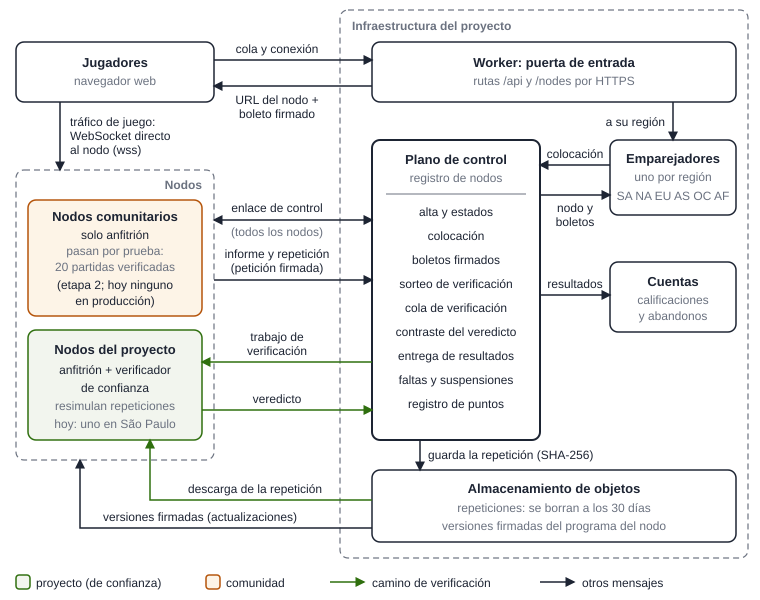
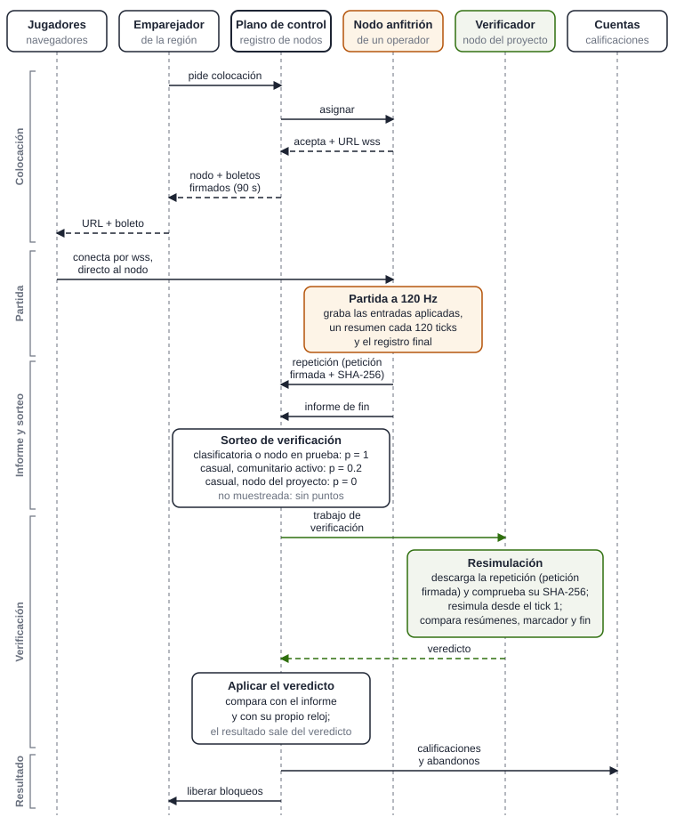
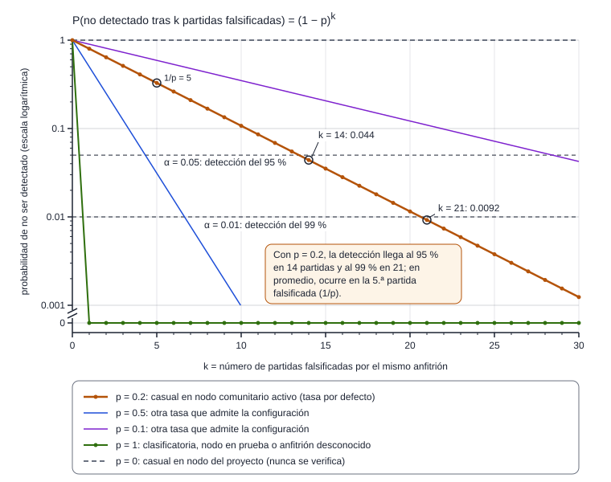
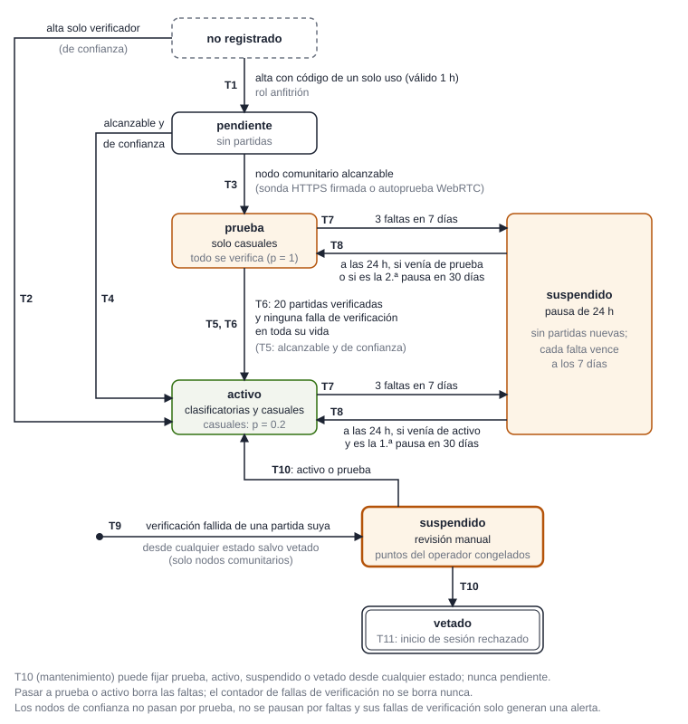

# Turbogol: una red comunitaria de servidores verificables

**Base técnica, arquitectura y modelo matemático de los nodos de la comunidad y los verificadores**

Versión 1.0 · octubre de 2026 · Proyecto Turbogol (código abierto, AGPL)

## Resumen

Turbogol es un juego de fútbol con autos, de código abierto, que se juega en el navegador. Este documento describe una red de servidores de partidas operados por terceros («nodos») y el mecanismo que permite al proyecto aceptar sus resultados porque cada uno se comprueba de forma independiente: un nodo solo *informa* un resultado; un verificador del proyecto *decide* si cuenta, volviendo a simular la partida completa.

La base técnica es una simulación determinista: un único binario WebAssembly del motor de física, ejecutado a 120 Hz fijos, con controles cuantizados a 6 bytes por auto y con bots y reglas que nunca consultan el reloj ni fuentes de azar sin semilla. Por eso una partida queda descrita por completo por su configuración, la secuencia de controles aplicados a los asientos humanos, las salidas explícitas y un registro final. El nodo graba esa información en una repetición binaria compacta (formato TGR1) que incluye un resumen FNV-1a de 32 bits del estado físico por cada segundo de juego, y la sube con una petición firmada con Ed25519; el servicio central del proyecto (plano de control) fija el SHA-256 de la repetición antes de sortear si la partida se verifica. Resimular una partida de tres minutos cuesta alrededor de un segundo de CPU en producción.

Formalizamos la transición por tick; las pruebas que se exigen a cada forma de finalizar una partida; el muestreo de verificación (probabilidad 1 para partidas clasificatorias y para nodos en período de prueba; 0.2 para partidas casuales en nodos comunitarios activos); la probabilidad de que $k$ falsificaciones pasen todas inadvertidas, $(1-p)^k$, con una esperanza de $1/p = 5$ partidas falsificadas hasta la primera detección; la máquina de estados de reputación (20 partidas verificadas sin ninguna falla para acceder a partidas clasificatorias; 3 faltas en 7 días para una pausa de 24 h); el predicado de elegibilidad y la regla de elección al azar dentro de la franja de ocupación más baja; los umbrales de vida del enlace (15, 30 y 60 s), y una fórmula, insesgada bajo muestreo, para los puntos de servidor que reconocen el alojamiento verificado. Los puntos no son dinero: no se compran, no se venden ni se transfieren, y solo desbloquean objetos cosméticos.

Somos explícitos sobre los límites. La verificación demuestra consistencia, no la autenticidad de las entradas: muestra que el resultado es la consecuencia determinista de las entradas registradas, no que esas entradas sean las que enviaron los jugadores. Hoy existe un único verificador, y la evidencia empírica de determinismo entre máquinas es acotada. A la fecha de esta versión, el sistema está en su primera etapa de despliegue (etapa 1): un solo nodo del proyecto, en São Paulo, aloja y verifica partidas reales desde el 21 de octubre de 2026, y nadie recibe puntos todavía.

## 1. Introducción y motivación

### 1.1 Contexto

Turbogol es un juego multijugador de fútbol con autos para navegador, publicado como código abierto bajo la licencia AGPL, con partidas de uno contra uno a tres contra tres (el formato de las repeticiones admite hasta 8 asientos), bots que completan los equipos y dos tipos de partida: casuales y clasificatorias (*ranked*); solo las clasificatorias modifican la calificación de los jugadores. Hasta la llegada de los nodos, toda partida con servidor autoritativo corría en la infraestructura del propio juego: un emparejador por región crea un objeto de partida (un *Durable Object* de la plataforma de cómputo en el borde que usa el proyecto), con un máximo de 20 objetos de partida activos por emparejador. Las partidas casuales con dos o más personas se juegan, por defecto, de navegador a navegador.

### 1.2 El problema de la confianza

Abrir la red a servidores de la comunidad aporta cobertura donde el proyecto no tiene máquinas, menor latencia y una forma concreta de participar. Pero en un juego con servidor autoritativo *el servidor decide*: quien lo controla podría inventar un gol, cortar una partida que va perdiendo, atribuir un abandono falso o declarar minutos que no hubo. Las respuestas habituales (listas cerradas de servidores, antitrampas en el cliente, auditorías manuales) no escalan a lo que buscamos: que cualquiera pueda prestar su máquina y que sus resultados se comprueben con el mismo rigor que los de los servidores propios del juego.

### 1.3 La idea central

La solución se apoya en una propiedad del motor: la simulación es determinista. Con el mismo binario, el mismo estado inicial y las mismas entradas, dos máquinas obtienen los mismos estados, tick por tick. El resultado de una partida es entonces función de pocos datos (la configuración y los controles aplicados a los asientos humanos), y cualquiera que los tenga puede recomputarlo. El resultado no depende de la palabra del servidor: este solo debe entregar la evidencia. Un verificador del proyecto vuelve a simular la partida y solo entonces el resultado cuenta. Un servicio central del proyecto, el *plano de control*, registra los nodos, les asigna partidas, sortea cuáles se verifican y aplica los veredictos. Recomputar tres minutos de tres contra tres con bots cuesta alrededor de un segundo de CPU en producción, aproximadamente 1/180 del tiempo que lleva jugarlos.

### 1.4 Contribuciones

Este documento:

- describe la arquitectura completa de la red;
- formaliza la simulación como una función de transición por tick;
- define el algoritmo de verificación y las comprobaciones temporales del plano de control;
- deriva la probabilidad de detección bajo muestreo, el número esperado de falsificaciones hasta que se descubre al falsificador, la probabilidad de superar el período de prueba falsificando y el costo de verificar;
- modela la reputación como una máquina de estados;
- formaliza la elegibilidad, la selección de nodos y el factor regional;
- demuestra que la fórmula de puntos no se sesga por el muestreo, y
- reúne las mediciones y una hoja de ruta que separa lo que funciona de lo planificado.

### 1.5 Estado actual y convenciones

Desde el 21 de octubre de 2026, toda partida elegible, de cualquier jugador, se ofrece a un nodo. En producción existe **un único nodo**, operado por el proyecto en São Paulo (región Sudamérica), con los roles de anfitrión y verificador, capacidad declarada de 15 partidas simultáneas y versión 0.3.0 del programa del nodo. Hoy solo las cuentas de operadores de confianza (del proyecto) pueden crear códigos de alta, de modo que toda la maquinaria pensada para nodos no confiables (período de prueba, muestreo con $p = 0.2$, congelamiento de puntos, puntos ponderados por $1/p$) está implementada y cubierta por pruebas automáticas, pero **no se ejercita en producción**. Por la misma razón, **nadie recibe puntos de servidor todavía**.

A lo largo del texto usamos cinco etiquetas de estado: *en funcionamiento* (activo en producción), *implementado* (en la rama principal y probado, pero sin efecto real en producción), *en curso* (implementado en una rama aún no fusionada), *planificado* (decidido, sin implementar) e *idea* (sin diseño todavía). Los valores numéricos corresponden a la versión 0.3.0 del nodo, publicada desde el commit `ab8d97d` de la rama principal.

### 1.6 Organización

Las secciones 2 y 3 presentan los principios de diseño y la base técnica; la 4 y la 5, la arquitectura y el ciclo de vida de una partida; de la 6 a la 9, los modelos de verificación, reputación, planificación y vida del enlace; la 10, los puntos de servidor; de la 11 a la 13, seguridad, privacidad y mediciones; la 14, la hoja de ruta, y la 15 concluye. Los apéndices reúnen constantes, notación, glosario, referencias al código fuente y referencias externas.

## 2. Principios de diseño

**P1. Los nodos alojan; el proyecto decide.** Una máquina de la comunidad nunca escribe un resultado. Aloja la partida, graba la repetición e informa. La calificación, los abandonos y los minutos que cuentan para los puntos se construyen a partir del veredicto de un verificador que resimuló la partida, nunca a partir de la palabra del nodo.

**P2. El determinismo es el cimiento.** Todo el diseño depende de que el mismo binario, con las mismas entradas, produzca los mismos estados en cualquier máquina. Por eso hay un único binario de física para navegador, servidores y nodos; por eso la identidad de una «simulación» es la terna formada por el SHA-256 del binario, la versión del protocolo de juego y la versión del programa del nodo; y por eso un nodo y un verificador solo trabajan juntos si esa terna coincide exactamente.

**P3. Comprometer antes de sortear.** La evidencia de una partida queda fijada (subida, resumida con SHA-256 y almacenada) antes de que el plano de control decida, con una fuente de aleatoriedad segura, si esa partida se verifica. El nodo no puede saber de antemano qué partidas se auditarán ni modificar la evidencia después.

**P4. Azar donde el operador podría sacar ventaja.** El nodo que aloja, el verificador, la semilla del saque inicial, el identificador de la partida y el sorteo de verificación se deciden al azar en el plano de control. Ningún operador puede elegir ni preparar en qué nodo caerá una partida concreta (el sorteo de nodo usa el generador aleatorio estándar del entorno, mientras que los sorteos con consecuencias de verificación usan la fuente de aleatoriedad segura; sección 8.3).

**P5. Separación de claves y mínimo privilegio.** Hay tres claves Ed25519 independientes: la de control (firma boletos de partida), la de versiones (firma el programa del nodo) y una por nodo (identifica la máquina). Un nodo puede comprobar boletos pero no emitirlos; quien comprometa el plano de control no puede distribuir código a los nodos.

**P6. Solo conexiones salientes.** El nodo abre un único enlace de control hacia el proyecto y no expone puertos de administración; aparte de una página de texto estática, solo atiende las conexiones de juego de los jugadores y el punto de acceso de alcanzabilidad que sondea el proyecto. Sigue el mismo patrón que los ejecutores de integración continua y los clientes voluntarios de los servicios de análisis distribuido de partidas de ajedrez.

**P7. Fallar de forma segura.** Los interruptores de configuración que habilitan los nodos quedan apagados ante cualquier error: un valor ausente o mal escrito equivale a «apagado». Si no hay nodo disponible, el emparejador usa sus propios servidores como antes. Una falla de infraestructura nunca penaliza a los jugadores.

**P8. Una caída, una falta.** Las sanciones a nodos miden fiabilidad, no mala suerte: las caídas se deduplican, las faltas expiran y una sola caída nunca excluye a nadie de forma permanente.

**P9. Reconocer el servicio verificado.** Los puntos de servidor se cuentan en minutos-jugador servidos y confirmados por la resimulación. Los puntos no son dinero: no se compran, no se venden ni se transfieren, y solo desbloquean objetos cosméticos.

**P10. Honestidad sobre los límites.** Cada mecanismo descansa en supuestos. Los hacemos explícitos y separamos lo que funciona hoy de lo planificado.

## 3. Base técnica: la simulación determinista

### 3.1 El motor de física y el binario único

La física la provee una biblioteca de C++ de código abierto construida sobre el motor Bullet, compilada con Emscripten a un único módulo WebAssembly de 593 938 bytes (indicadores `-O3`, `-flto`, `-msimd128` y `-fno-strict-aliasing`; el SIMD es de ancho fijo, no la variante «relajada», cuyos resultados pueden variar entre plataformas). **El mismo binario** corre en el navegador, en los *Workers* del proyecto (las funciones de servidor que el proyecto ejecuta en la plataforma de cómputo en el borde) y en los nodos, y un único módulo puente en TypeScript accede a su memoria.

Cada partida y cada verificación obtienen su propia instancia, con memoria propia y su propia *arena* (el mundo físico simulado de la partida: campo, autos y pelota), a partir de un módulo compilado una vez por proceso. La identidad de la compilación es el SHA-256 de sus bytes: el nodo lo calcula al cargar el módulo; para el Worker, que no puede resumir un módulo precompilado, el valor está fijado en el repositorio y una prueba automática falla si no coincide con el archivo.

Las arenas de servidores, nodos y verificación usan siempre la física estándar: los modos experimentales del juego solo se activan con una opción explícita que el código de nodos y de partidas clasificatorias nunca activa, y las partidas con física experimental nunca llegan a un nodo.

### 3.2 Un reloj de simulación fijo

La simulación avanza en pasos discretos (ticks) a una tasa fija de $f = 120$ Hz, con paso $\Delta = 1/120$ s $\approx 8.333$ ms. El protocolo de red tiene su propia copia de la constante y la arena se crea con esa tasa; el lado nativo reemplaza por 120 cualquier tasa fuera de $[15, 120]$ (también NaN), y el decodificador de repeticiones rechaza un encabezado con otra tasa. El verificador razona exclusivamente en ticks.

En un nodo, un temporizador compartido se dispara cada 4 ms. Cada *sala* (la instancia de una partida en el anfitrión: arena, reglas, conexiones y grabación) convierte el tiempo de reloj transcurrido en ticks con un acumulador $A$: el intervalo medido $\delta_j$ entre dos invocaciones se recorta a $[0, 250]$ ms, se ejecutan como máximo 8 ticks por invocación y el acumulador se limita a $8\Delta_{\mathrm{ms}}$, con $\Delta_{\mathrm{ms}} = 1000/120$ ms.

**Lema 1 (la simulación nunca adelanta al reloj).** Sea $t_0$ el instante en que una sala comienza a simular y $N_{\mathrm{ej}}(t)$ el número de ticks ejecutados hasta el instante $t$. Entonces

$$
N_{\mathrm{ej}}(t)\,\Delta_{\mathrm{ms}} \;\le\; t - t_0 .
$$

*Demostración.* Cada tick resta $\Delta_{\mathrm{ms}}$ del acumulador $A$, y un tick solo se ejecuta si $A \ge \Delta_{\mathrm{ms}}$, de modo que $A \ge 0$ en todo momento. Como $A = 0$ cuando la sala comienza en $t_0$ y el primer intervalo se mide desde $t_0$, lo que se suma a $A$ es, como mucho, $\sum_j \min(\delta_j, 250) \le t - t_0$, y el tope superior de $A$ solo descarta tiempo. Por lo tanto $N_{\mathrm{ej}}(t)\,\Delta_{\mathrm{ms}} \le \sum_j \min(\delta_j, 250) \le t - t_0$. $\square$

El lema tiene una consecuencia práctica que usaremos en la sección 6.5: ante una interrupción, el tiempo simulado se *atrasa* respecto del reloj y no se recupera de golpe. Después de una pausa de 250 ms o más, por ejemplo, se recuperan como máximo 16 ticks (unos 133.3 ms de juego): 8 en la primera invocación y otros 8 en la siguiente, con lo que quedó en el acumulador limitado. El resto se pierde y el reloj de la partida simplemente queda atrasado respecto del reloj real. Un anfitrión honesto nunca produce más tiempo de juego que el tiempo real transcurrido.

### 3.3 Cuantización de los controles

Los controles de cada auto se representan con 6 bytes: cinco ejes analógicos (acelerador, dirección, cabeceo, guiñada y alabeo) como enteros con signo de 8 bits y un byte de botones (salto = 1, turbo = 2, freno de mano = 4). Un valor analógico $x$ se cuantiza y se reconstruye así:

$$
\hat{x} = \big\lfloor 127\cdot\operatorname{clamp}(x,-1,1) + 0.5 \big\rfloor\in[-127,127],\qquad x' = \operatorname{f32}\!\left(\frac{\hat{x}}{127.0}\right)
\tag{1}
$$

donde $\lfloor y + 0.5 \rfloor$ es el redondeo al entero más cercano con los medios hacia arriba (el que hace `Math.round`) y $\operatorname{f32}$ redondea al flotante de 32 bits más cercano. El lado nativo decodifica los controles empaquetados como `(float)(q/127.0)`, con $q = \hat{x}$, exactamente el mismo valor que produce el camino en JavaScript. Cliente, anfitrión y verificador alimentan al motor con bytes idénticos y, por lo tanto, calculan ticks idénticos.

### 3.4 La transición por tick

Sea $s_T$ el estado físico tras el tick $T$ (autos, pelota, plataformas de turbo y contador de ticks), $g_T$ el estado de las reglas de la partida (fase, reloj, marcador), $\beta_T$ el estado interno de los bots y de la predicción de la pelota, y $u^{(i)}_T$ los 6 bytes de control del asiento $i$ en el tick $T$. Sea $\mathcal{H}_T$ el conjunto de asientos humanos que todavía no fueron relevados por un bot en el tick $T$. La transición que ejecuta el anfitrión es

$$
\begin{aligned}
u_T^{(i)} &= \begin{cases}
\mathbf{0} & \text{si } \mathrm{congelado}(g_{T-1})\\[2pt]
\bar{u}^{(i)}_{T} & \text{si } i \in \mathcal{H}_T\\[2pt]
\pi^{(i)}_{\mathrm{bot}}\big(s_{T-1},\,\beta_{T-1}\big) & \text{si } i \notin \mathcal{H}_T
\end{cases}\\[6pt]
s'_T &= \Phi\big(s_{T-1},\,u_T\big),\qquad g_T = \Gamma\big(g_{T-1},\,\mathrm{goles}(s'_T),\,\Delta\big)\\[4pt]
s_T &= \begin{cases}
\Psi\big(s'_T,\ \mathrm{seed} + n_{\mathrm{saq}}\big) & \text{si } \Gamma \text{ emitió un reinicio de saque en } T\\[2pt]
s'_T & \text{en otro caso}
\end{cases}
\end{aligned}
\tag{2}
$$

donde $\Phi$ es el paso del motor (escribir los controles empaquetados y avanzar un tick dentro del módulo WebAssembly), $\mathrm{goles}(s'_T)$ son los goles que detecta el motor en ese paso, $\Gamma$ es la máquina de estados de las reglas, $\Psi$ reinicia la arena para un saque con la semilla indicada y $\pi_{\mathrm{bot}}$ es la política de los bots. Los casos de $u^{(i)}_T$ se evalúan en orden (el primero que se cumple prevalece) y $u_T = (u^{(i)}_T)_i$. Para un humano, $\bar{u}^{(i)}_{T}$ es el último control aplicado, o $\mathbf{0}$ si el asiento no tiene conexión (al desconectarse se vacían su cola y su último control); si no llegó una entrada nueva para $T$, se repite la anterior: es lo que llamamos un tick sin entrada nueva, o *underrun*. El reinicio de saque ocurre dentro del mismo tick, después del paso, así que $s_T$ no es simplemente $\Phi(s_{T-1}, u_T)$.

En cada tick, primero cada humano toma la entrada encolada para $T$ o repite la última. Después, los bots, conducidos por un controlador por equipo con semillas fijas 777 (azul) y 7 (rojo), deciden con una predicción de la pelota que se recalcula cada 4 ticks; en las fases congeladas (antes del inicio, cuenta regresiva, pausa tras gol, final), todos los asientos reciben controles nulos. Luego se escriben 6 bytes por auto y el motor avanza un paso. Por último, las reglas avanzan $\Delta$ y, si piden un reinicio de saque, este se ejecuta. Cada reinicio de saque inicializa el generador de la posición inicial con $\mathrm{seed} + n_{\mathrm{saq}}$, donde $n_{\mathrm{saq}}$ es el número de saques ya ejecutados en la partida y $\mathrm{seed}$ es un entero de 31 bits que sortea el plano de control con su fuente de aleatoriedad segura. Ni los bots, ni las reglas, ni el bucle autoritativo de la partida (`RoomHost`) consultan el reloj, temporizadores o generadores aleatorios sin semilla; una búsqueda de esas llamadas en su código no encuentra ninguna.

**Proposición 1 (una partida es función de pocos datos).** Fijada la terna de simulación (SHA-256 del binario, versión del protocolo, versión del nodo), el estado completo $(s_T, g_T, \beta_T)$ en cada tick $T$ es función determinista de: (i) la configuración $\Xi$ (plantel, semilla de saque, opciones de reglas, dificultad de los bots); (ii) la secuencia de controles aplicados a los asientos humanos; y (iii) el conjunto de relevos $\{(i, T^{\mathrm{rv}}_i)\}$, es decir, el tick a partir del cual cada humano que salió explícitamente es sustituido por un bot.

*Demostración.* Por inducción sobre $T$. En $T = 0$ se crea una arena nueva, con un auto por asiento en orden de asiento, y se ejecuta el saque con la semilla; $(s_0, g_0, \beta_0)$ depende solo de $\Xi$. Supongamos el enunciado cierto para $T-1$. Por la ecuación (2), $u_T$ depende de $g_{T-1}$, de los controles humanos de (ii), del conjunto $\mathcal{H}_T$ que fija (iii) y de $\pi_{\mathrm{bot}}$, que solo usa sus semillas fijas y el estado previo; $\Phi$ y $\Psi$ son funciones de los bytes del binario y de sus argumentos; $\Gamma$ usa un paso fijo $\Delta$; y $n_{\mathrm{saq}}$ depende solo de la historia previa de la partida. Luego $(s_T, g_T, \beta_T)$ es función de los mismos datos. $\square$

Que $\Phi$ sea una función descansa en dos supuestos. El primero es el determinismo del punto flotante de WebAssembly, garantizado por el estándar salvo en los bits de los valores NaN; es una propiedad de la especificación de la plataforma, no algo que el repositorio verifique, aunque lo respaldan las pruebas de la sección 3.7. El segundo: la predicción de la pelota depende del historial de la arena, de modo que una arena que cargó un estado guardado podría llevar a los bots a decidir diferente. Anfitrión y verificador parten de una arena nueva y nunca cargan estados, así que sus historiales coinciden.

**Corolario.** Una repetición solo necesita la configuración, los controles humanos y los relevos. Los bots se recomputan durante la verificación en lugar de leerse de la repetición, lo que además demuestra que el anfitrión no dirigió a ningún bot.

### 3.5 El resumen del estado

Cada 120 ticks (la cadencia $\gamma$ que escribe un anfitrión honesto; sección 3.6) el anfitrión registra un resumen del estado físico. La función serializa la arena exactamente como lo haría el guardado de estado (identificador mágico, versión, contador de ticks, autos, pelota y plataformas de turbo) y calcula sobre esos bytes $z_0,\dots,z_{N_z-1}$ el FNV-1a de 32 bits:

$$
\begin{gathered}
y_0 = \texttt{0x811c9dc5},\qquad y_{j+1} = \big(y_j \oplus z_j\big)\cdot \texttt{0x01000193} \bmod 2^{32},\\
h_k = y_{N_z}\ \text{sobre}\ \mathrm{ser}\big(s_{120k}\big)
\end{gathered}
\tag{3}
$$

donde $\mathrm{ser}$ es la serialización descrita. Para $n_{\mathrm{autos}}$ autos, la serialización ocupa como máximo $13 + 448\,n_{\mathrm{autos}} + 594$ bytes (cada auto ocupa 448 bytes con registro de toque de pelota y 380 sin él): entre 2887 y 3295 bytes en un tres contra tres, y como máximo 4191 con 8 autos, por debajo de un tope de 8192.

El resumen cubre solo el estado físico, no el estado de las reglas en JavaScript (marcador, reloj, fase) ni el estado interno de los bots. Esos quedan cubiertos de forma indirecta, porque cada gol provoca un reinicio de saque que cambia el estado físico, y de forma explícita por las comprobaciones del marcador y del registro final (sección 6.3).

**Localización de una divergencia.** Sea $T_d$ el primer tick en que el estado del verificador difiere del que tuvo el anfitrión. Con la cadencia de un anfitrión honesto, si la repetición tiene un punto de control en o después de $T_d$, el primero está en $120\lceil T_d/120\rceil \le T_d + 119$, de modo que una divergencia se localiza con una resolución de un segundo de juego. Si los estados siguen siendo distintos en ese punto, la divergencia se detecta salvo colisión del resumen. Tratando heurísticamente a FNV-1a como una función aleatoria sobre entradas distintas, la probabilidad de colisión es del orden de $2^{-32} \approx 2.3\times 10^{-10}$ por punto de control, y si la divergencia persiste a lo largo de $r$ puntos de control, del orden de $2^{-32r}$. Una divergencia que comienza después del último punto de control, en el último segundo incompleto, solo se detecta si cambia el marcador o el final de la partida, que la sección 6.3 comprueba por separado.

**Por qué no hace falta un resumen resistente a colisiones.** El verificador calcula sus propios resúmenes a partir de las entradas registradas. Si el anfitrión registra valores falsos, hay discrepancia y la responsabilidad es suya; si registra los verdaderos, no aportan nada que el verificador no calcule; y el resultado se toma del verificador, no de los resúmenes. Buscar una colisión no da ventaja alguna: cualquier valor escrito debe coincidir con lo que produce resimular las propias entradas registradas. Los resúmenes detectan y localizan divergencias, incluidos los errores de determinismo; el ancla de seguridad es la resimulación completa.

### 3.6 La repetición TGR1

La repetición es un archivo binario *little-endian*: el identificador mágico `TGR1`, la longitud del encabezado (entero de 32 bits), un encabezado JSON y los registros en orden de tick. El encabezado fija la versión de formato, 1, los identificadores de partida y de nodo, la compilación, el modo, la región, si es clasificatoria, el plantel (de 1 a 8 asientos), la duración reglamentaria, la semilla de saque, la dificultad de los bots, los tiempos de cuenta regresiva y de pausa tras gol, la tasa de ticks (120) y la cadencia de puntos de control $\gamma$ (un anfitrión honesto escribe 120; el decodificador solo exige un entero $\ge 1$). La hora de inicio se escribe como 0, para que dos repeticiones de la misma partida sean idénticas byte a byte.

| Tipo | Código | Tamaño | Contenido | Cuándo se escribe |
|---|---|---|---|---|
| `INPUT` | 1 | 12 B | tick (u32), asiento (u8), 5 ejes y el byte de botones (6 × i8) | cuando cambian los controles aplicados de un humano, y para todo humano en el tick 1 |
| `TAKEOVER` | 2 | 6 B | tick (u32), asiento (u8) | el asiento pasa a ser un bot desde ese tick |
| `HASH` | 3 | 9 B | tick (u32), resumen (u32) | tras cada tick $T$ con $T \bmod \gamma = 0$ |
| `END` | 4 | 12 B | tick (u32), ganador (i8), azul (u16), rojo (u16), motivo (u8), equipo que abandona (i8) | una vez, al final |

*Tabla 1. Registros del formato TGR1 (los tamaños incluyen el byte de tipo). El motivo de fin es un índice en la lista* `rules` *(final reglamentario),* `forfeit` *(abandono de un equipo),* `ttl` *(se agotó el tiempo máximo de la partida),* `left` *(salieron todos los humanos) y* `empty` *(ningún humano sigue presente).*

Los bots nunca se registran. El decodificador rechaza archivos de más de 16 MiB o con encabezados de más de 64 KiB; registros desconocidos, truncados, en el tick 0, fuera de orden de tick entre registros del mismo tipo o posteriores a `END`; y entradas o relevos que no correspondan a asientos humanos o que sigan al relevo de su asiento.

Si $E$ es el tick del registro `END`, la repetición debe contener exactamente

$$
N_{\mathrm{hash}} = \left\lfloor \frac{E}{\gamma} \right\rfloor \text{ resúmenes, en los ticks } t_k = \gamma\,k,\quad k = 1,\dots,N_{\mathrm{hash}}
\tag{4}
$$

y su tamaño es

$$
\lvert\mathcal{R}\rvert = 8 + \lvert\mathrm{hdr}\rvert + 12\,N_{\mathrm{in}} + 6\,N_{\mathrm{rv}} + 9\,N_{\mathrm{hash}} + 12,\qquad \lvert\mathcal{R}\rvert \le 16\ \mathrm{MiB},\quad \lvert\mathrm{hdr}\rvert \le 64\ \mathrm{KiB}
\tag{5}
$$

donde $\lvert\mathcal{R}\rvert$ es el tamaño de la repetición en bytes, $\lvert\mathrm{hdr}\rvert$ la longitud del encabezado JSON, $N_{\mathrm{in}}$ el número de registros de entrada y $N_{\mathrm{rv}}$ el de relevos. La repetición de una partida de tres minutos solo con bots ocupa entre 2.3 y 2.8 KB (de 2329 a 2834 bytes: de 189 a 234 resúmenes, que suman de 1701 a 2106 bytes, más un encabezado de 0.5 a 0.7 KB); la de una partida de 34 s con humanos, alrededor de 6.5 KB, y las de partidas grabadas con humanos simulados por guion, entre 60 y 403 KB.

**El tope de 16 MiB nunca limita a un anfitrión honesto con duración estándar.** En el peor caso, cada humano cambia sus controles en cada tick. Una partida de tres minutos admite como máximo 108 000 ticks (ecuación (7), más adelante), así que con 8 asientos humanos los registros de entrada ocupan como máximo $8 \times 108\,000 \times 12 = 10\,368\,000$ bytes, unos 9.9 MiB, y el archivo completo, con un encabezado de 64 KiB como máximo, 900 resúmenes y el registro final, queda por debajo de 10 MiB. En una partida sin límite de tiempo el tope efectivo es de 86 400 ticks y los registros de entrada ocupan como máximo unos 7.9 MiB (menos de 8 MiB el archivo completo).

### 3.7 Identidad de la simulación y evidencia empírica

Dos procesos ejecutan «la misma simulación» cuando coinciden el SHA-256 del binario, la versión del protocolo de juego y la versión del programa del nodo. En la versión que describimos son el resumen `d8e6af256eafa07785d5e341ffe11ac95c311fc6780a2c968f19fee93c75fe07`, el protocolo 3 y el nodo 0.3.0. El protocolo de control entre nodo y plano de control tiene declarada su propia versión, la 2, que hoy no se intercambia ni se comprueba.

La evidencia empírica proviene de un guion que graba 12 partidas completas de tres minutos (humanos simulados por guion y bots reales) y verifica en una máquina lo grabado en otra, en ambos sentidos; el guion compara además lo grabado con una referencia fijada en el repositorio, pero solo cuando el binario coincide con el de esa referencia. Resultado: 12 de 12 partidas verificadas en ambos sentidos entre una PC con Windows (Ryzen 7 2700) y el servidor de producción con Linux (AMD EPYC), con el mismo motor V8. Esas 12 partidas se grabaron y verificaron el 19 de octubre de 2026 con el binario anterior (`c137f952…`); la referencia fijada también corresponde a ese binario, así que el guion no la compara con el actual (`d8e6af25…`), que reemplazó al anterior el 21 de octubre. Con el binario actual todavía no se repitió la ejecución entre máquinas; la evidencia para el binario actual es el juego real en producción con la versión 0.3.0, sin desincronizaciones. La primera partida clasificatoria real se alojó y se verificó en el nodo el 21 de octubre de 2026, pero su anfitrión y su verificador fueron la misma máquina, así que no aporta evidencia entre máquinas. Las pruebas automáticas cubren la manipulación: una entrada editada se detecta en el siguiente punto de control, y se rechazan marcadores, ganadores y abandonos falsificados.

Esta evidencia es acotada: dos máquinas, dos sistemas operativos y un único motor de JavaScript. El determinismo no está demostrado en otras arquitecturas de CPU ni en otros motores. Volvemos sobre esto en la sección 11.

## 4. Arquitectura

Con la base técnica establecida, esta sección describe quién ejecuta cada parte del sistema, qué claves usa cada una y cómo entra un nodo a la red.

### 4.1 Componentes

La Figura 1 muestra los componentes y sus relaciones. La Tabla 2 los resume.

| Componente | Función | Dónde corre |
|---|---|---|
| Cliente web | El cliente del juego, sin cambios: abre un WebSocket a la URL del nodo con el boleto en el subprotocolo | Navegador |
| Rutas `/nodes/*` | Responden consultas simples y reenvían el resto al plano de control, sobrescribiendo los encabezados de identidad del llamante | Worker en el borde |
| Emparejador regional | Forma partidas y pide colocarlas en un nodo; si no, usa su propio objeto de partida | Un objeto durable por región |
| Plano de control | Registro de nodos, colocación, boletos, repeticiones, cola de verificación, veredictos y entrega de resultados | Un objeto durable con SQLite, cerca de São Paulo |
| Objeto de cuentas | Calificaciones, abandonos y bloqueo de clasificatorias (una activa por cuenta) | Objeto durable |
| Almacenamiento de objetos | Repeticiones (se conservan 30 días) y versiones firmadas con su canal | Proveedor de la plataforma |
| Programa del nodo | Paquete firmado de unos 2 MB más el binario de física: salas de partida, servidores WebSocket y WebRTC, agente de control y verificador | Node.js 24, máquina del operador |
| Lanzador | Descarga, comprueba, ejecuta, actualiza y revierte versiones | Máquina del operador |
| Proxy TLS | Termina HTTPS con certificados automáticos | Servidor virtual del operador |
| Verificador | El programa del nodo con el rol `verify` | Nodos del proyecto |

*Tabla 2. Componentes de la red.*

El plano de control guarda en SQLite los códigos de alta (solo sus resúmenes SHA-256), los nodos, las partidas y una bandeja de salida de resultados, con escrituras síncronas y transaccionales. Usa la interfaz de hibernación de la plataforma, y una alarma cada 5 s ejecuta el barrido de vencimientos y la entrega de resultados. Al arrancar comprueba que su clave pública de control corresponda a la privada; si no, el plano de control no coloca partidas ni registra nodos, y emite una alerta.

<figure><figcaption>Figura 1. Arquitectura de la red de nodos. Las flechas indican el sentido de los mensajes; en verde, el camino de verificación. Toda conexión con una máquina de la comunidad la abre la propia máquina o el jugador, salvo las sondas de alcanzabilidad sobre la URL pública que el propio nodo declara.</figcaption></figure>

### 4.2 Roles y confianza

Un nodo declara uno o dos roles: `host` (aloja partidas) y `verify` (resimula partidas alojadas en nodos). Un operador es *de confianza* si su cuenta figura en una lista configurada en el servidor; esa condición se recalcula al cargar y nunca se almacena, de modo que quitar a un operador de la lista revoca la condición de confianza de sus nodos en el siguiente arranque. Solo los operadores de confianza pueden registrar el rol `verify`. Los nodos de confianza omiten el período de prueba y nunca se pausan por faltas, pero tampoco reciben puntos (sección 7.7).

### 4.3 Tres claves independientes

- **Clave de control.** Firma los boletos de partida; su mitad privada es un secreto del Worker y los nodos guardan la pública desde su alta.
- **Clave de versiones.** Firma los manifiestos de versión y el lanzador; vive en un entorno protegido de integración continua, con una copia fuera de línea.
- **Clave de nodo.** Una por nodo, generada en la máquina del operador; sirve para iniciar sesión, subir y descargar repeticiones y demostrar alcanzabilidad.

Las tres son claves Ed25519 (públicas de 32 bytes, firmas de 64 bytes). Quien comprometa el plano de control no puede distribuir código a los nodos, y nada de lo que guarda un nodo le permite hacerse pasar por el plano de control ni por otro nodo.

### 4.4 Alta de un nodo

1. Una cuenta habilitada (hoy, solo operadores de confianza, hasta 10 códigos por día) obtiene un **código de alta de un solo uso** para una región: un prefijo fijo más 24 bytes aleatorios, válido durante 1 hora; solo se almacena su SHA-256.
2. El instalador genera en la propia máquina el par de claves Ed25519 del nodo y envía la parte pública junto con el código, los roles, los transportes, la URL pública, la compilación y la capacidad (como máximo 5 altas por dirección y hora; en IPv6, el recuento se lleva por prefijo /64).
3. El plano de control comprueba el código, el tope de nodos del operador (10, o 2 si es de confianza), que la clave no esté en uso, los roles (`verify` está reservado), la URL (solo `wss`) y la capacidad (de 1 a 200), y repite las comprobaciones críticas justo antes de consumir el código, porque otras altas simultáneas podrían haber cambiado su resultado entretanto.
4. El nodo recibe su identificador y la clave pública de control, que conserva desde entonces, y queda en estado `pending` (pendiente).

La región se copia del código de alta y no puede cambiarse después. Hoy no se mide la ubicación real de la máquina; la colocación según la latencia medida por los clientes (sección 14) cerrará esa brecha.

### 4.5 El enlace de control

El nodo abre un WebSocket saliente hacia el plano de control, que le envía un valor aleatorio de un solo uso de 24 bytes; el nodo debe responder en menos de 10 s con la firma Ed25519 de `tgn-auth.v1.<nodo>.<valor>`. Tras la bienvenida (estado, región, canal de versiones, hora del servidor y servidores ICE), el nodo envía un saludo con su identificador de proceso (`bootId`, aleatorio por proceso), compilación, roles, transportes, capacidad y tope de tráfico, y luego un latido cada 5 s.

Las solicitudes del plano de control al nodo vencen a los 5 s (10 s para ofertas WebRTC; 60 s para verificaciones), y los informes se reenvían hasta recibir acuse. Como máximo 64 conexiones pueden esperar autenticación. Un mensaje con formato inválido cierra el enlace, y un informe con formato inválido cuenta como partida perdida con falta. El código de cierre 4408 indica silencio prolongado; 4403, nodo vetado.

### 4.6 Comprobación de alcanzabilidad

Antes de recibir partidas, un nodo debe demostrar que los jugadores llegan a él. Con `wss`, el plano de control solicita `<URL pública>/healthz` con un valor aleatorio de un solo uso de 18 bytes, y el nodo responde con la firma de `tgn-reach.v1.<nodo>.<valor>`, que ni un proxy ni otra máquina pueden producir. Un nodo que todavía no demostró su alcanzabilidad se sondea cada 30 s; una vez demostrada, se vuelve a sondear cada 5 minutos (cada 30 s después de una falla), y 3 fallas consecutivas retiran `wss` de sus transportes utilizables, sin cambiar su estado, hasta que una sonda posterior (de nuevo cada 30 s) tenga éxito. Con `rtc` (computadoras domésticas), el nodo ejecuta una autoprueba WebRTC, repetida cada 30 minutos, cuya conexión debe abrirse a través de un servidor de retransmisión TURN.

Como la sonda corre en un Worker, que no puede conectarse a una dirección IP sin nombre, un nodo comunitario en un servidor virtual necesita un nombre DNS. Una vez alcanzable, un nodo comunitario pasa de `pending` a `probation`; uno de confianza, directamente a `active`.

### 4.7 Boletos de partida

Por cada humano, el plano de control firma con su clave de control un boleto —una firma web JSON (JWS) en serialización compacta, con el algoritmo EdDSA— que contiene el jugador, la partida, el equipo, el asiento, el nombre visible, un vencimiento 90 s después de firmado el boleto, un identificador de un solo uso (`jti`, 16 bytes aleatorios) y la audiencia `node:<nodo>`. El nodo comprueba el boleto con la clave pública fijada en su alta y con el reloj del plano de control, que estima a partir del desfase de reloj que mide:

$$
\begin{aligned}
\text{válido}(\mathit{bol}) \iff{} & \mathrm{Ed25519.verify}\big(K^{\mathrm{pub}}_{\mathrm{ctl}}, \mathit{bol}\big) \land \mathrm{exp} > t_{\mathrm{srv}}\\
& \land\ \mathrm{aud} = \texttt{node:}\mathit{id} \land \mathrm{mid} = m \land \mathrm{jti} \notin \mathcal{U}_m
\end{aligned}
$$

donde $\mathit{bol}$ es el boleto, $K^{\mathrm{pub}}_{\mathrm{ctl}}$ la clave pública de control fijada en el alta y $\mathcal{U}_m$ el conjunto de identificadores ya usados en la sala; $\mathrm{exp}$, $\mathrm{aud}$, $\mathrm{mid}$ y $\mathrm{jti}$ son los campos de vencimiento, audiencia, partida e identificador de un solo uso del boleto; $m$ es la partida de la sala, $\mathit{id}$ el identificador del nodo y $t_{\mathrm{srv}}$ la hora del plano de control estimada por el nodo (su reloj corregido por el desfase). Se rechazan además los boletos con formato inválido (otro algoritmo, más de 4096 caracteres o campos fuera de rango), y la sala comprueba que el asiento pertenezca a ese jugador y que este no haya salido. Al ser asimétricas las claves, un nodo puede comprobar boletos pero nunca emitirlos, y un boleto para el nodo A no sirve en el nodo B.

### 4.8 Versiones firmadas y canal de distribución

**Publicación.** Una etiqueta de versión dispara cuatro trabajos de integración continua en ejecutores nuevos: pruebas y compilación (dos trabajos separados, sin secretos); firma, que corre en un entorno que solo contiene la clave de versiones, no instala nada y comprueba byte a byte el binario, el protocolo y los instaladores contra el repositorio antes de firmar el manifiesto y el lanzador; y subida, que corre en otro entorno y publica cada versión una sola vez. La persona mantenedora aprueba firma y subida por separado. El manifiesto lista el SHA-256 y el tamaño de cada archivo, así como el commit de origen.

**Canal.** Un archivo de canal declara `stable` (la versión que reciben los nodos al reiniciar) y `minimum` (la versión por debajo de la cual un nodo en marcha *drena*, es decir, deja de aceptar partidas nuevas y espera a que terminen las que aloja, y se actualiza). Publicar nunca mueve el canal; lo mueve una **compuerta de despliegue**. Si cambió el código de juego que empaquetan los nodos, la compuerta exige una versión publicada desde exactamente ese código y fija `stable = minimum` en ella antes de desplegar; si esa versión no existe, rechaza el despliegue, salvo que la persona mantenedora pase `--nodes-off` y los nodos no puedan tomar partidas de la nueva compilación de todos modos (porque su wasm o su protocolo difieren). Así, los nodos nunca alojan partidas con un código de juego distinto del que tiene el juego desplegado.

**Lanzador.** La clave pública de versiones se fija en la instalación y nunca se descarga después. El lanzador comprueba la firma del manifiesto y el SHA-256 de cada archivo antes de ejecutar una versión; tres caídas en 10 minutos la marcan como defectuosa, y el lanzador vuelve a la última buena, nunca por debajo de `minimum`. Un verificador que todavía tiene partidas de su versión por verificar posterga su actualización.

## 5. Ciclo de vida de una partida en un nodo

La Figura 2 resume el recorrido de una partida. A continuación lo describimos paso a paso.

### 5.1 Colocación

El emparejador regional forma una partida y, si los nodos están habilitados para todos sus jugadores, pide al plano de control que la coloque, esperando como máximo 8 s una respuesta. El plano de control determina los nodos elegibles (sección 8.2), elige uno al azar en la franja de ocupación más baja (sección 8.3), fija el factor regional, sortea el identificador de partida (32 bytes aleatorios) y la semilla de saque, y envía la asignación. El nodo prepara la arena y comprueba su propia capacidad, su tráfico y su estado; si rechaza, el plano de control prueba con un nodo más. Si ningún nodo acepta, el emparejador usa su propio objeto de partida, como antes.

### 5.2 Boletos y conexión

El plano de control firma un boleto por humano y persiste la partida **antes** de entregarlos. Con `wss`, el jugador abre `wss://<URL pública>/m/<partida>` con el boleto en el subprotocolo WebSocket, y el nodo lo comprueba antes de aceptar la conexión. Con `rtc` (etapa 2), la oferta del jugador viaja por el plano de control, que comprueba el boleto y la retransmite por el enlace saliente del nodo; el nodo vuelve a comprobar el boleto, e ICE abre entonces un único canal de datos fiable y ordenado.

<figure><figcaption>Figura 2. Ciclo de vida de una partida alojada en un nodo, desde la colocación hasta la entrega del resultado. El sorteo de verificación ocurre después de que el SHA-256 de la repetición haya quedado fijado.</figcaption></figure>

### 5.3 Juego, grabación y relevos

El nodo ejecuta el mismo código de sala que los servidores propios del juego, a 120 Hz, con instantáneas hacia los clientes cada 4 ticks (30 Hz). Mientras tanto graba la repetición: un registro de entrada cada vez que cambian los controles aplicados de un humano, un resumen cada 120 ticks, los relevos y el registro final.

Un relevo solo puede originarse en una salida explícita del jugador, que el plano de control registra con su hora **antes** de retransmitirla al nodo; la salida queda anotada aunque la retransmisión falle, y a un intento posterior de reconexión se le responde «salió». Desde el tick de relevo, el asiento lo conduce un bot.

### 5.4 Subida de la repetición e informe

Cuando la partida finaliza, el nodo calcula el SHA-256 de la repetición y firma con su clave de nodo el texto `tgn-replay.v1.PUT.<partida>.<sha256>.<marca de tiempo>`. Envía los bytes junto con su identificador de nodo, la marca de tiempo, la firma y el resumen declarado. Ante errores de red y respuestas 5xx o 429, lo intenta hasta 12 veces, con 11 esperas intermedias que se duplican desde 500 ms hasta un máximo de 10 s, lo que da una espera total de

$$
\sum_{i=0}^{10} \min\big(500\cdot 2^{i},\ 10\,000\big) = (500 + 1000 + 2000 + 4000 + 8000) + 6 \times 10\,000 = 75\,500\ \mathrm{ms}
$$

Es decir, unos 75 s, suficientes para sobrevivir a un despliegue del Worker. Un rechazo por desfase de reloj (`stale`) se reintenta además hasta 2 veces, después de que el nodo resincroniza su reloj. Si fallan todos los intentos, el nodo informa la partida como perdida, lo que cuesta una falta.

El plano de control comprueba, **antes de leer el cuerpo**, que quien sube sea el anfitrión de la partida, que la marca de tiempo esté dentro de $\pm 5$ minutos, que la firma sea válida y que todavía no exista un informe (si existe, responde 409: una repetición no puede cambiar una vez informada la partida). Así, una subida falsificada no obliga al plano de control a leer ni a resumir hasta 16 MiB. Solo entonces lee el cuerpo, recalcula el SHA-256, rechaza la subida si el resultado no coincide con el resumen declarado y guarda los bytes. La firma se comprueba, pero no se conserva: solo se guarda el resumen.

Luego el nodo envía su informe: `ended` (con marcador, motivo de fin, tick final y estadísticas por asiento), `cancelled` (antes de empezar) o `lost` (error propio). Un informe `ended` sin repetición, o con otro SHA-256, cuesta una falta y anula la partida como `no_replay`, haya sido muestreada o no. Los informes sin acuse se reenvían cada 20 s.

Si no llega ningún informe, la partida vence en

$$
t^{\mathrm{venc}}_m = t^{\mathrm{asg}} + 1000\,(L' + 600) + 900\,000\ \mathrm{ms},\qquad L' = \begin{cases} L & L > 0\\ 600 & L = 0\end{cases}
$$

donde $t^{\mathrm{asg}}$ es la hora de asignación, $L$ la duración reglamentaria en segundos ($L = 0$ significa sin límite), 600 s el máximo de tiempo extra y 900 s el margen de informe. Para una partida de 180 s, $t^{\mathrm{venc}}_m - t^{\mathrm{asg}} = 1680$ s, es decir, 28 minutos. Vencido ese plazo, la partida se anula como `no_report` con una falta para el nodo.

### 5.5 Resultados posibles

Una partida se cierra exactamente una vez, con uno de tres resultados.

- **Puntuada** (*rated*): una partida clasificatoria con veredicto correcto cuyo motivo de fin, según el veredicto, es `rules`, `forfeit` o `ttl` con duración reglamentaria finita. El marcador y el ganador salen del veredicto. Un jugador figura como desertor si su asiento tiene un relevo demostrado o, solo en nodos de confianza, si no tenía conexión al final de la partida.
- **Sin puntuar** (*unrated*): una partida casual, verificada o no muestreada. Lleva el marcador y la indicación de si se verificó.
- **Anulada** (*void*): una partida anulada por una de estas causas: cancelación (`unused`, partida casual a la que nadie se conectó; `dodge`; `no_show`), pérdida atribuida al nodo (`lost:<motivo>`), evidencia ausente (`no_replay`, `no_report`), pérdida de la vida del enlace (`node_offline`, `node_restarted`), verificación fallida o abandonada (`verification_failed:<motivo>`, `unverified`) o un final clasificatorio no puntuable (`left`, `empty`, o `ttl` en una partida sin límite).

Ninguna anulación penaliza a los jugadores, salvo las esquivas e incomparecencias demostradas de una cancelación clasificatoria (sección 5.6), que registran un abandono.

### 5.6 Cancelaciones clasificatorias en nodos comunitarios

La palabra de un nodo comunitario sobre una cancelación no decide nada. Sea $J$ la ventana de conexión de la partida (45 s por defecto en clasificatorias; 95 s en casuales), $t^{\mathrm{rep}}$ la hora del informe y $t^{\mathrm{asg}}$ la de asignación. Una partida clasificatoria solo puede cancelarse antes de empezar y por un motivo que el plano de control pueda comprobar:

- Si $t^{\mathrm{rep}} - t^{\mathrm{asg}} > J + 30$ s, o si los latidos ya mostraban la partida en marcha: pérdida con falta (`lost:late_cancel`).
- Una **esquiva** (`dodge`, salida antes de empezar) exige que el acusado tenga una salida retransmitida por el propio plano de control; sin ella, pérdida con falta (`lost:unproven_cancel`).
- Una **incomparecencia** (`no_show`) solo se acepta si $t^{\mathrm{rep}} - t^{\mathrm{asg}} \ge J - 5$ s (antes, `lost:early_cancel`); los abandonos se asignan solo en partidas WebRTC, a los jugadores que nunca enviaron su oferta, y solo si al menos un jugador sí envió la suya.
- Cualquier otro motivo es una pérdida con falta. En cambio, las cancelaciones clasificatorias que informan los nodos de confianza, incluidas sus incomparecencias, se aceptan tal como se informan.

### 5.7 Entrega de resultados

El cierre de una partida escribe las llamadas pendientes en la bandeja de salida, en la misma transacción de base de datos que el resultado: el resultado o la cancelación al objeto de cuentas (si la partida es clasificatoria) y la liberación de bloqueos al emparejador. Si la escritura falla, la partida queda como estaba y el cierre se reintenta: un informe queda sin acuse, de modo que el nodo lo reenvía, y un cierre iniciado por un veredicto o por el barrido lo reintenta la cola de verificación o el siguiente barrido.

Una respuesta 2xx da la llamada por entregada; cualquier otra respuesta por debajo de 500 la descarta con una alerta para aplicarla a mano; una respuesta 5xx, un error de red o un tiempo agotado (10 s) la reprograma para

$$
t + \min\big(1000\cdot 2^{r_a},\ 300\,000\big)\ \mathrm{ms},
$$

donde $r_a$ es el número de intentos fallidos (2, 4, 8, …, 256 s y luego cada 5 minutos). Entregar una llamada dos veces es inocuo: el objeto de cuentas registra cada partida una sola vez.

## 6. El modelo de verificación

Las secciones 3 a 5 describen qué evidencia produce un nodo; esta sección explica cómo se decide si una partida se verifica, cómo se verifica y qué garantías resultan.

### 6.1 Comprometer y luego sortear

Al recibir un informe `ended` con su repetición ya fijada, el plano de control decide si la partida se verifica. La probabilidad de verificación $p_m$ de una partida $m$ es

$$
p_m = \begin{cases}
1 & \text{clasificatoria, o anfitrión desconocido}\\
0 & \text{casual en un nodo de confianza (del proyecto)}\\
0.2 & \text{casual en un nodo comunitario activo}\\
1 & \text{en cualquier otro caso (nodo en período de prueba)}
\end{cases}
\tag{6}
$$

El valor 0.2 es configurable, recortado a $[0,1]$. El sorteo usa $\xi = \mathrm{rnd}/2^{32}$, con $\mathrm{rnd}$ un entero sin signo de 32 bits tomado de la fuente de aleatoriedad segura de la plataforma (`getRandomValues`), y la partida se verifica si $\xi < p_m$.

El orden importa. El sorteo ocurre **después** de que haya llegado el informe y **después** de que el SHA-256 de la repetición haya quedado fijado, y no se acepta una nueva subida tras el informe. En consecuencia, el anfitrión debe decidir si falsifica una partida sin saber si será auditada, y esa decisión no puede depender del resultado del sorteo. Esta es la propiedad que justifica el modelo de detección de la sección 6.7: los sorteos son independientes de la estrategia del anfitrión.

Una partida casual no muestreada se cierra de inmediato como *sin puntuar*, con el marcador del nodo y la marca «no verificada»; no otorga puntos, pero sí cuenta para el decaimiento por reiteración del registro de puntos (sección 10.4). Una partida muestreada pasa al estado `verifying`, con la fila guardada antes del acuse del informe para que sobreviva a un reinicio. Antes de encolarla, el plano de control vuelve a leer la repetición almacenada y a resumirla.

### 6.2 Elección del verificador

Un verificador elegible es de confianza, tiene el rol `verify`, está en estado `probation` o `active`, está en línea, no drena, envió un latido o un saludo en los últimos 15 s y ejecuta exactamente la simulación en la que se colocó la partida. Un anfitrión comunitario nunca es verificado por sí mismo ni por otro nodo de su operador; uno de confianza sí puede verificarse a sí mismo (una resimulación completa que detecta errores de determinismo, pero no la malicia de una máquina del proyecto comprometida). Se prefieren verificadores cuyo operador no jugó la partida y, entre los menos cargados, se elige uno al azar.

El verificador descarga la repetición con una petición firmada que el plano de control solo sirve al verificador designado, y vuelve a resumir los bytes. Acepta como máximo 2 verificaciones simultáneas y cede el bucle de eventos cada 60 ticks, de modo que las partidas que él mismo aloja siguen avanzando.

### 6.3 El algoritmo de resimulación

El verificador ejecuta las siguientes comprobaciones, en orden; la primera que falla determina el código del veredicto.

1. **Decodificación.** Si la repetición no se puede decodificar, o falta el registro `END`: `bad_replay`.
2. **Compilación.** El SHA-256 del binario, el protocolo y la versión del nodo del encabezado deben ser los del verificador: si no, `build_mismatch`.
3. **Encabezado.** Nodo, partida, modo, región, plantel, duración, semilla y demás parámetros deben coincidir con la asignación del plano de control: si no, `header_mismatch`.
4. **Longitud.** El tick final no puede superar

$$
E_{\max}(L) = \begin{cases} \lceil 120\,(L + 600 + 120) \rceil & L > 0\\[2pt] \lceil 120\,\min(7200,\,720) \rceil = 86\,400 & L = 0 \end{cases}
\tag{7}
$$

donde 600 s es el máximo de tiempo extra y 120 s el margen de la ventana de conexión. Una partida de tres minutos admite como máximo $120 \times 900 = 108\,000$ ticks. Si se excede: `too_long`. Como $\min(7200, 720) = 720$, el tope nominal de dos horas para partidas sin límite nunca entra en juego; el tope efectivo es de 720 s.

5. **Puntos de control completos.** La repetición debe contener exactamente $\lfloor E/\gamma \rfloor$ resúmenes, en los ticks $\gamma k$ (ecuación (4)), con $\gamma$ tomado del encabezado: si no, `bad_replay`. La cadencia $\gamma$ no se compara con la asignación, así que la resolución de un segundo vale solo si $\gamma = 120$, que es lo que escribe un anfitrión honesto. La seguridad no depende de ello, porque el resultado sale de la resimulación.
6. **Relevos.** Cada relevo debe corresponder a un asiento humano, estar en $[1, E+1]$ y tener una salida retransmitida por el plano de control: si no, `bad_takeover`.
7. **Resimulación.** En una arena nueva, para $T = 1,\dots,E$: aplicar los relevos, cargar las entradas de $T$, ejecutar el tick y, en cada punto de control, comparar resúmenes (`hash_mismatch`, con el tick de divergencia). Si las reglas finalizan la partida antes de $E$: `end_mismatch`.
8. **Marcador.** El marcador final debe coincidir con el de `END`: si no, `score_mismatch`.
9. **Prueba del motivo de fin** (sección 6.4). Si falta: `forfeit_unproven` o `end_mismatch` según el caso.

Cualquier excepción produce `error`. El veredicto incluye el código, el tick de divergencia, $E$, el marcador, el ganador, el motivo de fin, los ticks de presencia por asiento y las salidas con sus ticks.

### 6.4 La prueba que exige cada forma de finalizar

Para un asiento humano $i$, sea $T^{\mathrm{rv}}_i$ su tick de relevo (cualquier valor mayor que $E+1$ si el jugador no salió), $\text{último}_i(E)$ los últimos controles registrados del asiento en o antes de $E$ y $t^{\mathrm{ult}}_i$ el tick de esos controles. El predicado $\mathrm{cero}_i(Z)$, «el asiento $i$ mantuvo controles aplicados nulos durante al menos los últimos $Z$ ticks hasta $E$», y la prueba exigida al asiento son

$$
\begin{aligned}
\mathrm{cero}_i(Z) &\iff \text{último}_i(E) = \mathbf{0}\ \land\ t^{\mathrm{ult}}_i \le E - Z + 1,\\
\mathrm{prueba}_i(Z) &\iff T^{\mathrm{rv}}_i \le E + 1 \ \lor\ \mathrm{cero}_i(Z),\qquad Z = \begin{cases} 7200 & \texttt{forfeit}\\ 120 & \texttt{empty}\end{cases}
\end{aligned}
\tag{8}
$$

Un asiento sin ningún registro se trata como si tuviera controles nulos desde el tick 1, y la condición se reduce a $E \ge Z$. El predicado $\mathrm{cero}_i(Z)$ dice que el tramo nulo final, de $t^{\mathrm{ult}}_i$ a $E$ inclusive, mide $E - t^{\mathrm{ult}}_i + 1 \ge Z$ ticks.

| Motivo | Prueba exigida en la repetición |
|---|---|
| `rules` | El motor de reglas finalizó la partida exactamente en $E$, con el mismo ganador |
| `forfeit` | Las reglas no la habían finalizado; el ganador es el otro equipo; el equipo que abandona tiene al menos un humano y cada uno cumple $\mathrm{prueba}_i(7200)$: salió, o tuvo 60 s de controles nulos |
| `ttl` | Las reglas no la finalizaron; la partida estaba en tiempo extra (o era sin límite); el ganador es quien iba adelante, o hay empate |
| `left` | Todo humano tiene un relevo en o antes de $E+1$ (el del último en salir cae en $E+1$); ganador: quien iba adelante |
| `empty` | Todo humano cumple $\mathrm{prueba}_i(120)$: salió o tuvo 1 s de controles nulos; ganador: quien iba adelante |

*Tabla 3. Prueba exigida por motivo de fin.*

**Ticks de presencia.** Para los minutos que cuentan para los puntos, el verificador calcula cuántos ticks estuvo presente cada humano. Sean $\mathrm{seg}_i$ las rachas maximales de ticks consecutivos en $[1, \min(E, T^{\mathrm{rv}}_i - 1)]$ en las que los controles del asiento $i$ son todos nulos o todos no nulos. Para una racha $\rho$, $\lvert\rho\rvert$ es su longitud en ticks, y $\mathrm{nula}(\rho)$ se cumple cuando sus controles son nulos. Entonces

$$
\Pi_i = \sum_{\rho \in \mathrm{seg}_i} \lvert\rho\rvert \cdot \mathbf{1}\big[\lnot\big(\mathrm{nula}(\rho) \land \lvert\rho\rvert \ge 1200\big)\big]
\tag{9}
$$

Es decir, se descuenta todo tramo de controles nulos de 10 s (1200 ticks) o más: tiempo antes de la primera entrada y desconexiones. Los tramos nulos más cortos, como la cuenta regresiva o las pausas tras gol (en las que los controles se anulan), siguen contando. Los bots tienen presencia cero.

### 6.5 Comprobaciones del plano de control

Un veredicto correcto todavía debe coincidir con el informe del nodo y con el reloj del plano de control. El plano de control compara motivo de fin, equipo que abandona, marcador, ganador y tick final; cualquier diferencia es `report_mismatch`. Además impone tres restricciones temporales, con $t^{\mathrm{asg}}$ y $t^{\mathrm{rep}}$ medidas por su propio reloj.

**Longitud imposible.** Una repetición no puede contener más tiempo de juego que el tiempo de reloj transcurrido entre la asignación y el informe, más un margen de 5 s:

$$
\frac{E}{120} \ \le\ \frac{t^{\mathrm{rep}} - t^{\mathrm{asg}}}{1000} + 5
\tag{10}
$$

Por el Lema 1, un anfitrión honesto nunca simula más tiempo de juego que el tiempo real transcurrido desde que su sala empezó, y una sala solo empieza después de su asignación; el margen de 5 s absorbe diferencias de reloj entre el nodo y el plano de control. Un nodo que fabrique una partida más larga de lo que el tiempo transcurrido permite falla con `impossible_length`.

**Fin por tiempo anticipado.** Sea $t^{\mathrm{ttl}} = t^{\mathrm{asg}} + 1000L + 600\,000$ ms y $J$ la ventana de conexión (sección 5.6). Un fin `ttl` exige

$$
t^{\mathrm{rep}} \ge t^{\mathrm{ttl}} - 60\,000 \quad\land\quad \frac{E}{120} \ge (L + 600) - J - 60
\tag{11}
$$

De lo contrario, la comprobación falla con `early_ttl`: el nodo no puede declarar prematuramente un final por tiempo y luego retener su informe.

**Momento de los relevos.** Para cada asiento cuyo jugador salió, con tick de relevo $T^{\mathrm{rv}}_i$ y hora $t^{\mathrm{rel}}_i$ en que el plano de control retransmitió la salida,

$$
\frac{t^{\mathrm{rel}}_i - t^{\mathrm{asg}}}{1000} - J - 30 \ \le\ \frac{T^{\mathrm{rv}}_i}{120} \ \le\ \frac{t^{\mathrm{rel}}_i - t^{\mathrm{asg}}}{1000} + 5
\tag{12}
$$

Un asiento sin salida retransmitida falla con `bad_takeover`; uno fuera de la ventana, con `bad_takeover_time`. El margen de 30 s cubre atascos; el de 5 s, la red. Así, un nodo que retiene su informe no puede antedatar una salida automática posterior para que el jugador figure como desertor.

Los minutos de cada jugador que cuentan para los puntos salen de

$$
d_i = \min\!\left(d^{\mathrm{nodo}}_i,\ \frac{1000\,\Pi_i}{120},\ t^{\mathrm{rep}} - t^{\mathrm{asg}}\right)\ \mathrm{ms}
\tag{13}
$$

donde $d^{\mathrm{nodo}}_i$ es el tiempo conectado que informa el nodo: la palabra del nodo solo puede reducir la cifra. El resultado puntuado (ganador, marcador, desertores) y los minutos se toman del veredicto, nunca del informe. Finalmente, un final clasificatorio `empty` cuesta una falta al nodo solo si todos los humanos desaparecieron a la vez:

$$
\max_{i\in\mathcal{H}_m} T^{\mathrm{ido}}_i - \min_{i\in\mathcal{H}_m} T^{\mathrm{ido}}_i \le 240\ \text{ticks}\ (2\ \mathrm{s}),
$$

donde $\mathcal{H}_m$ es el conjunto de asientos humanos de la partida $m$ y $T^{\mathrm{ido}}_i$ es el tick de relevo o el inicio del tramo nulo final. Una desaparición simultánea apunta a la red del anfitrión; las salidas escalonadas, como las de jugadores que cierran su pestaña uno tras otro, no.

### 6.6 Códigos de veredicto y atribución de responsabilidad

| Código | Lo detecta | Responsable | Efecto |
|---|---|---|---|
| `bad_replay`, `header_mismatch`, `hash_mismatch`, `score_mismatch`, `end_mismatch`, `forfeit_unproven`, `bad_takeover`, `too_long` | Verificador | Anfitrión | Falla de verificación |
| `build_mismatch` | Verificador | Anfitrión: el verificador siempre se elige entre los que ejecutan la simulación exacta de la colocación, así que una discrepancia significa que el encabezado miente | Falla de verificación |
| `error` | Verificador | Nadie | Reintento |
| `report_mismatch`, `impossible_length`, `early_ttl`, `bad_takeover`, `bad_takeover_time` | Plano de control | Anfitrión | Falla de verificación |
| `no_replay` | Plano de control, antes de verificar | Anfitrión | Falta y anulación |
| `unverified` | Plano de control, tras 6 h en cola | Nadie | Anulación sin penalización |

*Tabla 4. Códigos de veredicto y atribución. Los ocho códigos de la primera fila son las fallas del anfitrión que devuelve el verificador;* `build_mismatch` *tiene el mismo efecto, porque el verificador siempre ejecuta la simulación de la colocación; los de la cuarta fila los decide el plano de control, también con el mismo efecto.* `bad_takeover` *aparece en la primera y en la cuarta fila porque lo comprueban tanto el verificador como el plano de control. Solo* `error` *se reintenta.*

### 6.7 Análisis de detección

**Modelo.** Consideremos un anfitrión que falsifica algunas de sus partidas. Suponemos: (S1) el verificador es honesto y efectivamente resimula; (S2) el determinismo se cumple, de modo que una partida falsificada que se verifica es detectada (por las comprobaciones de las secciones 6.3 a 6.5); (S3) la verificación ocurre dentro del plazo máximo de 6 h (si no, la partida se anula y no cuenta para nada); y (S4) los sorteos son independientes entre sí y de la estrategia del anfitrión, lo que garantiza la sección 6.1. Bajo estos supuestos, cada partida falsificada es detectada de forma independiente con probabilidad $p$.

**Proposición 2.** Sea $K$ el número de partidas falsificadas hasta la primera detección, inclusive. Entonces $K$ sigue una distribución geométrica de parámetro $p$, y

$$
P_{\mathrm{nodet}}(k) = \Pr[K > k] = (1-p)^{k}
\tag{14}
$$

$$
\mathbb{E}[K] = \frac{1}{p}
\tag{15}
$$

*Demostración.* Que las primeras $k$ falsificaciones pasen inadvertidas es la intersección de $k$ sucesos independientes de probabilidad $1-p$, de donde la ecuación (14). Para la esperanza, usamos la fórmula de la suma de colas para una variable aleatoria entera no negativa:

$$
\mathbb{E}[K] = \sum_{k \ge 0} \Pr[K > k] = \sum_{k \ge 0} (1-p)^k = \frac{1}{1-(1-p)} = \frac{1}{p}. \qquad\square
$$

<figure><figcaption>Figura 3. Probabilidad de que <em>k</em> partidas falsificadas pasen todas inadvertidas, (1 − <em>p</em>)<em>k</em>, para distintas tasas de muestreo <em>p</em>. La curva destacada es <em>p</em> = 0.2, la tasa de las partidas casuales en nodos comunitarios activos.</figcaption></figure>

**Corolario (falsificaciones necesarias para un nivel de confianza).** Para $0 < p < 1$ y $0 < \alpha < 1$, el menor $k$ tal que la probabilidad de seguir sin ser detectado no supera $\alpha$ es

$$
k_\alpha = \left\lceil \frac{\ln \alpha}{\ln(1-p)} \right\rceil
\tag{16}
$$

que se obtiene despejando $k$ de $(1-p)^k \le \alpha$ y recordando que dividir por $\ln(1-p) < 0$ invierte la desigualdad.

Para $p = 0.2$: $\ln 0.8 \approx -0.22314$, de donde $k_{0.05} = \lceil 2.9957/0.22314 \rceil = \lceil 13.43 \rceil = 14$, $k_{0.01} = \lceil 4.6052/0.22314 \rceil = \lceil 20.64 \rceil = 21$ y $k_{0.001} = \lceil 6.9078/0.22314 \rceil = \lceil 30.96 \rceil = 31$, con $\mathbb{E}[K] = 5$.

| $k$ | 1 | 2 | 3 | 5 | 10 | 14 | 20 | 21 | 30 | 50 |
|---|---|---|---|---|---|---|---|---|---|---|
| $(0.8)^k$ | 0.80 | 0.64 | 0.512 | 0.328 | 0.107 | 0.044 | 0.0115 | 0.0092 | 0.0012 | $1.43\times 10^{-5}$ |

*Tabla 5. Probabilidad de no detección con $p = 0.2$.*

La Figura 3 muestra también la curva de no detección para otras tasas que la configuración admite: con $p = 0.5$, cinco falsificaciones pasan todas inadvertidas con probabilidad $0.5^5 \approx 0.031$; con $p = 0.1$, diez lo hacen con probabilidad $0.9^{10} \approx 0.349$.

**Estrategias mixtas.** Supongamos ahora que el anfitrión falsifica cada partida de forma independiente con probabilidad $f$. Cada partida es entonces detectada con probabilidad $fp$, y en $M$ partidas totales

$$
P_{\mathrm{nodet}}(M; f) = (1 - f\,p)^{M},\qquad \mathbb{E}[\text{partidas totales hasta detección}] = \frac{1}{f\,p}
\tag{17}
$$

Con $p = 0.2$ y $f = 0.5$, la detección tarda 10 partidas en promedio y 29 para un 95 % de detección, ya que $\lceil \ln 0.05 / \ln 0.9 \rceil = \lceil 28.43 \rceil = 29$. Con $f = 0.1$, tarda 50 partidas en promedio y 149 para un 95 %, ya que $\lceil \ln 0.05/\ln 0.98 \rceil = \lceil 148.3\rceil = 149$; la probabilidad de seguir sin ser detectado tras 100 partidas es $0.98^{100} \approx 0.133$. Si en cambio el anfitrión falsifica exactamente una fracción $f$ de sus $M$ partidas, la probabilidad de no detección es $(1-p)^{fM} \le (1-fp)^{M}$, así que la ecuación (17) es conservadora desde el punto de vista del verificador.

Una observación importante: mezclar partidas honestas **no reduce** el número esperado de partidas falsificadas que el anfitrión realiza hasta ser descubierto. Solo las falsificadas pueden ser detectadas, cada una con probabilidad $p$, así que el número de falsificaciones hasta la detección sigue siendo geométrico de parámetro $p$, con esperanza $1/p$. Lo que cambia es el tiempo de reloj que tarda la detección, no lo que el anfitrión obtiene antes de ella.

**El caso $p = 1$.** Para partidas clasificatorias, para nodos en período de prueba y para anfitriones desconocidos, $P_{\mathrm{nodet}}(k) = 0$ para todo $k \ge 1$: la primera partida falsificada se detecta con certeza, bajo los supuestos S1 a S3. Si S3 falla, la partida se anula y no cuenta. Lo que más importa a los jugadores, la clasificación, queda protegido por completo frente a falsificaciones del resultado (no de las entradas; sección 11.3).

**El caso $p = 0$.** Las partidas casuales de nodos del proyecto nunca se auditan; son nodos que el proyecto opera.

### 6.8 El régimen de prueba

Un nodo comunitario recién dado de alta, una vez alcanzable, entra en período de prueba (`probation`). En ese estado solo aloja partidas casuales, **y todas se verifican** ($p = 1$). Pasa a activo (`active`) cuando cumple

$$
V_n \ge 20 \quad\land\quad F_n = 0
\tag{18}
$$

donde $V_n$ es el número de veredictos correctos desde que entró en prueba y $F_n$ el número de verificaciones fallidas en toda su vida.

**Probabilidad de superar la prueba falsificando.** Si el anfitrión falsifica cada partida con probabilidad $f$ de forma independiente, y toda partida se verifica, superar la prueba exige no falsificar ninguna de las 20:

$$
P_{\mathrm{supera}}(f) = (1-f)^{20}
\tag{19}
$$

| $f$ | 0.01 | 0.05 | 0.10 | 0.20 | 0.25 |
|---|---|---|---|---|---|
| $(1-f)^{20}$ | 0.818 | 0.358 | 0.122 | 0.0115 | 0.0032 |

*Tabla 6. Probabilidad de superar la prueba falsificando cada partida con probabilidad $f$.*

La Tabla 6 no debe leerse como si el período de prueba filtrara a un adversario paciente, que puede comportarse bien durante 20 partidas y falsificar después. Lo que hace el período de prueba es otra cosa: (i) condiciona la admisión a un período de servicio real y verificado; (ii) detecta con certeza, en su primera partida falsificada, a todo anfitrión que falsifica desde el principio; y (iii) liga la identidad del nodo a su historial, porque una sola falla impide para siempre la promoción automática de un nodo comunitario (sección 7.6). Un adversario paciente que superó la prueba y luego falsifica todas sus partidas casuales queda expuesto al régimen activo: en promedio 5 falsificaciones hasta la detección y, como mostramos a continuación, ninguna de ellas le aporta nada.

Una segunda pausa por faltas dentro de 30 días devuelve al nodo a prueba con $V_n \leftarrow 0$, de modo que debe volver a acumular 20 partidas verificadas.

### 6.9 Por qué falsificar partidas no muestreadas no aporta nada

Las partidas casuales no muestreadas no afectan ninguna calificación ni otorgan puntos. Las muestreadas otorgan puntos escalados por $1/p$ (sección 10). Consideremos qué obtiene un anfitrión al falsificar una partida casual en un nodo activo:

- si la partida no se muestrea (probabilidad $1-p$), se cierra sin puntuar y sin puntos: el beneficio es nulo, más allá de un marcador mostrado que nadie usa para nada;
- si se muestrea (probabilidad $p$), se detecta: la partida se anula sin puntos, el nodo queda suspendido para revisión manual, los puntos de su operador quedan congelados y su contador de fallas $F_n$ se incrementa (así que vale al menos 1) y nunca se reinicia.

El beneficio esperado de falsificar es entonces $(1-p)\cdot 0 + p\cdot(-\text{sanción}) < 0$. Por su parte, un anfitrión honesto recibe en valor esperado exactamente tantos puntos como si se verificaran todas sus partidas (sección 10.4). Falsificar lo que la verificación comprueba, por lo tanto, no aporta ningún beneficio.

El riesgo residual para los puntos no está en el resultado sino en la autenticidad de las entradas registradas, la limitación que discutimos en la sección 11.3. Hoy la mitigan los pesos reducidos de las cuentas nuevas y los invitados, el decaimiento por reiteración, la colocación exclusiva por el plano de control y la exclusión de los minutos del propio operador, y la cerrará la atestación de entradas del cliente (versión 2).

### 6.10 Costo y capacidad de la verificación

La resimulación recorre los $E$ ticks de la repetición, no los $L$ segundos reglamentarios. Resimular una partida cuesta

$$
C_{\mathrm{verif}} \approx \kappa\, \frac{E}{120},\qquad C_{\text{porción}} = \frac{60}{120}\,\kappa,\qquad U_{\mathrm{verif}} = \frac{1}{I}\sum_j p_j\, \kappa_j\, \frac{E_j}{120}
\tag{20}
$$

donde $\kappa$ es el tiempo de CPU en milisegundos por segundo de partida, $E/120$ los segundos de juego simulados (al menos $L$, más cuentas regresivas, pausas tras gol y tiempo extra), $C_{\text{porción}}$ el tiempo entre dos cesiones del bucle de eventos y $U_{\mathrm{verif}}$ la fracción esperada de un núcleo que ocupa la verificación en un intervalo de duración $I$ (en ms), sumando sobre las partidas $j$ que terminan en él, donde $p_j$, $\kappa_j$ y $E_j$ son la probabilidad de verificación (ecuación (6)), el costo de CPU por segundo de juego y el tick final de la partida $j$. Las partidas de tres minutos de la referencia del guion de determinismo simulan entre 185 y 278 s de juego. Para un tres contra tres con bots, el banco de pruebas mide $\kappa$ entre 7.7 y 11.4 ms, de modo que:

- 180 s de juego cuestan entre $180 \times 7.7 = 1386$ ms y $180 \times 11.4 = 2052$ ms según el banco de pruebas, mientras que en el servidor de producción una partida de tres minutos se verifica en alrededor de 1 s; es decir, en producción verificar es unas 180 veces más rápido que el tiempo real o más, ya que una partida de tres minutos simula al menos 180 s de juego (entre unas 90 y 130 veces según el banco de pruebas); verificar un uno contra uno de tres minutos cuesta menos de 0.5 s;
- una porción entre cesiones cuesta entre 3.9 y 5.7 ms, menos que un tick de 8.33 ms: el retraso que agrega cada porción a las partidas alojadas es de 3.9 a 5.7 ms, y el acumulador recupera luego los ticks atrasados;
- con $\kappa = 10$ ms, un núcleo verifica $3\,600\,000 / (180 \times 10) = 2000$ partidas por hora (tres contra tres, 180 s de juego cada una);
- muestrear con $p = 0.2$ reduce la CPU de auditoría casual al 20 %.

Como ejemplo derivado, el nodo de producción con 15 partidas simultáneas de 180 s completa en promedio $15/180 \approx 0.083$ partidas por segundo; si todas fueran clasificatorias de tres contra tres ($p = 1$, alrededor de 1 s cada una), la verificación ocuparía alrededor del 8 % de un núcleo. Es una cota superior: las clasificatorias tienen planteles completos de humanos y, por lo tanto, no tienen bots, cuya predicción de la pelota es la parte más pesada del tick.

### 6.11 Cola, reintentos y espera máxima

La cola se procesa en cada informe y en cada barrido (5 s), con al menos 15 s entre intentos de un mismo trabajo. Si no hay verificador, si no responde en 60 s o si el veredicto es `error`, el trabajo vuelve a la cola. Tras 6 h de espera, y fuera del período de gracia de 90 s que sigue a un reinicio del plano de control, la partida se anula como `unverified`, con una alerta y sin penalización para nadie.

### 6.12 Consecuencias de una falla

Ante una falla, la partida se anula como `verification_failed:<motivo>` sin penalizar a los jugadores, y $F_n$ se incrementa. Un nodo comunitario pasa a `suspended` sin fecha de fin (revisión manual, que reemplaza cualquier pausa vigente) y los puntos de su operador quedan congelados. En la versión 0.3.0 el congelamiento todavía no tiene efecto, porque el objeto durable del plano de control en producción no tiene conectado el catálogo de cosméticos; en la rama no fusionada, el congelamiento se guarda junto con el resultado (sección 14). En un nodo de confianza, la falla se trata como un error de determinismo y solo genera una alerta.

## 7. El modelo de reputación

La verificación juzga partidas sueltas; la reputación acumula ese historial, junto con la fiabilidad del nodo, para decidir qué partidas puede recibir.

<figure><figcaption>Figura 4. Máquina de estados de reputación de un nodo. Las transiciones T1 a T11 corresponden a la Tabla 7. Las dos variantes de suspensión comparten el mismo estado y difieren solo en si tienen fecha de fin.</figcaption></figure>

### 7.1 El estado de un nodo

El estado de reputación de un nodo $n$, cuya dinámica resume la Figura 4, es la tupla

$$
\big(\sigma_n,\ \theta_n,\ t^{\mathrm{susp}}_n,\ \sigma^{\mathrm{prev}}_n,\ \mathcal{T}_n,\ \mathcal{P}_n,\ V_n,\ F_n\big)
$$

donde $\sigma_n \in \{\texttt{pending}, \texttt{probation}, \texttt{active}, \texttt{suspended}, \texttt{banned}\}$ es el estado, $\theta_n \in \{0, 1\}$ indica si es de confianza, $t^{\mathrm{susp}}_n$ es el fin de la suspensión ($\bot$ si es por revisión manual), $\sigma^{\mathrm{prev}}_n$ el estado al que se vuelve tras una pausa, $\mathcal{T}_n$ el conjunto de instantes de falta, $\mathcal{P}_n$ el de instantes de inicio de pausa, $V_n$ las verificaciones correctas desde la última entrada en prueba y $F_n$ el total histórico de verificaciones fallidas. Lo que cada estado permite es simple: `pending`, `suspended` y `banned` no reciben partidas; `probation` recibe solo casuales, todas verificadas; `active` recibe también clasificatorias. El propio nodo aplica la misma regla y rechaza asignaciones mientras está pendiente, suspendido o vetado. Una suspensión no anula las partidas que ya están en curso.

### 7.2 Transiciones

| # | Desde | Hacia | Disparador | Guarda |
|---|---|---|---|---|
| T1 | no registrado | `pending` | alta con rol `host` | código válido y sin usar; operador bajo su tope de nodos; clave libre; capacidad entre 1 y 200 |
| T2 | no registrado | `active` | alta de un nodo solo verificador | operador de confianza |
| T3 | `pending` | `probation` | alcanzabilidad demostrada (sonda firmada, o autoprueba WebRTC a través de TURN) | no de confianza |
| T4 | `pending` | `active` | ídem | de confianza |
| T5 | `probation` | `active` | alcanzabilidad demostrada siendo de confianza | de confianza |
| T6 | `probation` | `active` | veredicto correcto | $V_n \ge 20$ y $F_n = 0$; se borran las faltas |
| T7 | `probation` o `active` | `suspended` (con plazo) | una falta lleva a $N^{\mathrm{f}}_n \ge 3$ | no de confianza; plazo de 24 h; si hubo otra pausa en los 30 días anteriores, el nodo volverá a `probation` con $V_n \leftarrow 0$ |
| T8 | `suspended` (con plazo) | $\sigma^{\mathrm{prev}}_n$ (por defecto `probation`) | barrido con $t \ge t^{\mathrm{susp}}_n$; se avisa al nodo | las faltas se vuelven a filtrar a la ventana de 7 días, no se borran |
| T9 | cualquiera salvo `banned` | `suspended` (revisión) | falla de verificación de una partida alojada | no de confianza; reemplaza una pausa con plazo |
| T10 | cualquiera | `probation`, `active`, `suspended` o `banned` | decisión de mantenimiento | no se puede fijar `pending`; borra el plazo; a `probation` o `active` borra faltas; a `probation` reinicia $V_n$; nunca reinicia $F_n$ ni $\mathcal{P}_n$ |
| T11 | `banned` | (terminal) | inicio de sesión rechazado (4403) | solo T10 sale de aquí |

*Tabla 7. Transiciones de la máquina de estados de reputación.*

Algunos eventos no cambian el estado: tres sondas fallidas solo retiran `wss` hasta que una sonda posterior tenga éxito, y las faltas de nodos de confianza, pendientes o suspendidos solo incrementan contadores. La variante de T2 que llevaría a un nodo comunitario solo verificador a `probation` existe en el código, pero es inalcanzable porque el rol `verify` está reservado.

### 7.3 Faltas

Una **falta** registra una partida perdida por culpa del nodo: un informe `lost` o inválido, un informe `ended` sin repetición válida, una cancelación clasificatoria no justificada en un nodo comunitario, la ausencia de informe al vencer el plazo, 60 s de silencio acumulado, un proceso nuevo que reemplaza al anterior o un final clasificatorio `empty` con todos los humanos desaparecidos a la vez.

No cuestan falta las cancelaciones casuales o justificadas, los finales `left` o los finales `empty` escalonados, las anulaciones `unverified` ni los errores del verificador. Una falla de verificación tampoco cuesta falta: suspende al nodo directamente.

El número de faltas vigentes en el instante $t$ es

$$
N^{\mathrm{f}}_n(t) = \big\lvert\{\, x \in \mathcal{T}_n \;:\; t - x < 7\ \mathrm{d} \,\}\big\rvert,\qquad 7\ \mathrm{d} = 604\,800\,000\ \mathrm{ms}
\tag{21}
$$

Se recalcula en cada falta y cuando termina una pausa.

### 7.4 Una caída, una falta

Una sola caída suele afectar a varias partidas a la vez. Para no multiplicar la sanción, las faltas se deduplican. Sea $t^{\mathrm{falta}}_n$ el instante de la última falta contada del nodo y $t^{\mathrm{desde}}$ el inicio de la falla actual. Una falta nueva se cuenta solo si

$$
t^{\mathrm{falta}}_n = \bot \ \lor\ t^{\mathrm{desde}} - t^{\mathrm{falta}}_n \ge 60\,000\ \mathrm{ms},\quad \text{y en ese caso } t^{\mathrm{falta}}_n \leftarrow t
\tag{22}
$$

donde $t$ es el instante en que se detecta la falla. Una anulación por silencio afecta a todas las partidas del nodo pero cuesta una sola falta, registrada en el momento en que se detecta el silencio; para la deduplicación de la ecuación (22), $t^{\mathrm{desde}}$ es el comienzo del silencio, de modo que el silencio y una falta que el nodo haya sumado con sus últimos mensajes antes de quedar en silencio (un informe `lost` o un plazo vencido) cuentan como una sola caída. La deduplicación sobrevive a un reinicio del plano de control.

### 7.5 Pausa y degradación

Si tras registrar una falta se cumple

$$
N^{\mathrm{f}}_n(t) \ge 3 \ \land\ \sigma_n \in \{\texttt{probation}, \texttt{active}\} \ \land\ \theta_n = 0
\tag{23}
$$

entonces $\sigma_n \leftarrow \texttt{suspended}$ y $t^{\mathrm{susp}}_n \leftarrow t + 86\,400\,000$ ms (24 h). El estado al que se volverá es

$$
\sigma^{\mathrm{prev}}_n \leftarrow \begin{cases} \texttt{probation}\ \ (\text{con } V_n \leftarrow 0) & \text{si } \exists\, x \in \mathcal{P}_n : t - x < 30\ \mathrm{d}\\ \sigma_n & \text{en otro caso}\end{cases}
$$

y $t$ se agrega a $\mathcal{P}_n$. El barrido, que corre cada 5 s, levanta la pausa por sí solo:

$$
\begin{aligned}
&\sigma_n = \texttt{suspended} \ \land\ t^{\mathrm{susp}}_n \neq \bot \ \land\ t \ge t^{\mathrm{susp}}_n\\
&\qquad\Rightarrow\ \sigma_n \leftarrow \sigma^{\mathrm{prev}}_n\ (\text{por defecto } \texttt{probation}),\quad t^{\mathrm{susp}}_n \leftarrow \bot
\end{aligned}
\tag{24}
$$

Al levantarse la pausa, las faltas se vuelven a filtrar a la ventana de 7 días, pero no se borran. Una suspensión por revisión manual ($t^{\mathrm{susp}}_n = \bot$) nunca se levanta sola.

**Propiedad derivada: las faltas sobreviven a la pausa.** Supongamos faltas en $x_1 \le x_2 \le x_3$, con la pausa iniciada en $x_3$. La pausa termina en $x_3 + 24\ \mathrm{h}$, pero las tres faltas siguen vigentes hasta $x_1 + 7\ \mathrm{d}$, $x_2 + 7\ \mathrm{d}$ y $x_3 + 7\ \mathrm{d}$, respectivamente. Mientras $x_2$ y $x_3$ sigan en la ventana, **una sola falta nueva** reactiva la pausa; y como esa segunda pausa cae dentro de los 30 días, el nodo vuelve a prueba con $V_n = 0$. Si las tres faltas ocurrieron dentro de un mismo día, ese régimen más estricto dura al menos 5 días después de levantada la pausa. Es un comportamiento documentado como intencional («las faltas siguen contando hasta que expiran»), pero conviene saber que la regla efectiva es más dura que «3 faltas, 24 h».

**Cota derivada.** En cualquier ventana de 7 días, un nodo comunitario puede acumular como máximo 2 faltas sin ser pausado. Pero las pérdidas que ocurren dentro de los 60 s siguientes a una falta contada no suman otra, y durante esos 60 s el nodo sigue en colocación y puede recibir más partidas. Por eso el número de partidas anuladas antes de la pausa no queda acotado por $3c_n$ (tres caídas, cada una de las cuales anula como máximo la capacidad declarada $c_n$ del nodo en partidas simultáneas; sección 8.2), sino por las partidas que el nodo tiene o recibe en esas ventanas; ninguna de esas anulaciones penaliza a los jugadores. La brecha sigue abierta: cerrarla exigiría, por ejemplo, retirar al nodo de la colocación durante esa ventana, y hoy no hay un cambio decidido.

### 7.6 Promoción y permanencia de una falla

La promoción automática (T6) exige $F_n = 0$, y $F_n$ comienza en 0 con el alta del nodo, solo se incrementa, se persiste y ningún camino del código lo reinicia, ni siquiera una decisión de mantenimiento.

**Proposición 3.** Si un nodo comunitario registra una sola verificación fallida, nunca más podrá pasar automáticamente de `probation` a `active`.

*Demostración.* Para un nodo comunitario, T6 es el único camino automático de `probation` a `active` (T5 se aplica solo a nodos de confianza); T6 exige $F_n = 0$, y $F_n$ nunca disminuye. $\square$

Solo una decisión de mantenimiento (la ruta `/nodes/admin/status`, que ya está en la rama principal y aplica T10) puede habilitarlo de nuevo, y ni siquiera ella reinicia $F_n$; descongelar los puntos del operador está implementado en la rama no fusionada. Esta severidad es adecuada frente a un adversario, pero alcanza también a un falso positivo causado por un error del sistema, y el código no documenta si esa permanencia es intencional. Un operador podría dar de alta un nodo nuevo, pero tendría que superar otra vez el período de prueba, y el congelamiento de puntos es por operador.

### 7.7 Nodos de confianza frente a nodos comunitarios

| Aspecto | Nodo de confianza (proyecto) | Nodo comunitario |
|---|---|---|
| Período de prueba | Lo omite: alcanzable significa activo | 20 partidas verificadas sin fallas |
| Faltas | Se cuentan, pero nunca pausan | 3 en 7 días pausan 24 h |
| Falla de verificación | Alerta y contador (un error de determinismo); la partida se anula; no se congela nada | Suspensión para revisión manual y congelamiento de los puntos del operador |
| Rol `verify` | Permitido; puede verificar sus propias partidas | Reservado |
| Verificación de sus casuales | Nunca ($p = 0$) | $p = 1$ en prueba; $p = 0.2$ cuando está activo |
| Puntos | Nunca los recibe | Los recibe por partidas verificadas |
| Cancelación clasificatoria | Se acepta tal como la informa | Solo por motivos que el plano de control puede comprobar |
| Desertor por estar desconectado al final | Sí | No: solo salidas demostradas |
| Tope de nodos por operador | 2 (con alerta por cada código y alta) | 10 |
| Umbrales de vida del enlace | Los mismos | Los mismos |

*Tabla 8. Diferencias entre nodos de confianza y comunitarios.*

## 8. Planificación, capacidad y regiones

La colocación de una partida se decide en dos lugares. En el **emparejador regional** se decide si una partida puede ofrecerse a un nodo; en el **plano de control**, a cuál.

### 8.1 Qué partidas llegan a un nodo

Solo se ofrecen a un nodo las partidas del camino de servidor autoritativo: la cola casual de servidor (completa, o con bots tras 10 s), las clasificatorias (planteles completos de humanos) y las partidas de una sola persona que quedó sin rival tras 15 s en la cola entre navegadores. Además, el interruptor de nodos debe cubrir a todos los humanos (queda apagado ante valores inválidos, y un interruptor de emergencia siempre prevalece), la región debe ser una de las seis y el emparejador no debe estar en su espera de 60 s. En producción el interruptor está activo para todos desde el 21 de octubre de 2026.

**Nunca llegan a un nodo** las salas de navegador a navegador con dos o más humanos (la opción por defecto del menú), los vestíbulos personalizados y las partidas con física experimental. En la versión 0.3.0, los nodos que solo ofrecen WebRTC tampoco reciben partidas, porque el emparejador todavía no envía los transportes de los clientes.

**Respaldo.** Si no hay anfitriones en la región, hay un error o no llega respuesta en 8 s, el emparejador deja de preguntar durante 60 s; si los hay pero están ocupados, no espera. En ambos casos crea su propio objeto de partida, como antes; las partidas en nodos no cuentan para su tope de 20. La formación de partidas nunca falla por culpa de los nodos.

### 8.2 El predicado de elegibilidad

Sea $\mathcal{N}$ el conjunto de nodos registrados y $\omega$ una solicitud de colocación, con región $\mathrm{reg}(\omega)$, indicador de clasificatoria $\mathrm{rank}(\omega) \in \{0,1\}$, transportes de los clientes $\mathcal{X}_\omega$ (hoy $\{\texttt{wss}\}$) y jugadores $\mathcal{J}_\omega$. Para cada nodo $n$, sean $\mathcal{X}(n)$ sus transportes utilizables (`wss` si tiene URL pública y alcanzabilidad demostrada; `rtc` si su autoprueba pasó), $\ell_n$ su carga, $c_n$ su capacidad declarada, $e_n$ su tráfico en lo que va del mes, $C^{\mathrm{eg}}_n$ su tope de tráfico y $o_n$ su operador. Sea $\mathcal{V}$ el conjunto de verificadores de confianza en servicio. El conjunto de nodos aptos es

$$
\mathcal{A}(\omega) = \left\{\, n \in \mathcal{N} \ :\ \begin{aligned}
&\text{en línea}(n, t) \land \mathrm{host}(n) \land \mathcal{X}(n) \cap \mathcal{X}_\omega \neq \varnothing\\
&\land\ \sigma_n \in \mathcal{S}(\omega) \land \mathrm{build}(n) \sim \mathrm{build}_{W} \land \lnot\,\mathrm{dren}(n) \land \ell_n < c_n\\
&\land\ \big(C^{\mathrm{eg}}_n = \bot \lor e_n < 0.95\,C^{\mathrm{eg}}_n\big) \land \mathrm{reg}(n) = \mathrm{reg}(\omega)\\
&\land\ \lnot\big(\mathrm{rank}(\omega) \land o_n \in \mathcal{J}_\omega\big) \land \lnot\,\mathrm{dif}(n)\\
&\land\ \big((\mathrm{rank}(\omega) \lor \sigma_n = \texttt{probation})\\
&\qquad \Rightarrow \exists\, v \in \mathcal{V} : \mathrm{build}(v) \equiv \mathrm{build}(n)\big)
\end{aligned} \right\}
\tag{25}
$$

con $\mathcal{S}(\omega) = \{\texttt{active}\}$ si $\mathrm{rank}(\omega) = 1$ y $\mathcal{S}(\omega) = \{\texttt{probation}, \texttt{active}\}$ si no (los estados admitidos). Aquí $\text{en línea}(n, t)$ es el predicado de la ecuación (31), $\mathrm{host}(n)$ significa que el nodo tiene el rol `host`, $\mathrm{reg}(n)$ es la región del nodo, $\mathrm{build}(n)$ es su compilación (SHA-256 del binario, versión del protocolo y versión del nodo), $\mathrm{build}_W$ es la compilación del cliente que sirve el Worker, $\sim$ significa mismo SHA-256 del binario y mismo protocolo (sin exigir la misma versión del nodo), $\equiv$ significa exactamente la misma simulación (incluida la versión del nodo), $\mathrm{dren}(n)$ que el nodo drena y $\mathrm{dif}(n)$ que es un verificador con actualización diferida. La Tabla 9 detalla las cláusulas en el orden en que se comprueban.

| # | Cláusula | Condición | Código de rechazo |
|---|---|---|---|
| 1 | En línea | marcado en línea, último latido o saludo hace $\le$ 15 s y sesión de control viva | `offline` |
| 2 | Anfitrión | tiene el rol `host` | `not_a_host` |
| 3 | Alcanzable | $\mathcal{X}(n) \neq \varnothing$ | `unreachable` |
| 4 | Transporte | $\mathcal{X}(n) \cap \mathcal{X}_\omega \neq \varnothing$ (se prefiere `wss`) | `transport` |
| 5 | Estado | $\sigma_n \in \mathcal{S}(\omega)$ | `status` |
| 6 | Compilación | mismo binario y protocolo que el cliente | `build` |
| 7 | Sin drenaje | no drena | `draining` |
| 8 | Plaza libre | $\ell_n < c_n$ | `full` |
| 9 | Tráfico | sin tope, o $e_n < 0.95\,C^{\mathrm{eg}}_n$ | `egress_cap` |
| 10 | Región | $\mathrm{reg}(n) = \mathrm{reg}(\omega)$ | `region` |
| 11 | Operador | en clasificatorias, el operador no juega | `operator_plays` |
| 12 | Verificable | clasificatoria o nodo en prueba ⇒ existe un verificador que ejecuta la misma simulación | (prefiltro) |
| 13 | Actualización | no es un verificador con actualización diferida | (prefiltro) |

*Tabla 9. Cláusulas de elegibilidad.*

La carga no depende solo de lo que declara el nodo: el plano de control toma $\ell_n = \max\big(\min(\ell^{\mathrm{lat}}_n, c_n),\ \ell^{\mathrm{pc}}_n\big)$, el máximo entre lo que informa el latido (recortado a la capacidad) y las partidas que el propio plano de control tiene asignadas o en informe en ese nodo, de modo que un nodo no puede declarar menos carga de la real.

La cláusula 12 tiene una consecuencia directa: si ningún verificador ejecuta exactamente la simulación del nodo, las partidas clasificatorias no pueden colocarse en él y van a los servidores propios del juego.

### 8.3 La regla de selección

Cada nodo apto se clasifica por su franja de ocupación (cuartos de su capacidad)

$$
b(n) = \left\lfloor 4\, \frac{\ell_n}{\max(1, c_n)} \right\rfloor \in \{0, 1, 2, 3\}
\tag{26}
$$

(un valor de 4 o más es imposible, porque un nodo lleno no es apto). El plano de control toma el conjunto de los nodos de la franja más baja y elige uno de ellos al azar de manera uniforme:

$$
b^{*} = \min_{n \in \mathcal{A}(\omega)} b(n),\qquad \mathcal{B}(\omega) = \{\, n \in \mathcal{A}(\omega) : b(n) = b^{*} \,\},\qquad \Pr[n^{\star} = n] = \frac{\mathbf{1}[n \in \mathcal{B}(\omega)]}{\lvert\mathcal{B}(\omega)\rvert}
\tag{27}
$$

Si el nodo elegido rechaza la asignación, se lo quita de $\mathcal{A}(\omega)$ y se elige una vez más. Si $\mathcal{A}(\omega) = \varnothing$, la partida no se coloca.

**Proposición 4 (selección aproximada del menos cargado).** El nodo elegido $n^\star$ cumple

$$
\frac{\ell_{n^\star}}{c_{n^\star}} - \min_{x \in \mathcal{A}(\omega)} \frac{\ell_x}{c_x} \ <\ \frac{1}{4}.
$$

*Demostración.* Como $b(n^\star) = b^*$, se tiene $\ell_{n^\star}/c_{n^\star} < (b^*+1)/4$, y para todo $x$ apto, $b(x) \ge b^*$ implica $\ell_x/c_x \ge b^*/4$. Restando, se obtiene la cota. $\square$

La regla es, entonces, una selección del menos cargado con tolerancia de un cuarto, aleatorizada dentro de esa tolerancia. ¿Por qué no elegir directamente el menos cargado? Porque una regla determinista sería predecible, y lo predecible se puede manipular: un operador podría mantener su nodo artificialmente vacío para atraer partidas concretas. Con la regla aleatoria, si un operador controla $k$ de los nodos de $\mathcal{B}(\omega)$, recibe una partida dada con probabilidad $k/\lvert\mathcal{B}(\omega)\rvert$, sin poder pedir una concreta (aunque sí rechazar las que le ofrecen; sección 11.3). Un matiz: la franja es relativa a la capacidad que declara cada nodo, que hoy se controla solo a posteriori mediante las alertas de retraso de tick. El sorteo de nodo usa el generador aleatorio estándar del entorno; los sorteos con consecuencias de verificación usan la fuente segura.

### 8.4 Capacidad

El nodo calcula su capacidad con un banco de pruebas del peor caso (tres partidas de tres contra tres con seis bots cada una, 5 s simulados por partida), del que obtiene $\kappa$ y la memoria por partida $\mu$ (al menos 8 MB). Con la RAM libre $A_{\mathrm{RAM}}$ (MB) y el ancho de banda de subida declarado $B_{\mathrm{up}}$ (Mbit/s):

$$
\begin{gathered}
N = \max\!\Big(1,\ \min\big(200,\ N_{\mathrm{cpu}},\ N_{\mathrm{mem}},\ N_{\mathrm{red}}\big)\Big),\\
N_{\mathrm{cpu}} = \left\lfloor \frac{600}{\kappa} \right\rfloor,\quad
N_{\mathrm{mem}} = \left\lfloor \frac{0.7\,A_{\mathrm{RAM}}}{\mu} \right\rfloor,\quad
N_{\mathrm{red}} = \left\lfloor \frac{0.7\,B_{\mathrm{up}}}{4.8} \right\rfloor
\end{gathered}
\tag{28}
$$

Si no se declara $B_{\mathrm{up}}$, $N_{\mathrm{red}} = 200$. El numerador 600 es el 60 % de un núcleo (600 ms de tiempo de CPU por segundo); el 40 % restante cubre la codificación de instantáneas y la escritura en las conexiones, que el banco no mide. El valor 4.8 Mbit/s es el ancho de banda supuesto de un tres contra tres a 30 instantáneas por segundo. El operador puede declarar en su lugar una capacidad explícita (de 1 a 200).

En el servidor de producción el banco mide $\kappa$ entre 7.7 y 11.4 ms, de donde $N_{\mathrm{cpu}}$ entre 52 y 77. La capacidad declarada sigue una regla operativa documentada (no está en el código):

$$
N_{\mathrm{decl}} = \left\lfloor \frac{0.6\, N_{\mathrm{cpu}}}{2} \right\rfloor = \left\lfloor \frac{0.6 \times 52}{2} \right\rfloor = \lfloor 15.6 \rfloor = 15
$$

El factor 0.6 tiene en cuenta los límites de créditos de CPU del proveedor, y el divisor 2 reserva lugar para la verificación, que comparte hilo con el alojamiento.

El banco subestima el costo real, porque solo mide la simulación (física, reglas y bots: alrededor del 1 % de un núcleo por tres contra tres), no la codificación de instantáneas ni la red. En producción, un uno contra uno consume cerca del 2.5 % de un núcleo, lo que da $0.6/0.025 = 24$ partidas simultáneas de uno contra uno por proceso y una estimación de 12 a 15 partidas simultáneas de tres contra tres. Esa estimación es la que justifica el valor 15.

### 8.5 Tráfico

El nodo suma los bytes enviados por cada partida al finalizar y reinicia el contador al comienzo de cada mes calendario UTC. Informa su tráfico y su tope en cada latido. Hay tres umbrales:

$$
\text{alerta: } e_n \ge 0.8\,C^{\mathrm{eg}}_n;\qquad \text{sin colocación: } e_n \ge 0.95\,C^{\mathrm{eg}}_n;\qquad \text{el nodo rechaza asignaciones: } e_n \ge C^{\mathrm{eg}}_n
$$

Con la conversión $\mathrm{GB/h} = 0.45 \cdot \mathrm{Mbit/s}$, el servidor del proyecto, que tiene un tope de 3800 GB, enviaría unos 126 GB diarios con sus 15 plazas ocupadas por partidas de uno contra uno entre personas (0.78 Mbit/s cada una) y alcanzaría el umbral del 95 % tras unos 28.6 días de carga plena sostenida.

### 8.6 Regiones

Las regiones son continentes (SA, NA, EU, AS, OC y AF), con un emparejador cada una. La región de un jugador es la que elige en el menú o, por defecto, el continente que informa la red de distribución para su conexión. Cada cuenta puede tener una sola partida clasificatoria activa entre todas las regiones.

### 8.7 El factor regional

Al colocar una partida, el plano de control calcula un multiplicador que refleja la escasez de servidores en la región y lo guarda con la partida:

$$
R_r = \frac{1}{100}\,\mathrm{round}\!\left(100\cdot \min\!\Big(3,\ \max\!\big(0.5,\ 0.5 + \tfrac{D_r}{\max(1,S_r)}\big)\Big)\right)
\tag{29}
$$

$$
D_r = 1 + N^{\mathrm{curso}}_r + N^{\mathrm{sin}}_r,\qquad S_r = \sum_{n:\ \mathrm{reg}(n) = r,\ \mathrm{puede}(n)} \max\big(c_n,\ c^{\max}_n\big)
\tag{30}
$$

donde $N^{\mathrm{curso}}_r$ son las partidas de la región asignadas o en informe en cualquier nodo, $N^{\mathrm{sin}}_r$ las solicitudes de los últimos 15 minutos que ningún nodo de la región pudo tomar, $\mathrm{puede}(n)$ indica un nodo en línea, con rol `host`, en `probation` o `active` y con algún transporte utilizable, y $c^{\max}_n$ la mayor capacidad que el nodo declaró alguna vez. Este último término impide que un nodo eleve el factor reduciendo su capacidad declarada.

Una solicitud no colocada solo se anota como demanda insatisfecha si ningún nodo la rechazó durante la asignación y si **todos** los anfitriones de la región quedaron fuera únicamente por carga o ausencia (`full`, `egress_cap` u `offline`); una región sin anfitriones también cuenta. Los rechazos por reglas (transporte, compilación, estado, operador que juega) no cuentan, de modo que un nodo no puede elevar su propio factor. Se conservan como máximo 10 000 anotaciones.

**Ejemplos.** En Sudamérica, con el nodo del proyecto (15 plazas) como única capacidad disponible: la primera partida, sin otras en curso, da $0.5 + 1/15 \approx 0.57$; la decimoquinta simultánea, $0.5 + 15/15 = 1.50$; y llegar al tope de 3 exige $D_r \ge 37.5$, es decir, $D_r \ge 38$. Un nodo de una plaza que aloja una partida en una región sin otra actividad da $0.5 + 1/1 = 1.5$.

El factor regional **solo** escala los puntos de una partida verificada; no interviene en la elección del nodo. En la etapa 1 se calcula y se guarda, pero no tiene efecto, porque solo alojan nodos del proyecto, que no reciben puntos. Del código se desprenden dos observaciones. Primero, los nodos del proyecto cuentan como capacidad disponible, de modo que en Sudamérica las 15 plazas del nodo del proyecto reducirían el factor de un nodo comunitario hacia 0.5. Segundo, como el emparejador deja de preguntar durante 60 s cuando no hay anfitriones, una región sin nodos anota como mucho una solicitud por minuto por emparejador, lo que subestima su demanda real.

### 8.8 Alcanzabilidad continuada

Con los tiempos de la sección 4.6, un anfitrión cuyo punto de acceso público deja de responder sigue recibiendo partidas, en el peor caso, durante

$$
T_{\mathrm{det}} \lesssim 300 + 30 + 30\ \mathrm{s} + 3 \times 5\ \mathrm{s} + 5\ \mathrm{s} \approx 380\ \mathrm{s},
$$

es decir, unos 6 minutos: hasta 300 s hasta la siguiente sonda, dos reintentos a intervalos de 30 s tras la primera falla, tres sondas de hasta 5 s cada una y un barrido de 5 s. Una tarea programada cada 5 minutos sondea además a los nodos de confianza, solo para emitir alertas.

## 9. Vida del enlace y tolerancia a fallas

Las secciones anteriores suponen que el enlace de control funciona; esta sección trata qué ocurre cuando se interrumpe.

### 9.1 Tres umbrales

El nodo envía un latido cada 5 s. Solo un latido o un saludo cuentan como «haber escuchado» al nodo. Sobre esa base hay tres umbrales independientes:

$$
\text{en línea}(n, t) \iff \mathrm{on}_n \land t - t^{\mathrm{lat}}_n \le 15\,000\ \mathrm{ms} \land \exists\ \text{sesión}(n)
\tag{31}
$$

donde $\mathrm{on}_n$ indica que el nodo figura marcado en línea, $t^{\mathrm{lat}}_n$ es el instante de su último latido o saludo y $\text{sesión}(n)$ es una sesión de control abierta del nodo.

- **15 s de silencio: fuera de colocación.** El nodo deja de recibir partidas, solicitudes, retransmisiones de salidas y reconexiones WebRTC. El enlace se conserva y el silencio se registra.
- **30 s de silencio: enlace cerrado.** Una sesión con $t - t^{\mathrm{ses}}_s > 30\,000$ ms, donde $t^{\mathrm{ses}}_s$ es el instante de la última señal recibida por la sesión $s$, se cierra con el código 4408. Los mensajes que sigan llegando por ella se cuentan y registran, pero no se procesan.
- **60 s de silencio acumulado: partidas anuladas.** Las partidas en curso del nodo se anulan como `node_offline`, sin penalizar a los jugadores, con una sola falta, registrada al detectarse el silencio y deduplicada desde el comienzo del silencio (ecuación (22)).

### 9.2 Silencio acumulado

Cuando un latido o un saludo pone fin a un silencio de duración $\delta^{\mathrm{sil}} = t - t^{\mathrm{lat}}_n > 15\,000$ ms, y $t^{\mathrm{lat}}_n \ge t_R$ (el instante de restauración del plano de control), cada partida asignada al nodo acumula ese silencio: $\Sigma_m \leftarrow \Sigma_m + \delta^{\mathrm{sil}}$. Una partida vence cuando

$$
t > \max\big(t^{\mathrm{lat}}_n,\ t_R\big) + \max\big(15\,000,\ 60\,000 - \Sigma_m\big)
\tag{32}
$$

salvo durante la gracia de reinicio, y salvo que el nodo haya vuelto a iniciar sesión antes del vencimiento y todavía esté dentro de los 10 s que tiene para enviar su saludo. Como el barrido corre cada 5 s, una partida se anula en realidad hasta 5 s después de este vencimiento: para un único silencio, entre 60 y 65 s después del último latido.

¿Por qué acumular? Sin acumulación, un nodo que enviara un único latido cada 50 s nunca superaría los 60 s de un solo silencio y mantendría sus partidas vivas indefinidamente, aunque los jugadores estuvieran sufriendo cortes. Con acumulación, el primer silencio de 50 s deja $\Sigma_m = 50$ s y un margen restante de $\max(15, 10) = 15$ s, de modo que el segundo silencio anula la partida a los 15 s. El término $\max(15\,000, \cdot)$ garantiza que cada silencio individual tenga al menos 15 s de tolerancia. Cada partida tolera unos 60 s en total de silencios mayores de 15 s, más hasta 15 s del último; los silencios de 15 s o menos no cuentan.

### 9.3 Reconexión

Tras perder el enlace, el nodo espera antes de cada intento

$$
w_k = \min\big(1000 \cdot 2^{k},\ 30\,000\big)\cdot\big(0.75 + 0.5\,\xi_k\big)\ \mathrm{ms},\qquad \xi_k \sim \mathcal{U}[0,1)
\tag{33}
$$

donde $k$ cuenta los intentos fallidos desde la última bienvenida (el contador vuelve a 0 en cada bienvenida). En el peor caso, las esperas previas a los cuatro primeros intentos suman $1.25 \times (1+2+4+8) = 18.75$ s, y las previas a los seis primeros, $1.25 \times (1+2+4+8+16+30) = 76.25$ s. La primera cifra cabe dentro de los 25 a 30 s de los que dispone un nodo tras un cierre 4408 para volver antes de que sus partidas venzan; la segunda, dentro de los 90 s de gracia tras un reinicio del plano de control. La dispersión aleatoria evita que todos los nodos vuelvan a la vez.

### 9.4 Reinicios y persistencia

**Del plano de control.** Las filas se escriben antes de cualquier mensaje que dependa de ellas, mientras que los datos de los latidos no se persisten: tras un reinicio, todo nodo está fuera de línea hasta su primer latido. Tras un arranque en frío con partidas en curso (típicamente, un despliegue), durante 90 s no se anula nada por silencio o vencimiento ni se abandona ninguna verificación.

**Del nodo.** Cada proceso del nodo tiene un `bootId` aleatorio. Un saludo con un `bootId` distinto del guardado anula todas las partidas asignadas al proceso anterior como `node_restarted`, con una falta. Un mismo proceso que solo se reconecta conserva sus partidas.

**Estado en memoria.** Los silencios acumulados, el último latido, las fallas de sonda y el registro de puntos viven en memoria y se pierden en un reinicio; tras uno, cada partida obtiene una ventana nueva de 60 s contada desde la restauración.

### 9.5 Caso de estudio: el atasco de transporte del 21 de octubre de 2026

El mismo día en que los nodos empezaron a recibir partidas reales, el transporte entre el nodo de São Paulo y el plano de control retuvo los latidos del nodo durante unos 24 s y luego los entregó todos juntos. El nodo no se había caído: estaba simulando con normalidad. El episodio motivó el cambio que introdujo los tres umbrales separados (solicitud de cambios n.º 34). La Tabla 10 muestra cómo se procesa ese mismo episodio con las reglas actuales.

| $t$ (s) | Evento | Efecto con las reglas actuales |
|---|---|---|
| 0 | último latido recibido | — |
| 5, 10, 15, 20 | latidos retenidos en tránsito | no llegan |
| 15–20 | el primer barrido después de los 15 s observa más de 15 s de silencio | nodo fuera de colocación; el enlace se conserva |
| ≈ 24 | llegan juntos los latidos retenidos | el nodo vuelve a la colocación por el mismo enlace; cada partida en curso acumula $\Sigma_m = 24$ s |
| 30 | no se alcanza | (el enlace se habría cerrado con 4408) |
| 60 | no se alcanza | (las partidas se habrían anulado) |

*Tabla 10. El atasco de 24 s bajo las reglas introducidas por la solicitud de cambios n.º 34.*

Las partidas sobreviven, y a cada una le queda un margen de $\max(15, 60 - 24) = 36$ s para un eventual segundo silencio. Si se hubiera aplicado un único umbral de 15 s para todo (la regla que todavía describe un comentario desactualizado del protocolo), ese mismo atasco se habría tratado como una caída del nodo: todas sus partidas en curso anuladas y una falta, por un problema de transporte ajeno al nodo. La separación distingue tres preguntas que antes se confundían: ¿conviene enviarle partidas nuevas? (15 s), ¿el enlace está muerto? (30 s), ¿las partidas en curso siguen siendo jugables? (60 s acumulados).

### 9.6 Escenarios de falla

| Escenario | Qué ocurre |
|---|---|
| Atasco de transporte de menos de 30 s | Fuera de colocación desde los 15 s; vuelve por el mismo enlace; las partidas acumulan silencio y sobreviven |
| Silencio de 30 a 60 s | Enlace cerrado con 4408; el nodo vuelve a iniciar sesión (4 intentos en $\le$ 18.75 s); las partidas sobreviven si el silencio total no llega a 60 s |
| Corte de más de 60 s | Partidas anuladas como `node_offline`, una falta, sin penalización a jugadores |
| Caída del proceso del nodo | El nuevo proceso saluda con otro `bootId`: partidas anteriores anuladas como `node_restarted`, una falta |
| Despliegue del plano de control | 90 s de gracia; los nodos vuelven en $\le$ 76.25 s (6 intentos); las subidas de repetición reintentan durante unos 75 s |
| Falla de entrega a cuentas | Reintentos con espera exponencial hasta 5 minutos; alerta si sigue sin entregarse al cabo de un día |
| Verificador caído | Las clasificatorias van a los servidores propios del juego; las partidas terminadas esperan hasta 6 h y luego se anulan sin penalización |

*Tabla 11. Escenarios de falla y su tratamiento.*

Quedan pendientes simulacros reales de varios de estos escenarios: despliegue durante una partida, reinicio forzado del servidor durante una partida, actualización del nodo con partidas en curso, cambio de binario, cancelación durante la conexión a una clasificatoria y un corte breve del enlace con una partida en marcha.

## 10. Puntos de servidor

Con la verificación, la reputación y la colocación definidas, queda describir cómo se reconoce a quienes alojan partidas.

### 10.1 Qué son y qué no son

Los **puntos de servidor** (o puntos de anfitrión) reconocen a quienes comparten su máquina con la comunidad. Su unidad es simple: **un punto por minuto-jugador verificado servido en un nodo comunitario**, antes de aplicar pesos y factores.

Los puntos **no son dinero**. No se compran ni se venden, no se transfieren entre cuentas, no se obtienen jugando y los objetos que se desbloquean con ellos no se intercambian. Solo sirven para desbloquear objetos **cosméticos**, que únicamente pueden obtener quienes alojan partidas, y que no alteran en nada el juego. En la rama no fusionada, los autos desbloqueables tienen la misma caja de colisión, las mismas ruedas y la misma física que el auto por defecto, y el programa del nodo ni siquiera incluye la tabla de cosméticos. Los puntos no vencen. Aparte de los pesos y factores de la sección 10.2, la cantidad depende solo de los minutos de juego servidos y verificados.

**Estado actual: nadie recibe puntos todavía.** Solo alojan nodos del proyecto, que nunca reciben puntos; el registro de puntos existe solo en memoria; el catálogo de cosméticos no está conectado en producción (sus rutas responden 404); la tabla pública de anfitriones existe pero está vacía. Además, el emparejador de la rama principal todavía no envía los datos de cuenta de los jugadores, de modo que si hoy alojara un nodo comunitario todos los jugadores pesarían como invitados. La persistencia, el cálculo de puntos disponibles y el catálogo con autos están *en curso* (sección 14).

### 10.2 La fórmula

Los puntos otorgados al operador del nodo que alojó la partida $m$ son

$$
P_m = \mathbf{1}[v_m]\cdot \mathrm{round}_2\!\left(\frac{W_m\, R_m\, Q_m\, \eta_m}{p_m}\right),\qquad \mathrm{round}_2(x) = \frac{\lfloor 100x + 0.5 \rfloor}{100}
\tag{34}
$$

donde $v_m$ indica que la partida se verificó con éxito, $W_m$ son los minutos ponderados, $R_m$ el factor regional fijado al colocarla (ecuación (29)), $Q_m$ el factor de calidad, $\eta_m$ el factor de reiteración y $p_m$ la tasa de muestreo de la ecuación (6) (un valor fuera de $(0,1]$ se trata como 1). Los nodos de confianza nunca reciben puntos. Los minutos ponderados son

$$
W_m = \sum_{i \in \mathcal{H}_m,\ \mathrm{cuenta}(i) \neq o_m} w_i\, \tau_i,\qquad \tau_i = \frac{\max(0, d_i)}{60\,000}
\tag{35}
$$

con $d_i$ de la ecuación (13), $\mathcal{H}_m$ los asientos humanos de la partida, $\mathrm{cuenta}(i)$ la cuenta del jugador del asiento $i$ y $o_m$ el operador del nodo que alojó la partida. El peso de cada jugador es

$$
w_i = \begin{cases} 1 & \text{cuenta registrada con antigüedad } a_i \ge 7 \text{ días}\\ 0.25 & \text{invitado, o cuenta con } a_i < 7 \text{ días}\end{cases}
\tag{36}
$$

El factor de calidad, con $\lambda$ el percentil 99 del retraso de tick de la sala durante la partida (en ms; cuánto se atrasa cada tick respecto de su instante previsto) y $\varepsilon$ la tasa de ticks sin entrada nueva, es

$$
Q_m = \min\big(1.0,\ q(\lambda, \varepsilon)\big),\quad q = \begin{cases} 1.2 & \lambda \le 4 \land \varepsilon \le 0.01\\ 1.0 & \lambda \le 12 \land \varepsilon \le 0.05\\ 0.5 & \text{en otro caso}\end{cases},\quad \varepsilon = \frac{\sum_i n^{\mathrm{se}}_i}{E \cdot \max(1, \lvert\mathcal{H}_m\rvert)}
\tag{37}
$$

donde $n^{\mathrm{se}}_i$ es el número de ticks sin entrada nueva del asiento $i$, y el factor de reiteración, con $\nu_m$ el número de partidas previas, en las últimas 24 h, del mismo conjunto exacto de jugadores contados con el mismo operador, es

$$
\eta_m = \begin{cases} 0 & \text{si no hay jugadores contados}\\[2pt] \dfrac{1}{1 + \nu_m} & \text{en otro caso}\end{cases}
\tag{38}
$$

### 10.3 Por qué cada factor

- **Minutos demostrados.** Los minutos salen de la repetición verificada (ecuaciones (9) y (13)). La cifra del nodo solo puede reducirlos, y nadie puede estar presente más tiempo del que transcurrió entre asignación e informe.
- **Exclusión del operador.** Los minutos del propio operador no cuentan, y un operador nunca aloja una partida clasificatoria en la que juega. Si solo juega el operador, no hay jugadores contados y $\eta_m = 0$.
- **Peso 0.25.** Los invitados reciben un identificador aleatorio nuevo en cada sesión, así que el decaimiento por reiteración no puede seguirlos; el peso bajo acota lo que valen las identidades desechables creadas en masa, y la antigüedad mínima de 7 días hace que una cuenta nueva cuente por completo solo después de una semana.
- **Factor regional.** Anima a los operadores a alojar en las regiones con pocos servidores, y va de 0.5 a 3.
- **Calidad con tope 1.0.** El retraso de tick y la tasa de ticks sin entrada los mide el propio nodo, así que la calidad autoinformada solo puede reducir los puntos: el escalón 1.2 está reservado para cuando la calidad la midan los clientes (atestación de entradas, versión 2). Un nodo deshonesto siempre puede declarar 1.0; el escalón 0.5 solo afecta a nodos honestos con mal servicio.
- **Reiteración.** Impide que un grupo fijo de amigos acumule puntos jugando una y otra vez en el nodo de uno de ellos. Las $q$ partidas que un grupo juega en 24 h con el mismo operador valen $\sum_{k=1}^{q} X/k = X\,H_q$, donde $X$ es lo que vale una partida sin el factor de reiteración y $H_q$ el $q$-ésimo número armónico: diez partidas valen $H_{10} \approx 2.93$ partidas individuales.
- **División por $p$.** Mantiene insesgados los puntos bajo muestreo (sección 10.4).

### 10.4 El muestreo no sesga los puntos

Sea $X_m = W_m R_m Q_m \eta_m$ lo que la partida valdría si todo se verificara. Una partida casual de un nodo activo se verifica con probabilidad $p$, y solo entonces otorga $X_m/p$:

$$
\mathbb{E}[P_m] = p \cdot \frac{X_m}{p} + (1 - p)\cdot 0 = X_m
\tag{39}
$$

(ignorando el redondeo a centésimos). En promedio, el operador recibe los mismos puntos que con verificación total, con una quinta parte del trabajo de verificación (para $p = 0.2$).

Hay un detalle sutil que hace falta para que esta igualdad sea cierta: **las partidas no muestreadas también cuentan para el decaimiento por reiteración**. Supongamos que no fuera así y que $\nu$ solo contara las partidas previas muestreadas. Si un grupo jugó $k$ partidas previas, el número de muestreadas sería $\nu' \sim \mathrm{Bin}(k, p)$, y una identidad conocida de la distribución binomial da

$$
\mathbb{E}\!\left[\frac{1}{1 + \nu'}\right] = \frac{1 - (1-p)^{k+1}}{(k+1)\,p}.
$$

Con $k = 9$ y $p = 0.2$, esto vale $(1 - 0.8^{10})/2 \approx 0.446$, frente a $1/(1+9) = 0.1$ con verificación total: la décima partida del grupo valdría, en esperanza, unas 4.5 veces más. En general, para $k \ge 1$ y $p < 1$, $\mathbb{E}[\nu'] = kp < k$ y, como $x \mapsto 1/(1+x)$ es convexa, la desigualdad de Jensen da $\mathbb{E}[1/(1+\nu')] \ge 1/(1+kp) > 1/(1+k)$: el muestreo favorecería sistemáticamente a los grupos repetitivos. Anotar todas las partidas, muestreadas o no, hace que $\eta_m$ sea idéntico bajo ambos regímenes y restablece la ecuación (39).

**Varianza.** La insesgadez tiene una contrapartida: con $p = 0.2$, los puntos llegan a saltos. Para una partida, $\mathrm{Var}[P_m] = X_m^2(1-p)/p = 4X_m^2$, una desviación típica del doble del valor esperado. Para $q$ partidas de igual valor, el coeficiente de variación del total es $\sqrt{(1-p)/(qp)} = 2/\sqrt{q}$: 0.63 para 10 partidas y 0.2 para 100. La documentación del proyecto lo resume así: en lugar de diez partidas de 9 puntos por noche, un operador ve, en promedio, dos partidas verificadas de 45 puntos cada una.

### 10.5 Ejemplos

Consideremos un dos contra dos casual de tres minutos con los 4 humanos presentes de principio a fin (unos 3.0 minutos cada uno; la presencia real puede ser algo mayor, porque los tramos nulos breves como la cuenta regresiva siguen contando), nodo sano ($Q = 1.0$), primera partida del grupo en 24 h ($\eta = 1$) y operador que no juega. Entre paréntesis, lo que se otorga en un nodo activo cuando la partida se muestrea con $p = 0.2$ (con probabilidad 0.8 no se otorga nada; la esperanza coincide con el valor sin paréntesis).

| Escenario | $W$ | $R = 1.5$ | $R = 0.68$ | $R = 3$ |
|---|---|---|---|---|
| 4 cuentas con 7 días o más | 12 | 18.00 (90.00) | 8.16 (40.80) | 36.00 (180.00) |
| 2 cuentas y 2 invitados | 7.5 | 11.25 (56.25) | 5.10 (25.50) | 22.50 (112.50) |
| 4 invitados o cuentas nuevas | 3 | 4.50 (22.50) | 2.04 (10.20) | 9.00 (45.00) |
| Mismo grupo, segunda vez en 24 h (4 cuentas) | 12 | 9.00 (45.00) | 4.08 (20.40) | 18.00 (90.00) |

*Tabla 12. Puntos de una partida de dos contra dos de tres minutos.*

La columna $R = 1.5$ corresponde a un nodo de una plaza sin otra actividad en su región. La columna $R = 0.68$ ilustra Sudamérica hoy si existiera un nodo comunitario de 2 plazas junto al del proyecto y otras 2 partidas en curso: $R = \mathrm{round}_2(0.5 + 3/17) = 0.68$. Un nodo con mal servicio (retraso de tick superior a 12 ms o más de un 5 % de ticks sin entrada) recibe la mitad de los puntos. Como referencia de ritmo, la documentación estima que un uno contra uno de tres minutos entre dos cuentas con $R = 1.5$ vale $2 \times 3 \times 1.5 = 9$ puntos; diez por noche suman 90, y desbloquear un auto (1500 puntos) tomaría unas 17 noches (unas 9 con $R = 3$). Estas cifras son estimaciones aproximadas, todavía no calibradas con tráfico real.

### 10.6 Puntos disponibles, desbloqueos y catálogo

El total histórico del operador $G_o$ es la suma acumulada (redondeada a centésimos) de todos sus $P_m$; nunca se recorta ni vence. Los puntos disponibles son

$$
B_o = \mathrm{round}_2\Big(G_o - \sum_{c \in C_o} \mathrm{req}_c\Big)
\tag{40}
$$

donde $C_o$ son los objetos que desbloqueó el operador y $\mathrm{req}_c$ los puntos que requiere cada uno; en la rama no fusionada, los puntos disponibles se calculan en el objeto de cuentas y se acotan inferiormente en 0. Una solicitud de desbloqueo se rechaza por el primero de estos motivos que corresponda, comprobados en este orden: objeto desconocido, objeto ya obtenido, objeto no disponible (próximamente o retirado), puntos congelados, partidas verificadas por debajo del mínimo y puntos insuficientes. El objeto desbloqueado entra en el inventario de la cuenta, que el juego consulta para habilitarlo. No existe ningún camino de transferencia.

La actividad de los últimos 30 días alimenta una tabla pública de anfitriones (los 50 primeros con puntos positivos), que mide partidas bien servidas.

| Objeto | Puntos necesarios | Estado |
|---|---|---|
| Insignia de Anfitrión | 0, con 1 partida alojada verificada | Disponible en la rama principal; en la rama no fusionada, la partida debe haber otorgado más de 0 puntos |
| Próximo auto (marcador) | 1500 | Próximamente (rama principal) |
| Autos Pampero, Carpincho, Cóndor y Tero (rama no fusionada) | 1500 cada uno (decisión de la persona mantenedora) | Próximamente, hasta que exista cada carrocería |
| Estela de turbo | 600 | Próximamente |
| Explosión de gol | 1000 | Próximamente |

*Tabla 13. Catálogo de cosméticos. El auto por defecto está disponible para todos desde el inicio y nunca figura en el catálogo.*

## 11. Seguridad: modelo de amenazas, mitigaciones y límites conocidos

Esta sección reúne, actor por actor, las garantías repartidas en las secciones 3 a 10 y enumera lo que el diseño todavía no cubre.

### 11.1 Actores y supuestos de confianza

Consideramos cuatro actores: el **operador deshonesto** de un nodo, el **jugador deshonesto**, el **atacante externo** y un **componente del proyecto comprometido**. El proyecto confía en: (i) el Worker y sus objetos durables, que guardan la clave privada de control y están en el camino de los resultados; (ii) los operadores de confianza, cuyas cuentas usan verificación en dos pasos y cuyos códigos de alta y altas de nodos generan alertas; (iii) quien custodia la clave de versiones, una clave guardada en un entorno que requiere aprobación, con una copia fuera de línea; (iv) el determinismo del mismo binario sobre el mismo motor V8; y (v) los proveedores de infraestructura y de certificados. Una bifurcación del código sin los secretos del proyecto no tiene operadores de confianza y no envía nada a nodos.

### 11.2 Lo que un anfitrión deshonesto no puede hacer

| Intento | Por qué falla |
|---|---|
| Inventar goles, mover la pelota, cambiar el marcador | El resultado sale de la resimulación: el marcador o el final no coinciden con lo declarado; con la cadencia $\gamma = 120$ de un anfitrión honesto, la divergencia se localiza además en un segundo de juego |
| Informar algo distinto de la repetición | El informe se compara con el veredicto; los resultados salen solo de la repetición |
| Cortar una partida que pierde | Cada motivo de fin exige su prueba; un final `empty` clasificatorio con desaparición simultánea cuesta una falta |
| Cancelar una clasificatoria ya empezada | Cuenta como pérdida con falta |
| Inflar minutos para obtener puntos | Los minutos salen de la repetición verificada; la cifra del nodo solo los reduce; el tiempo de juego no puede superar el tiempo real |
| Dirigir a un bot | Los bots se recomputan |
| Inventar la salida de un jugador | Solo cuentan salidas retransmitidas, en un tick coherente con la hora en que se retransmitieron |
| Reutilizar o robar boletos | Firma Ed25519, 90 s de vigencia, un solo uso, ligados a nodo, partida y asiento |
| Ejecutar código modificado | El nodo no guarda secretos del proyecto, y cualquier efecto sobre la física se detecta en las partidas verificadas |
| Cambiar la evidencia tras el sorteo | La repetición queda fijada antes del informe; no se acepta otra subida |
| Anular partidas a voluntad provocando cortes | Cada corte separado de la falta anterior por 60 s o más cuesta una falta; una segunda pausa en 30 días devuelve el nodo a prueba (sección 7.5) |
| Elegir qué partidas alojar | No puede pedir una partida concreta: solo el plano de control coloca, al azar dentro de la franja de ocupación más baja, y el operador nunca aloja una clasificatoria en la que juega. Sí puede rechazar sin costo las asignaciones que ve (incluido el plantel), lo que le permite filtrar (sección 11.3) |

*Tabla 14. Ataques del anfitrión que el diseño neutraliza.*

### 11.3 Lo que un anfitrión deshonesto todavía puede hacer

El límite principal es inherente al enfoque: **la verificación demuestra consistencia, no la autenticidad de las entradas.** El verificador prueba que el resultado es la consecuencia determinista de las entradas humanas registradas, los relevos, las reglas y los bots. No puede probar que las entradas registradas sean las que los jugadores enviaron realmente. Un anfitrión podría alterar las entradas antes de registrarlas, y la repetición resultante seguiría siendo coherente. Los jugadores lo notarían, pero el verificador no.

Mitigaciones actuales: un operador nunca aloja una partida clasificatoria en la que juega; la colocación es aleatoria dentro de la franja de ocupación más baja; los nodos nuevos pasan por el período de prueba; en la etapa 1 solo nodos del proyecto alojan; y las salidas de los jugadores pasan por el plano de control. La solución prevista es la **atestación de entradas del cliente** (versión 2): cada cliente comparará el eco de sus propias entradas que vuelve en las instantáneas con lo que envió, e informará diferencias. Esa misma medición habilitará el escalón de calidad 1.2.

Un límite relacionado es la selección de partidas. El nodo recibe la asignación completa, con el plantel y los identificadores de los jugadores, y puede rechazarla sin costo: no se anota ninguna falta ni se incrementa ningún contador, el plano de control prueba con otro nodo y la solicitud tampoco se anota como demanda insatisfecha. Un operador no puede pedir una partida concreta, pero sí filtrar las que le ofrecen. Hoy no hay una medida decidida para este margen.

Otro límite: las partidas casuales no muestreadas (el 80 % de las de un nodo activo) se cierran con el marcador del nodo. Es inocuo para calificaciones y puntos, que esas partidas no producen, pero esos marcadores mostrados no están demostrados.

### 11.4 El verificador perezoso y la verificación reservada

Hoy no hay forma de demostrar que un verificador efectivamente resimuló la partida antes de emitir su veredicto. Por eso el rol `verify` está reservado a nodos del proyecto. Abrir la verificación a la comunidad exigiría un mecanismo que obligue a demostrar que se simuló, por ejemplo «ticks de desafío» cuyo estado el verificador no pueda conocer sin resimular; es una idea todavía sin diseño ni implementación.

### 11.5 El jugador deshonesto

Un jugador conoce los identificadores de su partida y de su nodo, así que el diseño asume que los jugadores pueden enviar tráfico basura al plano de control: las firmas se comprueban antes de leer los cuerpos de las solicitudes, hay topes de conexiones sin autenticar, límites por dirección y topes de tamaño (4096 bytes de JSON, 16 MiB por repetición). Un jugador no puede elegir el nodo, reutilizar boletos ajenos ni falsificar la salida de otra persona. Queda una debilidad residual menor en la atribución de cancelaciones, que hoy depende en parte de lo que declara el cliente; se planifica exigir además la confirmación del nodo.

### 11.6 Distribución del software

Las versiones del nodo y el lanzador están firmadas, pero los instaladores no: llegan por HTTPS desde el contenedor de versiones, de modo que quien tuviera credenciales de escritura sobre él podría modificar guiones que las instalaciones nuevas ejecutan con privilegios elevados. Mitigaciones: la subida requiere aprobación en un entorno propio, el instalador de Linux comprueba la firma del lanzador antes de instalar nada, y el lanzador comprueba cada versión que descarga.

### 11.7 Límites conocidos

| Límite | Situación hoy | Previsión |
|---|---|---|
| Autenticidad de las entradas | Mitigada por reglas de colocación y el período de prueba | Atestación del cliente (v2) |
| Un único verificador | Si cae, las clasificatorias van a los servidores propios del juego y las terminadas esperan hasta 6 h; además verifica sus propias clasificatorias, lo que detecta errores de determinismo pero no es independiente de una máquina del proyecto comprometida | Segundo verificador en otra región (el tope de 2 nodos por operador de confianza deberá revisarse) |
| Verificación reservada al proyecto | Un verificador perezoso podría fingir su trabajo | Ticks de desafío (idea) |
| Evidencia de determinismo acotada | 12/12 entre dos máquinas, mismo V8, con el binario anterior | Ampliar a otras arquitecturas y motores de JavaScript |
| Una falla bloquea la promoción para siempre | Incluso ante falsos positivos; la ruta que fija el estado existe, pero no reinicia $F_n$ | Ruta de descongelamiento (rama no fusionada); criterio de revisión de falsos positivos |
| Verificación y alojamiento comparten hilo | Retraso de tick 0 en producción; capacidad declarada reducida a la mitad | Verificación en un hilo de trabajo |
| Evidencia de corta vida | Repeticiones 30 días; la firma de subida no se guarda; partidas terminadas 10 minutos en memoria | — |
| Clave de control sin rotación | Una filtración exigiría dar de alta todos los nodos de nuevo | Una forma de distribuir una clave nueva, por ejemplo dentro de una versión |
| Canal fiable y ordenado | Bloqueo de cabeza de línea: en enlaces con pérdidas, un paquete perdido retrasa a todos los que vienen detrás | Canal no ordenado para entradas e instantáneas |
| Sin canal de despliegue gradual (canario) operativo | Una nueva versión mínima obliga a todos a actualizar a la vez | Canal de despliegue gradual funcional |
| Colocación que no tiene en cuenta la latencia | Regiones continentales, elección aleatoria | Colocación según la latencia medida por los clientes |
| Rechazo de asignaciones sin costo | El nodo ve el plantel y puede rechazar una asignación sin falta ni contador | Todavía sin medida decidida |
| Pérdidas dentro de la ventana de deduplicación | Las pérdidas en los 60 s posteriores a una falta no suman otra, y el nodo sigue en colocación | Todavía sin medida decidida |

*Tabla 15. Límites conocidos y su tratamiento.*

## 12. Privacidad

**Lo que ve un anfitrión.** Los nombres visibles y los identificadores de los jugadores (de cuenta o de invitado), que figuran en el plantel y en los boletos; cada entrada de control; con `wss`, la dirección IP de cada jugador, que el proxy TLS le reenvía; y con `rtc`, las direcciones públicas de los jugadores, salvo que se fuerce la retransmisión TURN. A su vez, los jugadores ven la dirección o el nombre del servidor virtual que aloja su partida.

**Lo que muestra el estado público.** La página pública de estado (en caché 10 s) lista, por nodo, su nombre, el nombre visible del operador, la región, el estado, si está en línea, roles, transportes, partidas activas, capacidad, retraso de tick, versión, compatibilidad e indicación de confianza, además de la tabla de anfitriones con nombres y puntos. **Nunca** incluye direcciones ni URL públicas, identificadores de cuenta de operadores, características de las máquinas, tráfico, identificadores de proceso ni contadores. Esos datos solo aparecen en la vista del propio operador sobre sus nodos y en la vista de mantenimiento, cuyas consultas quedan auditadas en el canal interno del equipo.

**Retención.** Las repeticiones se conservan 30 días; las partidas cerradas, 10 minutos en memoria.

**Ocultar direcciones.** Forzar la retransmisión TURN oculta direcciones a un costo de infraestructura (los primeros 1000 GB mensuales no tienen cargo; luego, 0.05 USD por GB). Ocultar al anfitrión cuesta casi nada, porque el único tráfico retransmitido que tiene costo son las entradas de los jugadores hacia el anfitrión; ocultar a los jugadores cuesta todo el tráfico de la partida. La recomendación es ocultar al anfitrión desde la etapa 2 y a los jugadores por defecto en la apertura pública, con una opción de conexión directa que advierta que el anfitrión verá la dirección del jugador. Forzar TURN no cubre a los servidores virtuales por `wss` ni a las partidas casuales de navegador a navegador, y las credenciales TURN, que hoy duran 600 s, deberán ajustarse a la duración de cada partida.

**Pendiente.** Todavía no existen términos para operadores ni un aviso de privacidad para jugadores; ambos, con revisión legal, son requisitos de la etapa 3.

## 13. Mediciones

La Tabla 16 reúne las mediciones en las que se apoyan las cifras de este documento, junto con la fuente de cada una.

| Magnitud | Valor | Fuente |
|---|---|---|
| CPU por partida en producción | ~2.5 % de un núcleo por uno contra uno (2.7 % contra bot, 2.3 % entre personas; máximo 5 %) | Producción, 21 de octubre de 2026 |
| Tráfico saliente por partida | 400 kbit/s (uno contra uno contra bot); 780 kbit/s (uno contra uno entre personas) | Producción, 21 de octubre de 2026 |
| Memoria del proceso del nodo | 188 MB | Producción, 21 de octubre de 2026 |
| Latencia desde Córdoba (Argentina) al nodo de São Paulo | 41 ms de ida y vuelta, 0.8 ms de variación | Producción (documentación, 19 de octubre de 2026: 40 a 51 ms, media 42) |
| Retraso de tick | 0 | Producción, 21 de octubre de 2026 |
| Desincronizaciones | 0 | Producción |
| Capacidad declarada | 15 partidas | Configuración |
| Banco de pruebas, $\kappa$ (tres contra tres con bots) | 11.4 / 9.5 / 7.7 ms por segundo de partida (10 / 30 / 60 s) | Servidor de producción, 19 de octubre de 2026 |
| Capacidad por CPU según banco | 52 a 77 | Ecuación (28) |
| Resimulación de 3 minutos | ~1 s (tres contra tres con bots); < 0.5 s (uno contra uno) | Servidor de producción, 19 de octubre de 2026 |
| Ancho de banda en laboratorio | 0.70 / 2.15 / 4.33 Mbit/s (uno contra uno / dos contra dos / tres contra tres), es decir 0.32 / 0.97 / 1.95 GB/h | Laboratorio |
| Determinismo entre máquinas | 12/12 en ambos sentidos (Windows Ryzen 7 2700 y Linux EPYC, mismo V8) | Guion de comprobación, 19 de octubre de 2026, binario anterior |
| Tamaño de repeticiones | 2.3 a 2.8 KB (3 min, solo bots); ~6.5 KB (34 s, con humanos); 60 a 403 KB (humanos por guion) | Referencia fijada y documentación |
| Primera partida clasificatoria real | Alojada y verificada en el nodo el 21 de octubre de 2026 | Producción |

*Tabla 16. Mediciones.*

Tres lecturas se desprenden de la tabla. Primero, el costo real de alojar está dominado por la red, no por la simulación: simular un tres contra tres ocupa alrededor del 1 % de un núcleo, pero un uno contra uno real ya ocupa el 2.5 %. Segundo, verificar es barato frente a alojar: un segundo de CPU por partida de tres minutos, de modo que un solo verificador puede cubrir muchos anfitriones. Tercero, la latencia medida (41 ms con 0.8 ms de variación) sugiere que un nodo regional puede ofrecer una experiencia comparable a la de un servidor cercano del propio juego.

Tres discrepancias menores entre el código y sus comentarios y documentación, que señalamos por transparencia: un par de comentarios dicen que el verificador cede el control al bucle de eventos «cada pocos cientos de ticks», pero el valor en el código es 60; una cifra de la documentación, 41.7 ms de CPU por segundo de partida de tres contra tres, está medida en un Ryzen 7 2700 (la PC de la persona mantenedora, unas dos veces más lenta por núcleo) y probablemente con una versión anterior, así que no es comparable con el banco del servidor (7.7 a 11.4 ms); y el comentario de la lista de códigos de falla del anfitrión dice que `build_mismatch` corresponde al lado del verificador y se reintenta, mientras que el plano de control lo trata como falla del anfitrión siempre que el verificador ejecuta la simulación exacta de la colocación, lo que en la práctica ocurre siempre (Tabla 4).

## 14. Hoja de ruta

El despliegue se organiza en etapas. La etapa 0 (respaldo del paquete del nodo y de las claves, y publicación de la documentación) todavía no está completa. La **etapa 1**, beta con el nodo del proyecto en São Paulo abierta a todas las partidas elegibles, está **en funcionamiento** desde el 21 de octubre de 2026, con simulacros de falla todavía pendientes. La **etapa 2** abrirá el alojamiento a computadoras de personas allegadas al proyecto, con WebRTC y retransmisión TURN, y será la primera en ejercitar en producción el período de prueba, el muestreo y los puntos. La **etapa 3** abrirá el registro a cualquiera, previa revisión legal.

| Ítem | Estado |
|---|---|
| Repetición determinista y verificador con el binario real, la misma sala, bots recomputados y pruebas por motivo de fin | En funcionamiento |
| Verificador de confianza con cola, reintentos cada 15 s y espera máxima de 6 h | En funcionamiento |
| Exigencia de misma simulación (binario, protocolo y versión del nodo) | En funcionamiento |
| Verificador elegido al azar entre los menos cargados, prefiriendo uno cuyo operador no jugó | En funcionamiento |
| Verificación de toda clasificatoria; muestreo casual (prueba 1, activo 0.2, proyecto 0); puntos ponderados por $1/p$ | En funcionamiento (clasificatorias); implementado (muestreo y puntos) |
| Clasificatorias, y todas las partidas de nodos en prueba, colocadas solo donde hay un verificador disponible; repetición obligatoria incluso sin muestreo | En funcionamiento |
| Guion de determinismo entre máquinas con referencia fijada | En funcionamiento |
| Persistencia del plano de control, rutas, colocación desde el emparejador, alertas, rutas de mantenimiento y sondeo programado (etapa 1) | En funcionamiento |
| Separación de umbrales de vida tras el atasco del 21 de octubre (solicitud de cambios n.º 34) | En funcionamiento |
| Versión 0.3.0 publicada mediante el proceso de versiones firmadas | En funcionamiento |
| Registro de puntos persistido, puntos disponibles, desbloqueos, congelamientos e inventario en el objeto de cuentas; rutas de mantenimiento para otorgar, revocar y descongelar | En curso |
| El emparejador envía cuenta y antigüedad desde la sesión firmada, para que funcionen los pesos | En curso |
| Autos cosméticos y garaje (se desbloquean con 1500 puntos cada uno) | En curso |
| Congelamiento de puntos guardado junto con el resultado de la partida | En curso |
| Etapa 2: códigos de alta para una lista de cuentas autorizadas de personas allegadas al proyecto, transportes en la cola, adaptador WebRTC en el cliente, TURN con tope de 900 GB | Planificado |
| Aceptar «nunca me conecté» solo si el nodo lo confirma | Planificado |
| Decidir si los nodos comunitarios toman partidas casuales (para que los nodos en prueba tengan trabajo) | Planificado |
| Segundo verificador de confianza, en otra región | Planificado |
| Verificación en un hilo de trabajo | Planificado |
| Atestación de entradas del cliente (v2), que además reactiva el escalón de calidad 1.2 | Planificado |
| Aviso dedicado ante una falla de verificación (hoy, una alerta genérica) | Planificado |
| Rotación de la clave de control | Planificado |
| Colocación según latencia medida por los clientes | Planificado |
| Canal de despliegue gradual (canario) de versiones funcional; canal no ordenado para entradas e instantáneas | Planificado |
| Páginas de autoservicio «Poner un servidor» y «Mis servidores» en el juego | Planificado |
| Insignia de Anfitrión en el perfil y nombre del anfitrión en la pantalla de carga | Planificado |
| Recalibrar pesos, reiteración y puntos necesarios con datos reales | Planificado |
| Simulacros pendientes de la etapa 1 (despliegue, reinicio forzado y corte breve con partidas en curso) | Planificado |
| Términos para operadores y aviso de privacidad con revisión legal; etapa 3 | Planificado |
| Excluir los nodos del proyecto del cálculo del factor regional | Idea |
| Verificadores comunitarios con ticks de desafío | Idea |

*Tabla 17. Hoja de ruta.*

La prioridad técnica inmediata es reducir las dos dependencias más fuertes del sistema actual: el verificador único (con un segundo verificador en otra región) y la confianza en las entradas que registra el anfitrión (con la atestación del cliente). La primera mejora la disponibilidad y la independencia de la verificación; la segunda cierra el principal límite conceptual del modelo. En paralelo, la etapa 2 llevará a producción la parte comunitaria de la máquina de estados, que hoy solo ejercitan las pruebas automáticas, y permitirá calibrar con datos reales los parámetros que este documento deriva analíticamente.

## 15. Conclusión

Turbogol separa dos funciones que en un servidor de juego tradicional están unidas: alojar una partida y decidir su resultado. Los nodos de la comunidad alojan; el proyecto decide, resimulando. Lo que hace posible esa separación es una base técnica concreta (un binario de física único, un reloj fijo de 120 Hz, entradas cuantizadas y bots y reglas que no usan ni el reloj ni azar sin semilla). Gracias a esa base, toda partida grabada hasta ahora cabe en unos cientos de kilobytes de evidencia como mucho (de 2.3 a 2.8 KB si solo juegan bots; entre 60 y 403 KB con humanos simulados por guion) y se verifica en alrededor de un segundo.

Sobre esa base, el modelo combina tres herramientas. La **verificación** convierte cualquier falsificación de una partida verificada en una detección cierta. El **muestreo**, aplicado después de fijar la evidencia, extiende esa protección a las partidas casuales, de forma probabilística y con una fracción del costo: con $p = 0.2$, un anfitrión falsificador es descubierto en promedio a la quinta falsificación y no obtiene beneficio con ninguna de ellas; una vez descubierto, su nodo queda suspendido para revisión manual y los puntos de su operador quedan congelados. La **reputación**, con faltas deduplicadas que expiran y umbrales de vida del enlace separados, mide la fiabilidad sin castigar la mala suerte. Los puntos de servidor, que no son dinero y solo desbloquean cosméticos, reconocen los minutos de juego servidos y verificados sin que el muestreo los sesgue.

Los límites también son claros. La verificación demuestra consistencia, no la autenticidad de las entradas; el verificador es hoy uno solo; la evidencia de determinismo entre máquinas es todavía estrecha. Y el sistema está en la etapa 1: un nodo del proyecto, en una región, sin puntos. La hoja de ruta indica cómo pasar de ahí a una red abierta, y este documento busca que cualquier persona de la comunidad pueda comprobar, en el código, cada afirmación que contiene.

## Apéndice A. Constantes

| Constante | Valor | Significado |
|---|---|---|
| Tasa de ticks | 120 Hz ($\Delta \approx 8.333$ ms) | Simulación de anfitrión, cliente y verificador |
| Controles por auto | 6 bytes | 5 ejes i8 en $[-127, 127]$ y un byte de botones |
| Máximo de asientos | 8 | Plantel de una repetición |
| Punto de control | cada $\gamma = 120$ ticks (1 s) en un anfitrión honesto | Resumen FNV-1a de 32 bits |
| FNV-1a | base de desplazamiento `0x811c9dc5`, primo `0x01000193` | Resumen del estado físico |
| Estado serializado | como máximo $13 + 448\,n_{\mathrm{autos}} + 594$ B (380 por auto sin registro de toque de pelota): de 2887 a 3295 en un tres contra tres; como máximo 4191 con 8 autos; tope 8192 | Bytes resumidos |
| Formato de repetición | `TGR1`, versión 1 | Identificador mágico y versión del formato |
| Tamaño máximo de repetición | 16 MiB (encabezado 64 KiB) | Decodificador y subida |
| Registros | 12 / 6 / 9 / 12 B | `INPUT` / `TAKEOVER` / `HASH` / `END` |
| Temporizador del nodo | 4 ms; máximo 8 ticks por invocación; intervalo recortado a 250 ms | Conversión de reloj a ticks |
| Instantáneas | cada 4 ticks (30 Hz) | Anfitrión a clientes |
| Semillas de bots | 777 (azul), 7 (rojo); predicción de la pelota cada 4 ticks | Bots reproducibles |
| Semilla de saque / identificador de partida | entero aleatorio de 31 bits / 32 bytes aleatorios | Sorteados por el plano de control |
| Prueba de abandono (`forfeit`) | 7200 ticks (60 s) | Controles nulos exigidos |
| Prueba de sala vacía (`empty`) | 120 ticks (1 s) | Controles nulos exigidos |
| Ausencia | 1200 ticks (10 s) | Tramo nulo que no cuenta como presencia |
| Tiempo extra máximo | 600 s | Fin por tiempo y tope de longitud |
| Tope para partidas sin límite | 7200 s nominal; 720 s efectivo | $\min(7200, 720)$ |
| Cesión del bucle de eventos en el verificador | cada 60 ticks | Las partidas alojadas siguen avanzando |
| Verificaciones simultáneas | 2 por nodo | La tercera se rechaza (`busy`) |
| Tiempo límite de un trabajo de verificación | 60 s | Solicitud al verificador |
| Reintento de verificación | 15 s | Mínimo entre intentos |
| Espera máxima de verificación | 6 h | Luego `unverified`, sin penalización |
| Tasa de muestreo casual | 0.2 | Nodos comunitarios activos |
| Período de prueba | 20 partidas verificadas, $F_n = 0$ | Para pasar a activo |
| Faltas | 3 en 7 días; pausa de 24 h; una segunda pausa en 30 días devuelve el nodo a prueba | Reputación |
| Deduplicación de faltas | 60 s | Una caída, una falta |
| Nodos por operador | 10 comunitarios; 2 de confianza | Topes |
| Capacidad declarada | 1 a 200 | Tope del registro |
| Código de alta | 1 h, un solo uso; 10 por cuenta y día; 5 altas por dirección y hora | Alta |
| Boleto de partida | 90 s; `jti` de 16 bytes; hasta 4096 caracteres | Acceso al nodo |
| Ventana de firma de repeticiones | $\pm 5$ minutos | Subida y descarga |
| Reintentos de subida | 12 intentos, esperas de 500 ms a 10 s, ~75.5 s en total; 2 más tras un rechazo por desfase del reloj | Luego `lost` |
| Retención de repeticiones | 30 días | Regla de ciclo de vida del contenedor |
| Latido | 5 s | Enlace de control |
| Fuera de colocación | 15 s de silencio | Vida del enlace |
| Cierre del enlace | 30 s de silencio (4408) | Vida del enlace |
| Anulación por silencio | 60 s acumulados | `node_offline` |
| Gracia de reinicio | 90 s | Tras un arranque en frío |
| Autenticación | 10 s; máximo 64 conexiones esperando | Enlace de control |
| Solicitudes al nodo | 5 s (asignación y salida); 10 s (oferta WebRTC) | Tiempos límite |
| Reconexión del nodo | 1 s, duplicando hasta 30 s, $\pm 25$ % de dispersión aleatoria | Espera |
| Reenvío de informes | cada 20 s, los que llevan 15 s o más sin acuse | Fiabilidad |
| Margen de informe | 15 minutos | `no_report` |
| Holguras del plano de control | salida 5 s; atasco 30 s; límite de tiempo 60 s; conexión 45 s; inicio casual 95 s; cancelación 30 s; incomparecencia 5 s | Comprobaciones temporales |
| Desaparición simultánea | 240 ticks (2 s) | Falta por un final `empty` en una clasificatoria |
| Barrido del plano de control | 5 s | Alarma interna |
| Bandeja de salida | 50 filas por pasada; 10 s por llamada; espera hasta 5 min; alerta tras un día sin entregar | Entrega de resultados |
| Sondas de alcanzabilidad | cada 30 s mientras no está demostrada; cada 5 min una vez demostrada (30 s tras una falla); 3 fallas consecutivas; 5 s por sonda | `wss` |
| Espera del emparejador | 60 s; tiempo límite de llamada de 8 s | Sin anfitriones, o un error |
| Relleno con bots / espera en la cola entre navegadores | 10 s / 15 s | Formación de partidas |
| Objetos de partida propios del emparejador | 20 por emparejador | No cuentan las partidas alojadas en nodos |
| Tráfico | alerta al 80 %; sin colocación al 95 %; rechazo al 100 % | Tope mensual (mes calendario UTC) |
| Banco de pruebas | 60 % de un núcleo; 70 % de la RAM libre; 70 % del ancho de banda de subida (sin subida declarada, el término de red vale 200); 4.8 Mbit/s por partida de tres contra tres; como mínimo 8 MB por partida | Capacidad |
| Franjas de ocupación | 4 (cuartos de la capacidad) | Selección de nodo |
| Factor regional | base 0.5; rango $[0.5, 3]$; redondeado a centésimos; solicitudes no colocadas de los últimos 15 min; como máximo 10 000 anotaciones | Puntos |
| Pesos de los jugadores | 1 (cuenta de 7 días o más); 0.25 (resto) | Puntos |
| Factor de calidad | 1.2 / 1.0 / 0.5; tope 1.0 mientras sea autoinformada | Puntos |
| Factor de reiteración | ventana de 24 h | Puntos |
| Ventana de actividad | 30 días; tabla de 50 anfitriones | Puntos |
| Alertas | nodo de confianza fuera de línea 2 min; tráfico 80 %; retraso de tick p99 > 8 ms en 3 latidos consecutivos; verificación en espera 30 min; nodo bajo la versión mínima 2 h | Operación |
| Lanzador | 3 caídas en 10 min marcan una versión como defectuosa durante 24 h; 5 min en marcha la marcan como buena; el código de salida 75 pide una actualización | Versiones |
| Identidad de la simulación | binario `d8e6af25…75fe07`; protocolo 3; nodo 0.3.0 (protocolo de control 2: declarado, pero ni se intercambia ni se comprueba) | Misma simulación |

*Tabla A.1. Constantes del sistema en la versión 0.3.0.*

## Apéndice B. Notación

Usamos punto decimal y, para los números de cinco o más cifras, un espacio fino como separador de miles; los números de cuatro cifras se escriben sin separador. Los tiempos de reloj se expresan en milisegundos salvo indicación en contrario; los ticks son enteros.

| Símbolo | Significado |
|---|---|
| $T$, $E$, $E_{\max}(L)$ | Índice de tick; tick del registro final; tope de $E$ para una duración $L$ |
| $\Delta$, $\Delta_{\mathrm{ms}}$ | Paso de simulación: 1/120 s; 1000/120 ms |
| $t_0$, $N_{\mathrm{ej}}(t)$, $A$, $\delta_j$ | Instante en que una sala comienza a simular; ticks ejecutados hasta $t$; acumulador de la sala; intervalo medido entre dos invocaciones del temporizador |
| $L$, $L'$ | Duración reglamentaria en segundos ($0$ = sin límite); $L$, o 600 si $L = 0$ |
| $s_T$, $s'_T$, $g_T$, $\beta_T$ | Estado físico tras el tick $T$; estado físico tras el paso del motor, antes de un eventual reinicio de saque; estado de las reglas; estado de los bots y de la predicción de la pelota |
| $u^{(i)}_T$, $u_T$ | Controles (6 bytes) del asiento $i$ en el tick $T$; controles de todos los asientos |
| $\bar{u}^{(i)}_T$ | Último control aplicado del humano $i$, o $\mathbf{0}$ si el asiento no tiene conexión |
| $\mathcal{H}_T$, $\mathcal{H}_m$ | Asientos humanos no relevados en $T$; asientos humanos de la partida $m$ |
| $\Phi$, $\Gamma$, $\Psi$, $\pi_{\mathrm{bot}}$ | Paso del motor; transición de reglas; reinicio de saque; política de bots |
| $\mathrm{congelado}(\cdot)$, $\mathrm{goles}(\cdot)$ | El estado de las reglas está en una fase congelada; goles que detecta el motor en un paso |
| $\Xi$, $\mathrm{seed}$, $n_{\mathrm{saq}}$ | Configuración de la partida; semilla de saque; saques ya ejecutados |
| $x$, $\hat{x}$, $x'$, $q$ | Control analógico; valor cuantizado; valor reconstruido; byte decodificado ($q = \hat{x}$) |
| $\gamma$, $t_k$ | Cadencia de puntos de control declarada en el encabezado (120 en un anfitrión honesto); tick del punto de control $k$ |
| $z_j$, $N_z$, $y_j$, $h_k$, $\mathrm{ser}$, $n_{\mathrm{autos}}$ | Bytes serializados y su cantidad; acumulador FNV-1a; resumen del punto de control $k$; serialización del estado; cantidad de autos |
| $T_d$, $r$ | Primer tick de divergencia; cantidad de puntos de control a lo largo de los que persiste la divergencia |
| $N_{\mathrm{hash}}$, $N_{\mathrm{in}}$, $N_{\mathrm{rv}}$ | Resúmenes, registros de entrada y relevos de una repetición |
| $\lvert\mathcal{R}\rvert$, $\lvert\mathrm{hdr}\rvert$ | Tamaño de la repetición; tamaño del encabezado |
| $\mathit{bol}$, $K^{\mathrm{pub}}_{\mathrm{ctl}}$, $t_{\mathrm{srv}}$, $\mathcal{U}_m$ | Boleto de partida; clave pública de control; hora del plano de control estimada por el nodo; identificadores de boleto ya usados en la sala |
| $\text{válido}(\mathit{bol})$, $\mathrm{Ed25519.verify}$, $\mathit{id}$ | Predicado de validez del boleto; comprobación de la firma Ed25519; identificador del nodo |
| $\mathrm{exp}$, $\mathrm{aud}$, $\mathrm{mid}$, $\mathrm{jti}$ | Campos de vencimiento, audiencia, partida e identificador de un solo uso de un boleto |
| $T^{\mathrm{rv}}_i$, $T^{\mathrm{ido}}_i$ | Tick de relevo; tick de desaparición del asiento $i$ |
| $\text{último}_i(E)$, $t^{\mathrm{ult}}_i$ | Últimos controles registrados del asiento $i$ en o antes de $E$; su tick |
| $\mathrm{cero}_i(Z)$, $\mathrm{prueba}_i(Z)$, $Z$ | $Z$ ticks finales de controles nulos; salida o $\mathrm{cero}_i(Z)$; ventana exigida (7200 o 120 ticks) |
| $\Pi_i$, $\mathrm{seg}_i$, $\rho$, $\mathrm{nula}(\rho)$ | Ticks de presencia del asiento $i$; sus rachas maximales; una racha; la racha consta de controles nulos |
| $d_i$, $d^{\mathrm{nodo}}_i$, $\tau_i$ | Tiempo conectado demostrado (ms); tiempo conectado informado por el nodo; minutos |
| $t^{\mathrm{asg}}$, $t^{\mathrm{rep}}$, $t^{\mathrm{rel}}_i$ | Hora de asignación; hora del informe; hora en que el plano de control retransmitió la salida de $i$ |
| $t^{\mathrm{venc}}_m$, $t^{\mathrm{ttl}}$ | Vencimiento de la partida sin informe; hora en que se agota el límite de tiempo de la partida, según el reloj del plano de control |
| $J$ | Ventana de conexión (45 s por defecto en clasificatorias; 95 s en casuales) |
| $r_a$ | Intentos fallidos de entrega de una llamada pendiente |
| $p$, $p_m$ | Probabilidad de verificación (en general; de la partida $m$) |
| $\xi$, $\mathrm{rnd}$ | Sorteo uniforme en $[0,1)$; entero aleatorio de 32 bits del que se deriva |
| $K$, $k$, $k_\alpha$, $\alpha$ | Falsificaciones hasta la primera detección; una cantidad de falsificaciones; umbral para el nivel $\alpha$; probabilidad máxima de seguir sin ser detectado |
| $P_{\mathrm{nodet}}$, $P_{\mathrm{supera}}(f)$ | Probabilidad de no detección; probabilidad de superar el período de prueba falsificando cada partida con probabilidad $f$ |
| $f$, $M$ | Probabilidad de que el anfitrión falsifique una partida dada (solo en la sección 3.2, la tasa de ticks de 120 Hz); partidas totales |
| $\kappa$ | ms de CPU por segundo de partida |
| $C_{\mathrm{verif}}$, $C_{\text{porción}}$, $U_{\mathrm{verif}}$, $I$ | Costo de resimular una partida; costo entre dos cesiones del bucle de eventos; fracción esperada de un núcleo dedicada a verificar; intervalo de medición (ms) |
| $\sigma_n$, $\theta_n$ | Estado del nodo; indicador de confianza |
| $t^{\mathrm{susp}}_n$, $\sigma^{\mathrm{prev}}_n$ | Fin de la suspensión; estado de retorno |
| $\mathcal{T}_n$, $\mathcal{P}_n$ | Instantes de falta; instantes de inicio de pausa |
| $N^{\mathrm{f}}_n(t)$, $t^{\mathrm{falta}}_n$, $t^{\mathrm{desde}}$ | Faltas vigentes; última falta contada; inicio de la falla actual |
| $V_n$, $F_n$ | Verificaciones correctas desde la última vez que el nodo entró en período de prueba; total histórico de verificaciones fallidas |
| $\mathcal{N}$, $\omega$, $\mathcal{J}_\omega$, $\mathrm{rank}(\omega)$ | Nodos registrados; solicitud de colocación; sus jugadores; indicador de clasificatoria |
| $\mathrm{reg}(\cdot)$, $\mathrm{host}(n)$, $\mathrm{build}(\cdot)$ | Región; el nodo tiene el rol `host`; compilación de un nodo o cliente (SHA-256 del binario, versión del protocolo y versión del nodo) |
| $\mathcal{A}(\omega)$, $\mathcal{B}(\omega)$, $\mathcal{S}(\omega)$ | Nodos aptos; nodos aptos de la franja de ocupación más baja; estados admitidos |
| $b^{*}$, $n^{\star}$ | Franja de ocupación más baja entre los nodos aptos; nodo elegido |
| $\mathcal{X}(n)$, $\mathcal{X}_\omega$ | Transportes utilizables del nodo; de los clientes |
| $\mathrm{build}_W$, $\sim$, $\equiv$ | Compilación del cliente que sirve el Worker; mismo binario y protocolo; misma simulación exacta |
| $\mathrm{dren}(n)$, $\mathrm{dif}(n)$ | El nodo drena; es un verificador con actualización diferida |
| $\ell_n$, $\ell^{\mathrm{lat}}_n$, $\ell^{\mathrm{pc}}_n$ | Carga; carga informada en el latido; partidas que el plano de control tiene en el nodo |
| $c_n$, $c^{\max}_n$, $b(n)$ | Capacidad; capacidad máxima declarada; franja de ocupación |
| $e_n$, $C^{\mathrm{eg}}_n$ | Tráfico del mes (GB); tope de tráfico |
| $o_n$, $o_m$, $\mathcal{V}$ | Operador del nodo; operador del nodo que alojó la partida $m$; verificadores de confianza en servicio |
| $N$, $N_{\mathrm{cpu}}$, $N_{\mathrm{mem}}$, $N_{\mathrm{red}}$, $N_{\mathrm{decl}}$ | Capacidad del banco de pruebas y sus términos; capacidad declarada según la regla operativa |
| $A_{\mathrm{RAM}}$, $\mu$, $B_{\mathrm{up}}$ | RAM libre (MB); MB por partida; ancho de banda de subida (Mbit/s) |
| $R_r$, $R_m$, $D_r$, $S_r$ | Factor regional de la región $r$; factor regional fijado para la partida $m$ al colocarla; demanda (la partida que se está colocando, las partidas en curso y las solicitudes recientes no atendidas); capacidad de la región $r$ |
| $N^{\mathrm{curso}}_r$, $N^{\mathrm{sin}}_r$, $\mathrm{puede}(n)$ | Partidas en curso de la región; solicitudes no colocadas en los últimos 15 min; nodo que puede alojar |
| $T_{\mathrm{det}}$ | Tiempo hasta que un anfitrión que dejó de responder deja de recibir partidas |
| $\text{en línea}(n, t)$, $\text{sesión}(n)$ | Predicado de nodo en línea (ecuación (31)); sesión de control abierta del nodo |
| $t^{\mathrm{lat}}_n$, $t^{\mathrm{ses}}_s$, $\mathrm{on}_n$, $t_R$ | Último latido o saludo; última señal recibida en la sesión $s$; marca de nodo en línea; hora de restauración del plano de control |
| $\delta^{\mathrm{sil}}$, $\Sigma_m$ | Duración de un silencio que acaba de terminar; silencio acumulado de la partida $m$ |
| $w_k$, $\xi_k$ | Espera antes del intento de reconexión $k$; su sorteo aleatorio |
| $P_m$, $v_m$, $X_m$, $\mathrm{round}_2$ | Puntos de la partida; la partida se verificó con éxito; valor sin muestreo; redondeo a centésimos |
| $W_m$, $w_i$, $a_i$, $\mathrm{cuenta}(i)$ | Minutos ponderados; peso del jugador; antigüedad de su cuenta; cuenta del asiento $i$ |
| $Q_m$, $q(\lambda, \varepsilon)$, $\lambda$, $\varepsilon$, $n^{\mathrm{se}}_i$ | Factor de calidad; escalón de calidad sin tope (1.2, 1.0 o 0.5); retraso de tick p99 de la sala; tasa de ticks sin entrada; ticks sin entrada del asiento $i$ |
| $\eta_m$, $\nu_m$, $q$, $H_q$ | Factor de reiteración; partidas previas del grupo en 24 h; cantidad de partidas de un grupo; número armónico |
| $G_o$, $B_o$, $C_o$ | Total histórico; puntos disponibles; objetos desbloqueados por el operador |
| $\mathrm{req}_c$ | Puntos necesarios para desbloquear el objeto $c$ |

*Tabla B.1. Notación.*

## Apéndice C. Glosario

- **Abandono**: penalización que el objeto de cuentas registra en contra de un jugador que dejó una partida clasificatoria.
- **Anfitrión** (`host`): rol de un nodo que aloja partidas.
- **Anulación** (*void*): resultado de una partida que no cuenta; salvo esquivas e incomparecencias demostradas, no penaliza a ningún jugador.
- **Arena**: el mundo físico simulado de una partida (campo, autos y pelota) dentro de una instancia del motor de física.
- **Atestación de entradas**: mecanismo planificado por el que los clientes comparan sus entradas con el eco que reciben del anfitrión.
- **Bandeja de salida**: filas de resultados pendientes de entrega, escritas en la misma transacción de base de datos que el cierre de la partida.
- **Boleto de partida**: credencial firmada por el plano de control, válida 90 s y una sola vez, que permite a un jugador entrar a una partida en un nodo concreto.
- **Cierre de una partida**: registro definitivo de su resultado (puntuada, sin puntuar o anulada).
- **Código de alta de un solo uso**: credencial de una hora que autoriza dar de alta un nodo y fija su región.
- **Compuerta de despliegue**: comprobación, ejecutada antes de cada despliegue del juego, que garantiza que los nodos nunca alojen partidas con un código del juego distinto del desplegado.
- **Desbloqueo**: uso de puntos de servidor para habilitar un objeto cosmético.
- **Desertor**: jugador al que se le atribuye un abandono en una partida puntuada.
- **Drenar**: dejar de aceptar partidas nuevas y esperar a que terminen las que se alojan, por ejemplo antes de actualizarse.
- **Emparejador**: componente regional que forma partidas a partir de las colas.
- **Esquiva** (*dodge*): salida de un jugador antes de que empiece una partida clasificatoria.
- **Factor de reiteración**: factor que reduce los puntos de una partida según las partidas previas que el mismo grupo de jugadores jugó con el mismo operador en las últimas 24 h.
- **Falta** (*strike*): registro de una partida perdida por culpa del nodo; vence a los 7 días.
- **ICE**: procedimiento con el que WebRTC busca una ruta de conexión entre dos extremos.
- **Incomparecencia** (*no-show*): jugador que no se conecta dentro de la ventana de conexión.
- **Latido** (*heartbeat*): mensaje periódico (cada 5 s) del nodo al plano de control.
- **Misma simulación**: coincidencia del SHA-256 del binario, la versión del protocolo del juego y la versión del nodo.
- **Muestreo**: sorteo, posterior a fijar la evidencia, que decide si una partida casual se verifica.
- **Nodo**: proceso del programa del nodo de Turbogol, ejecutado en una máquina de un operador, que aloja y/o verifica partidas.
- **Nodo de confianza**: nodo de un operador de confianza (del proyecto).
- **Operador**: cuenta responsable de uno o más nodos.
- **Período de prueba** (`probation`): estado inicial de un nodo comunitario alcanzable; solo casuales, todas verificadas.
- **Plano de control**: servicio central que registra nodos, coloca partidas, firma los boletos de partida y aplica veredictos.
- **Plantel**: lista de asientos de una partida, con su equipo y si es humano o bot.
- **Punto de control**: tick múltiplo de la cadencia de puntos de control de la repetición (120 en un anfitrión honesto) en que se registra el resumen del estado.
- **Puntos de servidor**: reconocimiento por minutos-jugador verificados servidos; no son dinero y solo desbloquean cosméticos.
- **Puntos disponibles**: total histórico menos los puntos necesarios de los objetos ya desbloqueados.
- **Registro de puntos**: estructura que acumula los puntos otorgados por partida y por operador.
- **Relevo** (*takeover*): sustitución por un bot, desde un tick dado en adelante, de un humano que salió.
- **Repetición** (*replay*): archivo TGR1 con la configuración, las entradas humanas, los relevos, los resúmenes y el registro final.
- **Resumen** (*hash*): valor de longitud fija calculado sobre datos; FNV-1a de 32 bits para el estado físico, SHA-256 para archivos.
- **Retraso de tick**: cuánto se atrasa la ejecución de un tick respecto de su instante previsto.
- **Sala**: la instancia de una partida en el anfitrión: arena, reglas, conexiones y grabación.
- **Tick**: paso de simulación de 1/120 s.
- **Tick sin entrada nueva** (*underrun*): tick en que no llegó la entrada de un jugador conectado y se repitió la anterior.
- **TURN**: servidor que retransmite el tráfico WebRTC cuando no hay conexión directa.
- **Valor aleatorio de un solo uso**: dato aleatorio que se firma para demostrar identidad o alcanzabilidad sin posibilidad de reutilizar la respuesta.
- **Veredicto**: resultado de una verificación: código, marcador, motivo de fin, ticks de presencia y salidas.
- **Verificador** (`verify`): rol de un nodo que resimula partidas; hoy reservado al proyecto.
- **Worker**: función de servidor que el proyecto ejecuta en la plataforma de cómputo en el borde; atiende las rutas del juego y de los nodos.

## Apéndice D. Referencias al código

Las rutas son relativas a la raíz del repositorio y corresponden a la versión publicada desde el commit `ab8d97d` (versión 0.3.0 del nodo).

| Parte | Módulos |
|---|---|
| Tasa de ticks y empaquetado de controles | `src/sim/types.ts`; `src/net/protocol.ts` |
| Motor de física y su compilación | `native/build.ps1`, `native/wrapper.cpp`, `native/rs_api.h`; el puente TypeScript y el binario, con su SHA-256 fijado, en `src/sim/` y `src/sim/wasm/` |
| Transición por tick, bots y reglas | `server/src/roomHost.ts`; `src/ai/`; `src/game/Match.ts` |
| Arena de nodos y verificación | `nodes/shared/nodeArena.ts` |
| Formato de repetición TGR1 | `nodes/shared/replay.ts` |
| Algoritmo de verificación y pruebas de los motivos de fin | `nodes/shared/verify.ts` |
| Protocolo de control, códigos de veredicto y comprobación de misma simulación | `nodes/shared/controlProtocol.ts` |
| Boletos de partida y firmas Ed25519 | `nodes/shared/nodeTickets.ts` y el módulo de firmas de `nodes/shared/` |
| Plano de control (colocación, muestreo, veredictos, vida del enlace, faltas) | `nodes/control-plane/controlPlane.ts` |
| Planificador y elección de verificador | `nodes/control-plane/scheduler.ts` |
| Máquina de estados de reputación | `nodes/control-plane/registry.ts`; `nodes/control-plane/persist.ts` |
| Registro de puntos y catálogo de cosméticos | los módulos del registro de puntos y del catálogo de `nodes/control-plane/` |
| Programa del nodo | `nodes/node/runtime.ts`, `matchRoom.ts`, `agent.ts`, `ticker.ts`, `wsServer.ts`, `register.ts`, `main.ts`, `version.ts` |
| Banco de pruebas de capacidad | `nodes/node/bench.ts` |
| Lanzador | `nodes/node/launcher.ts` |
| Objeto durable del plano de control, rutas y entrega de resultados | `server/src/NodeRegistryDO.ts`, `nodeRoutes.ts`, `nodeApi.ts`, `nodeStore.ts`, `nodeOutcome.ts`, `nodeWatch.ts`, `nodeAlerts.ts` |
| Emparejador y regiones | `server/src/MatchmakerDO.ts`; `server/src/index.ts`; `server/src/env.ts`; `src/net/account.ts` |
| Cuentas y resultados de partidas | `server/src/accountStore.ts` |
| Configuración del Worker y retención de repeticiones | `server/wrangler.jsonc` |
| Versiones firmadas y canal de versiones | `.github/workflows/node-release.yml`; `nodes/scripts/build-node.mjs`, `sign-release.mjs`, `publish-release.mjs`, `channel.mjs`; `scripts/node-release-gate.mjs` |
| Instaladores | `nodes/install/` |
| Determinismo entre máquinas | `nodes/scripts/xmachine.mjs`; `nodes/scripts/xmachine-reference.json` |
| Pruebas automáticas | `nodes/test/verify.test.mjs`, `tamper.test.mjs`, `logic.test.mjs`, `review-cp.test.mjs` y la prueba del catálogo |
| Documentación de diseño y operación | `nodes/docs/ARQUITECTURA.md`, `PRODUCCION.md`, `INTEGRACION.md`, `DECISIONES.md` y el documento de puntos de servidor |

*Tabla D.1. Dónde está implementada cada parte.*

## Apéndice E. Referencias externas

- WebAssembly Community Group. *WebAssembly Core Specification*, versión 2.0. W3C. Semántica numérica determinista salvo en los bits de los valores NaN (sección 3.4).
- S. Josefsson e I. Liusvaara. *Edwards-Curve Digital Signature Algorithm (EdDSA)*. RFC 8032, IETF, 2017. Firmas Ed25519 de los boletos de partida, las versiones, las subidas de repeticiones y las comprobaciones de alcanzabilidad.
- NIST. *Secure Hash Standard (SHS)*. FIPS PUB 180-4, 2015. SHA-256 de binarios, repeticiones y códigos de alta.
- G. Fowler, L. C. Noll, K.-P. Vo y D. Eastlake. Borrador de la IETF draft-eastlake-fnv, que especifica la familia de funciones de resumen FNV. Resumen FNV-1a de 32 bits del estado físico (sección 3.5).
- M. Jones, J. Bradley y N. Sakimura. *JSON Web Signature (JWS)*. RFC 7515, IETF, 2015; e I. Liusvaara, *CFRG Elliptic Curve Diffie-Hellman (ECDH) and Signatures in JSON Object Signing and Encryption (JOSE)*, RFC 8037, IETF, 2017. Serialización compacta y algoritmo EdDSA de los boletos de partida (sección 4.7).
- A. Keranen, C. Holmberg y J. Rosenberg. *Interactive Connectivity Establishment (ICE)*. RFC 8445, IETF, 2018. Establecimiento de la conexión WebRTC (secciones 4.5 y 5.2).
- T. Reddy, A. Johnston, P. Matthews y J. Rosenberg. *Traversal Using Relays around NAT (TURN)*. RFC 8656, IETF, 2020. Retransmisión del tráfico WebRTC (secciones 4.6 y 12).
- E. Coumans y colaboradores. *Bullet Physics SDK*. Motor de física de código abierto sobre el que se construye la biblioteca de física del juego (sección 3.1).
- A. Zakai y colaboradores. *Emscripten*. Compilador de C y C++ a WebAssembly (sección 3.1).
